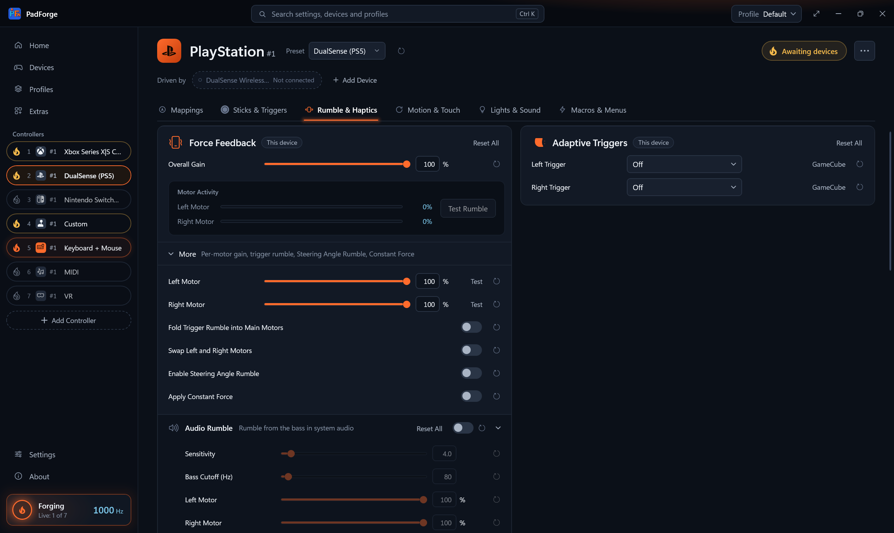

# Adaptive Triggers

*Per-trigger feedback effects for DualSense and DualSense Edge, with mode cards that preview each effect and track your live trigger pull.*

<!-- SCREENSHOT: pad-adaptive-triggers -->

<figure class="pf-video">
<video controls playsinline preload="none" width="1920" height="1080"
       poster="/assets/video/padforge-tutorial-dualsense-triggers-light-sound-poster.jpg"
       aria-label="Video: a DualSense's adaptive triggers, lightbar and speaker, recorded live in PadForge 5.2.1">
<source src="/assets/video/padforge-tutorial-dualsense-triggers-light-sound.mp4" type="video/mp4">
<track kind="captions" srclang="en" label="English" src="/assets/video/padforge-tutorial-dualsense-triggers-light-sound.vtt" default>
</video>
<figcaption>The left trigger set to Weapon, the lightbar to Rainbow Cycle, and the PC's sound mirrored to the DualSense speaker, recorded live in PadForge 5.2.1 in 57 seconds. PadForge 6 has since rebuilt the interface, so the screens differ from the steps on this page. The narration is a generated voice, with English captions. <a href="/assets/video/padforge-tutorial-dualsense-triggers-light-sound-transcript.txt">Read the transcript</a>.</figcaption>
</figure>

---

## When the card shows

The **Adaptive Triggers** card sits in the **Rumble & Haptics** section of a controller's page. It follows the device picked in the **Driven by** row of the controller's header, the same way the [Lighting](lighting.md) card does, so its chip reads **This device**. It appears when that device is a DualSense or DualSense Edge and hides for anything else. On a slot with a DualSense plus another pad, the card hides while the other pad is selected. Pick the DualSense in the Driven by row again and the card comes back.

A [Flydigi Apex](flydigi-apex.md) 4, 5 or 6 Pro gets the card too. An Apex 4 and 5 play the effects with their force triggers. An Apex 6 Pro's triggers vibrate and do not resist, so each effect plays as a vibration that follows what the effect does. The card title's tooltip says which.

These settings drive the trigger when no game is writing to it. A game that programs the triggers itself writes through a separate path, and its effects override this card while it runs.

A [game mod made for DSX](game-mods.md) can set the triggers too. Its effects override this card until the mod's program exits, the mod resets the controller, or you click **Clear Mod Effects** on the [Devices](devices.md) page, and an orange line above the card names the program meanwhile. A game writing to the virtual DualSense still comes first. When the mod's effects end, this card's settings return, and a trigger with no setting of its own is released.

A macro's **Adaptive Trigger Effect** action can set the triggers as well (see [Game Telemetry](game-telemetry.md#adaptive-trigger-effect)). It comes after a game and a mod and before this card, and when its effect ends this card's settings return.

A DualSense holds its trigger program in firmware with no timeout, so an exiting game would otherwise leave its last effect loaded. After fifteen seconds with no packet from the game, PadForge sends a release frame that sets both triggers to Off and claims nothing else. Reconnecting the pad, or restarting PadForge, also reasserts this card: a configured effect reloads and Off ships a release.

---

## Effect modes

Each trigger, **Left Trigger** and **Right Trigger**, is a row of the card with its effect picker. Open the picker and click a mode's card. Seven modes:

| Mode | Feel |
|---|---|
| Off | No resistance. Trigger feels normal. |
| Feedback | Constant push-back from the start point to fully pressed. |
| Weapon | Soft pull into a firm click at the end point. Gun-trigger feel. |
| Vibration | Continuous buzz once you cross the start point. |
| Multiple-Position Feedback | Ratcheting force bumps inside the start-to-end range. Like clicking through detents. |
| Slope Feedback | Resistance ramps from light at the start point to full at the end point, then holds at peak. Bow-draw feel. |
| Multiple-Position Vibration | Short buzz bursts inside the start-to-end range. |

---

## Live preview

The open picker shows the mode cards in three columns. Each card names a mode and draws its own sparkline of the resistance or vibration shape across the full trigger pull. Left edge is released. Right edge is fully pressed. Nine faint ticks divide the pull into ten zones. The selected card reads ember.

While a trigger has an effect, the same graph stands beside its picker and redraws as you drag the Range, Strength, and Frequency sliders. It carries a marker line at the trigger's current pull position, and so does the selected card in the open picker. Squeeze the physical trigger and the marker slides in real time, so you can see where the effect starts against your actual pull.

The shapes are drawn in PadForge's ember accent color.

| Mode | Shape on the card |
|---|---|
| Off | Empty track |
| Feedback | Solid bar from start to the right edge |
| Weapon | Solid bar inside [start, end] with a click marker at the end |
| Vibration | Continuous sine wave from start onward |
| Multiple-Position Feedback | Alternating bumps inside [start, end] |
| Slope Feedback | Triangular ramp from start to end, held at peak past end |
| Multiple-Position Vibration | Stuttering sine bursts inside [start, end] |

---

## Per-trigger settings

Each trigger's three sliders sit under its row while it has an effect. They hide while the mode is Off. Range and Strength read in percent. PadForge stores each as the byte the trigger firmware takes, 0 to 255, and shows it as the nearest whole percent.

### Range (start and end)

A dual-thumb slider from 0% to 100%, with a box for each end. 0% is fully released. 100% is fully pressed. Start sets where the effect begins. End sets where it stops.

Some modes use only the start thumb. Feedback uses start. Vibration uses start. The preview shows which thumb is active.

### Strength

A 0% to 100% slider for how hard the effect pushes back, or how strong the buzz is on the vibration modes. The default is 78% (the byte 200, firm but not maxed). Setting strength to 0 blanks the preview. Multiple-Position Feedback, Slope Feedback, and Multiple-Position Vibration then send Off. Feedback, Weapon, and Vibration send their effect with a zero force byte.

### Frequency (Hz)

A 0 to 255 slider. Vibration and Multiple-Position Vibration use it to set the buzz rate. The byte reaches the trigger firmware as written. Default is 10. PadForge's own impulse-trigger translation buzzes at 15.

Setting frequency to 0 in a vibration mode gives no buzz, and the preview hides the wave.

### Reset buttons

Every slider has its own reset button. Range snaps to 0% to 100%. Strength snaps to 78%. Frequency snaps to 10. The reset at the end of a trigger's row (**Reset Left Trigger**, **Reset Right Trigger**) clears every parameter on that trigger and sets the mode back to Off. **Reset All** on the card does that for both triggers.

---

## GameCube preset

Each trigger's row carries a **GameCube** button at its end. It stays visible whatever the trigger's mode, so you can find it first.

1. Click **GameCube** on the trigger's row.
2. The Range and Strength sliders fill with GameCube trigger values drawn from the [DualSenseSupport](https://github.com/Mxater/DualSenseSupport) and [DualSenseY-v2](https://github.com/WujekFoliarz/DualSenseY-v2) community presets. Start is about 56%, end is about 63%, force at max. The result is the physical click-feel of a real GameCube trigger.
3. Select Weapon as the mode if it isn't already. The button leaves the mode as it is.
4. Pair with a trigger ceiling ([Trigger Deadzones](trigger-deadzones.md)) and an axis-to-button mapping from [Button and Axis Mappings](mappings.md) for an analog-then-digital trigger.

The sliders stay editable after loading. It's a one-click loader, not a lock.

---

## What a game reads back

A DualSense reports the state of its own trigger effects in its input
report: two feedback bytes carrying a stop-location and a status nibble
each, and a byte of active effect-mode nibbles. Games that drive adaptive
triggers read those back to decide whether a trigger is being held against
its effect.

A virtual DualSense used to send zeros there. A game that checks the
bytes then saw no effect running, so holding L2 against a resistance it
had itself commanded did nothing. Since 4.5.0 PadForge copies the eight
bytes at payload offsets 40 through 47 from the physical pad into the
virtual report, so the game reads the real state of the triggers under
your finger.

This needs a physical DualSense or DualSense Edge on the slot and a USB
DualSense preset on the virtual pad: DualSense (PS5), DualSense Edge
(PS5), or their Full forms. The Bluetooth DualSense presets do not carry
the bytes. The bytes come from the bundled SDL fork, which publishes them
as a joystick property. SDL upstream parses nothing from that range.
Without the fork build the property is absent and the virtual report is
unchanged.

---

## Tips

- For Multiple-Position Feedback, narrow the Range to a partial span (such as 20% to 60%) to feel the bumps. The default 0% to 100% range spreads them across the whole pull and can feel like one rough surface.
- For Weapon, set the end point close to where you want the click. Strength governs the click force, not the soft zone before it.
- For Slope, the gradient is most pronounced at high strength (78% and up). At low strengths the ramp is too subtle to feel.
- The Frequency (Hz) slider shows for every mode except Off. Only Vibration and Multiple-Position Vibration use it. The value persists for when you switch back to a vibration mode.

---

## Related pages

- [Force Feedback](force-feedback.md): rumble passthrough, audio bass rumble, and constant force on the body motors.
- [Trigger Deadzones](trigger-deadzones.md): floor, ceiling, and curve for the trigger axis before it reaches the game.
- [Impulse Triggers](impulse-triggers.md): Xbox impulse trigger motors, audio bass trigger rumble, and constant trigger force.
- [Lighting](lighting.md): lightbar modes, palettes, and Input Reactive overlay.
- [Flydigi Apex](flydigi-apex.md): the Apex pads, whose triggers play these effects.
- [Button and Axis Mappings](mappings.md): the trigger axis source picker.

---

*Last updated for PadForge 6.0.0.*
