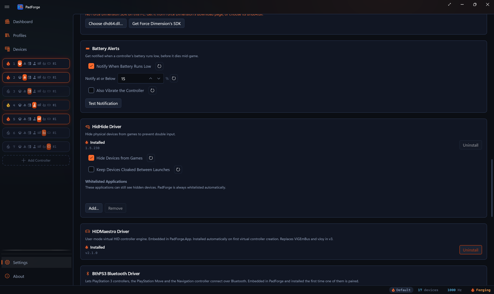
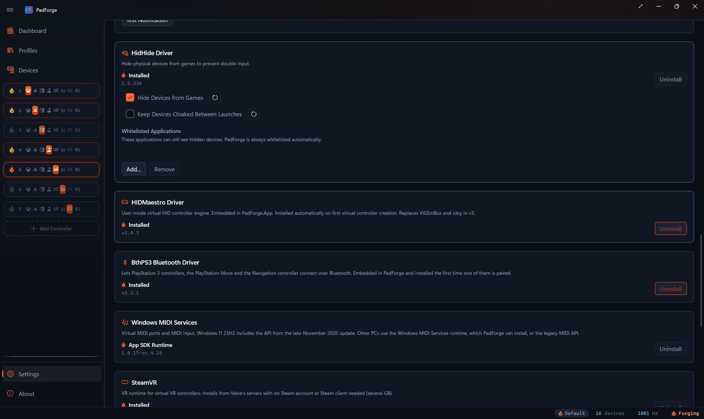

# Driver Management

*PadForge needs one driver (HIDMaestro, which auto-installs the first time you create a virtual controller) and offers two optional ones (HidHide and SteamVR) that install and uninstall from **Settings**. Windows MIDI Services comes with Windows 11 25H2 from the late-November 2026 update. Until a PC has it, PadForge installs the Windows MIDI Services runtime from **Settings**, and without either it uses the legacy MIDI API.*

---

## What's required vs optional

| Component | Status | What it does |
|---|---|---|
| **HIDMaestro** | Required for any virtual controller other than MIDI, and for a Keyboard+Mouse slot set to a keyboard or mouse model. Auto-installs on first use. | Creates the virtual controller that matches each slot's shape (Xbox Series, DualSense, Switch Pro, Logitech wheel, and so on), and the virtual keyboard and mouse a Keyboard+Mouse slot sends through. HIDMaestro ships 337 device profiles. PadForge offers 136 controllers with a captured HID descriptor, and all 51 keyboards and 52 mice to the Keyboard+Mouse slot. |
| **Keyboard+Mouse** | Built in. Windows input needs no driver, and a keyboard or mouse model needs HIDMaestro. | Maps controller inputs to keyboard and mouse presses, sent through Windows input or through a virtual keyboard and mouse that programs see as hardware. |
| **HidHide** | Optional. Install when games show double input. | Hides physical controllers from games so they only see the virtual ones. |
| **Windows MIDI Services** | Part of Windows 11 25H2 from the late-November 2026 update. Elsewhere on 24H2 or later, an optional runtime install from **Settings**. | Virtual MIDI ports for sending notes and CC to DAWs and music software, and the input path that reads a MIDI keyboard as a mapping source. Without it, PadForge uses the legacy MIDI API, which reads MIDI keyboards too but cannot create ports, so MIDI slots send to a port you pick. |
| **SteamVR** | Optional. Install for the VR controller type. | VR runtime for virtual VR controllers. Installs from Valve's servers with no Steam account or Steam client needed (several GB). |

> **Upgrading from an older PadForge?** Older versions needed ViGEmBus and vJoy. HIDMaestro replaces both. If either is still on your PC, PadForge finds it on first launch and offers to remove it (see [Legacy driver cleanup](#legacy-driver-cleanup)).

---

## First-run auto-install

HIDMaestro installs itself the first time PadForge creates a virtual controller (any Xbox, PlayStation, Nintendo, or Extended slot). PadForge already runs as administrator, so no extra prompt appears. Install takes a few seconds. No restart. The driver ships inside PadForge, so the Xbox, PlayStation, Nintendo, and Extended slot types are available from the first launch and the HIDMaestro card on the **Settings** page always reads **Installed**.

HidHide, SteamVR and the Windows MIDI Services runtime do not auto-install. They sit on the **Settings** page until you click **Install**. The runtime's **Install** shows only on a PC that needs it (see [Windows MIDI Services](#windows-midi-services)).

Two more drivers install outside **Settings**, and only when something needs them. Pairing a [DualShock 3](../devices/dualshock-3.md), [PS Move](../devices/ps-move.md) or Navigation controller for Bluetooth installs the bundled PlayStation Bluetooth driver (BthPS3 and its BthPS3PSM filter) the first time. The first controller on a composite profile (the three PlayStation profiles named **Full**, **Nintendo Switch 2 Pro Controller: Full**, the two Valve **Composite** profiles, and **Steam Controller (2026)**) installs usbip-win2, the USB transport HIDMaestro carries for those profiles. The PlayStation slot's default profile, **DualSense (PS5): Full**, is one of them. That install needs no prompt, and USB devices disconnect and reconnect once while Windows re-enumerates its USB root hubs.

---

## Controllers Windows leaves without a driver

Some controllers plug in and sit dead, because Windows has no driver for them or gives them one that reads nothing. While the engine runs, PadForge binds the driver a controller needs within a few seconds of it appearing, with no prompt:

- **WinUSB**, Windows' own generic USB driver, for the controllers PadForge's controller library reads directly: the Wii U GameCube adapter, the Xbox 360 Big Button receiver, the Gametrak, the DJI RC remote, force-feedback wheels and sticks built on the I-Force chip, Namco's GunCon 2 and USIO, Konami's P3IO and P4IO arcade boards, Densha de GO! and other train controllers, the CH Products Multi-Function Panel, the Ergodex DX1, the TrackIR 2 and 3, the Tacx T1904 and T1932, and original Xbox controllers.
- **xusb22**, Windows' own Xbox 360 driver, for clone Xbox 360 wireless receivers (USB IDs 045E:0291, 045E:02A9 and 05C6:9244) and the Guitar Hero Live Xbox 360 dongle (1430:070B). By ID, that driver's own list names only Microsoft's receiver, wired controller and Play and Charge cable, and since Windows 10 version 2004 it can no longer be picked by hand for these. Once bound, they reach every game through XInput, with PadForge running or not.

On its own, PadForge takes a controller only from no driver, or for WinUSB from Windows' generic HID driver, and never from another vendor's driver. A second controller of the same model on another vendor's driver keeps the whole model where it is. Each driver package names one ID, the controller's own or, for original Xbox controllers, their USB device class, and is signed with the certificate this PC's [DualShock 3](../devices/dualshock-3.md) binding uses.

Five devices lose something to the switch, so they move only when you ask, from their card on the [Devices](devices.md#switch-driver-buttons) page.

---

## Status indicators

Each driver card on the Settings page shows an ember flame next to its status text.

| Flame | Meaning |
|---|---|
| **Lit flame** (orange, glowing) "Installed" | Driver ready. HidHide and HIDMaestro show their version number below. The SteamVR card has no version line, and its text changes to "Running", "Running, driver connected", or "Running, controllers live" while SteamVR is active. |
| **Unlit flame** (outline only) "Not Installed" | Install before the matching slot type works. |

HIDMaestro auto-installs, so its flame stays lit. The Windows MIDI Services card has its own states, listed under [Windows MIDI Services](#the-settings-card). Driver status lives on the Settings page and nowhere else. The [Dashboard](dashboard.md) carried a **Drivers** text row through 4.3.2 and no longer does.

---

## What happens with a driver missing

PadForge runs whether or not the optional drivers are installed. Missing drivers only limit the features that need them.

| Missing | What you lose |
|---|---|
| **HIDMaestro** | It auto-installs on first use, so it isn't normally missing. If that install fails, Xbox, PlayStation, Nintendo, and Extended slots can't create a virtual controller. Keyboard+Mouse and MIDI still work. |
| **HidHide** | **Hide from Games (HidHide)** has no effect. Games may see the physical and the virtual at the same time. |
| **Windows MIDI Services** | MIDI runs on the legacy MIDI API instead: each MIDI slot sends to a port you pick, and MIDI input opens only devices assigned to a slot. If no MIDI API starts at all, the MIDI slot type won't switch on, and its button shows the tooltip "MIDI (not running, see the Windows MIDI Services card in Settings)". Every other slot type works. |
| **SteamVR** | The VR slot type won't switch on. Its button stays visible and shows the tooltip "VR (requires SteamVR)". Every other slot type works. |

---

## Admin rights

PadForge always runs as administrator. The UAC prompt fires once per launch, when PadForge itself starts. Everything after that (HIDMaestro auto-install, HidHide install and uninstall, the Windows MIDI Services runtime's install and uninstall, the SteamVR install and uninstall, and HidHide whitelist edits) runs inside that same session, so no second prompt appears.

---

## HIDMaestro

One driver that publishes the virtual controllers. Each Xbox, PlayStation, Nintendo, and Extended slot uses one HIDMaestro **device profile**. VR slots ride HIDMaestro's OpenVR driver instead and have no profile. A profile decides how the virtual controller looks to Windows and games: its name, its make and model, its buttons and axes, and its force-feedback support.

The **Nintendo** slot type carries four profiles: Switch Pro (the default), Switch Pro (USB), Switch 2 Pro, and Switch 2 Pro: Full. Pick between them from the slot's preset dropdown. None can be customized, so the slot deploys the chosen profile as-is, with Nintendo button lettering. Switch Pro, Switch Pro (USB) and Switch 2 Pro: Full carry motion passthrough (games read gyro and accelerometer from the virtual pad) and rumble. Switch Pro (USB) is the pad on its USB cable, and like a real one it sends input only once a program such as SDL or Steam starts it with the Switch protocol. The plain Switch 2 Pro profile carries neither, and [Controller Slots](controller-slots.md#nintendo) says which programs read which. The remaining Nintendo profiles (Joy-Cons, GameCube adapter, NSO retro pads) live in the **Extended** category.

### The profiles PadForge offers cover

HIDMaestro ships 337 device profiles. PadForge's controller pickers offer 136 controllers that carry a captured HID descriptor, since a profile without one cannot be deployed, plus PadForge's own **Custom** profile. The Keyboard+Mouse slot's pickers offer 103 more, all 51 keyboards and 52 mice. One profile with a descriptor stays out of every picker: the GameCube adapter's Full persona. Dolphin and Slippi read that adapter only through WinUSB, and it carries four ports where a slot drives one. The adapter's HID-mode profile is offered. They cover:

- Xbox 360, Xbox One, Xbox Series, Elite, Adaptive
- DualShock 3, DualShock 4, DualSense, DualSense Edge
- Switch Pro, Switch 2 Pro, the original Joy-Cons and their charging grip, the GameCube adapter in HID mode, NSO retro pads (N64, SNES, Genesis)
- Logitech G-series wheels (G29, G920, G923, G27)
- Thrustmaster wheels, the Thrustmaster T-Rudder Pedals, and the Fanatec ClubSport Handbrake
- HOTAS and flight sticks (Thrustmaster T.Flight HOTAS 4 and One, Thrustmaster T.16000M, Saitek X52, SideWinder Force Feedback 2)
- Hori, Nacon, Razer, Flydigi, other third-party gamepads
- A **Custom** profile for the Extended category, with up to 8 axes, 128 buttons, and 4 POV hats.
- 51 keyboards and 52 mice from 32 vendors, for the Keyboard+Mouse slot ([the full list](../devices/supported.md#virtual-keyboards-and-mice)).

### Install when you want

- Any Xbox, PlayStation, Nintendo, or Extended virtual controller
- Force feedback in racing wheels and sticks
- A custom controller shape for niche games

### Install

HIDMaestro installs itself the first time PadForge creates a virtual controller. There is no Install button. Because PadForge already runs as administrator, no extra prompt appears. The HIDMaestro card on the **Settings** page lights its flame while the driver is in Windows' driver store, and shows the HIDMaestro version PadForge carries. The Xbox, PlayStation, Nintendo, and Extended slot types are always available, because the driver ships inside PadForge.

### Uninstall

**Uninstall** on the HIDMaestro card removes HIDMaestro from the PC. It first shows what HIDMaestro left: each item it would remove, each item it keeps and why, and any running program that uses HIDMaestro. Such a program blocks the removal until you close it and select **Refresh**. **Also remove usbip-win2 set up by its own installer** also takes what usbip-win2's installer left on a PC where an older PadForge set it up that way, unless another program uses usbip-win2. Its USB root hub filter always stays, since removing it restarts every USB root hub.

When you confirm, PadForge stops its engine, and HIDMaestro removes every virtual controller and the records Windows keeps of them, its driver packages, its signing certificate, its registry keys and its files. The controller names and GameInput tables it changed go back to what they held, unless another program changed them since. A file in use under `%ProgramFiles%\HIDMaestro` goes when Windows next starts. The status line says how the removal ended, and one that could not take everything lists what stayed and why. The engine stays stopped, and PadForge installs HIDMaestro again the next time it starts a virtual controller. Other programs that use HIDMaestro lose its driver until they next start.

On a PC where PadForge is already gone, download `HIDMaestro-v2.0.2.zip` (`HIDMaestro-v2.0.2-arm64.zip` on Windows on ARM) from the [HIDMaestro releases](https://github.com/hifihedgehog/HIDMaestro/releases/latest) and extract it. In a terminal opened as administrator, change to its `HIDMaestroUninstall` folder and run `.\HIDMaestroUninstall.exe`. It lists what it would remove and keep, asks before it removes anything, and then prints what it removed and kept. It needs no .NET runtime. Removing the devices in Device Manager leaves the driver packages, the certificate and the files behind.

For the contract between PadForge and HIDMaestro, see [HIDMaestro Deep Dive](../reference/hidmaestro-deep-dive.md).

---

## HidHide

Hides physical controllers from apps so games only see PadForge's virtual ones. Fixes the "double input" problem where every press counts twice because games detect the real pad and the virtual one at the same time.

### Install when you see

- Button presses counting twice
- Menus scrolling at double speed
- Jerky or doubled character movement
- Two controllers in a game when only one is plugged in
- Games auto-picking the wrong controller

Installing it before any of these show up is a fine plan.

### How PadForge drives HidHide

PadForge runs HidHide on its own. You do not need the HidHide Configuration Client.

| Feature | Detail |
|---|---|
| **Per-device hiding** | Toggle **Hide from Games (HidHide)** on each device card ([Devices](devices.md) page). |
| **Automatic whitelist** | PadForge adds itself so it can still read hidden controllers, under the native path Windows records for its executable as well as its drive-letter path. The entry stays in the driver's whitelist between sessions. Harmless, and it keeps hidden controllers readable when **Keep Devices Cloaked Between Launches** is on. While PadForge cannot read or write the whitelist, it hides no new controllers, since a controller hidden then could be hidden from PadForge too. |
| **Self-check** | After hiding a controller, PadForge opens it once itself, the way it reopens every device on each scan, and once more each time a hidden controller reconnects. If HidHide refuses, PadForge takes every entry back and says so in the status bar, because a controller hidden from PadForge itself stops responding at the next scan. PadForge hides again as soon as HidHide's whitelist changes, which is when HidHide reconsiders a program it refused, or when HidHide's Inverse application cloak goes off. |
| **Inverse application cloak** | This HidHide option turns the whitelist into a list of programs that cannot see hidden devices, so PadForge's own entry would hide every controller from PadForge. While it is on, PadForge keeps itself off the list, hides nothing, and says so in the status bar. When it goes off, the line clears and PadForge hides again. |
| **Engine-aware** | By default, hiding holds only while the engine runs. Stop the engine or close PadForge and the controllers reappear. |
| **Hides the whole device** | One toggle covers the device, not one interface. PadForge blacklists every HID interface under the controller's base container, the nodes between that interface and the base on classes HidHide filters, and the base container itself when it is one of those classes and all of its children are HID. XInput and WGI cannot then reach the pad through a sibling path. |
| **Visible rows keep their interface** | A device PadForge lists as its own row with hiding off is left alone, and no other device's hide blocks a parent above it. A handheld whose built-in pad and touchpad are separate rows can hide one and keep the other. |
| **Transport switches** | A pad that moves between USB and Bluetooth is hidden on the first pass either way. The hide also sweeps present nodes reporting that pad's serial number, so a second pad of the same model is never touched. |
| **Master switch** | **Settings > HidHide Driver > Hide Devices from Games** (global on/off). Turning it off mid-session unhides every controller right away. |
| **Keep Devices Cloaked Between Launches** | **Settings > HidHide Driver** checkbox, off by default. Leaves physical controllers hidden even while PadForge is closed. Turn it on when another app (Steam, for example) scans for controllers between PadForge sessions and should keep seeing only the virtual ones. |

### Whitelist

Other controller utilities (Steam Input, for example) need their own whitelist entry to see hidden controllers.

- **Add...** browses for an .exe.
- **Remove** drops the selected entry.

### Install steps

1. Open **Settings**. Scroll to **HidHide Driver**.
2. Click **Install**. The installer runs inside PadForge's session, which is already running as administrator, so no extra prompt appears.

Turn on **Keep a Diagnostics Log** under **Settings** to see what hiding actually did. Each pass records the devices it hid, the interfaces the visible-row rule held back, which rule the transport sweep used, whether HidHide's whitelist could be read and written, and whether PadForge could still open a device it hid. When hiding is requested and the HidHide control device will not open, the log says so and names the Windows error, instead of failing quietly.

### Uninstall steps

1. Turn off **Hide from Games (HidHide)** on every device. **Uninstall** stays disabled while any device has hiding on.
2. Open **Settings**. Scroll to **HidHide Driver**.
3. Click **Uninstall**. It runs inside the same administrator session, so no extra prompt appears.

Every physical controller becomes visible again the moment the driver leaves.

---

## Windows MIDI Services

System-wide virtual MIDI endpoint (named "PadForge MIDI 1", "PadForge MIDI 2", and so on for each MIDI slot) that any music app can subscribe to. Turns a gamepad into a MIDI controller. No loopMIDI bridge needed on Windows MIDI Services. On the legacy MIDI API each slot sends to an existing port instead.

### Use it for

- Driving a DAW (Ableton Live, FL Studio, Reaper) from a gamepad
- Playing MIDI notes from controller buttons during a live set
- Sending MIDI CC from sticks and triggers to synth parameters
- Feeding VJ or stage-lighting software that takes MIDI
- Mapping a MIDI keyboard or control surface as an input (see [MIDI Input](midi-input.md))

### Where it comes from

Windows MIDI Services is part of **Windows 11 25H2 from the late-November 2026 update**. PadForge uses the copy Windows installs.

Until a PC has that update, and on Windows 11 24H2, which never gets it, apps need the **Windows MIDI Services runtime**. Microsoft removed its runtime installers on October 1, 2026. PadForge installs its own build of the same runtime, version 1.0.17-rc.4.25 built from Microsoft's MIT-licensed source, from [PadForge-MIDI-Runtime](https://github.com/hifihedgehog/PadForge-MIDI-Runtime) when you click **Install** on the card. A PC that still has Microsoft's runtime keeps using it. When a PC has both the API in Windows and a runtime, PadForge uses the one built into Windows.

Where neither runs, PadForge falls back to the **legacy MIDI API** (WinMM), which every Windows has: Windows 10, Windows 11 before 24H2, Legacy API mode, and a PC with no runtime installed. See [The legacy MIDI API](#the-legacy-midi-api).

### Installing the runtime

**Install** shows on Windows 11 24H2 or later when Windows has no API of its own yet, Legacy API mode is off, and no runtime is installed.

1. Open **Settings**. Scroll to **Windows MIDI Services**.
2. Click **Install**.

PadForge downloads the package for your PC, x64 or ARM64 and about 1 MB, from GitHub, and installs it only when it matches the SHA-256 it was published with. The runtime needs the Microsoft Visual C++ Redistributable 14.51 or later. When the PC's copy is missing or older, PadForge downloads Microsoft's redistributable first and runs it only after its Microsoft signature checks out. The runtime goes to `C:\Program Files\PadForge MIDI Runtime`. Once it is in, MIDI slots rebuild with ports of their own and MIDI input reopens through it. When a program holds the old Visual C++ runtime open so Windows cannot swap in the new one, PadForge runs the redistributable again as a repair, twice at most, five seconds apart. When the redistributable is still running after three minutes, or Windows starts it without letting PadForge follow it, the install stops with "The Visual C++ Redistributable installer is still running. Select Install again once it finishes." The runtime's own installer has not run at that point.

### The Settings card

| Status | Line below it | Meaning |
|---|---|---|
| **Built into Windows** | Empty, or "Older runtime *version* is also installed and is no longer needed" | PadForge uses the API in Windows. |
| **App SDK Runtime** | The runtime's version | PadForge uses the runtime, Microsoft's or PadForge's build. |
| **Legacy MIDI API** | "Each MIDI slot sends to a port picked on the slot's page. MIDI input opens only devices assigned to a slot." | No Windows MIDI Services API runs, so PadForge uses the legacy API. |
| **Legacy MIDI API** | "The MIDI API built into Windows did not start (error 0x*code*), so PadForge uses the legacy MIDI API. Each MIDI slot sends to a port picked on the slot's page. MIDI input opens only devices assigned to a slot." | Windows registers its own API, but it failed to start. The code is the error Windows answered with. |
| **Not Running** | "The Windows MIDI service did not respond. PadForge restarts the service and checks again." | The engine's check got no answer from the Windows MIDI service within 10 seconds. An answer that comes late is kept. A check still pending after 15 seconds has the service restarted, then restarted again once every two minutes until MIDI answers. |
| **Not Running** | "A MIDI driver did not respond. PadForge checks again once it answers." | The check is waiting on a classic MIDI driver, which a service restart does not reach: on Windows 10 and Windows 11 before 24H2, in Legacy API mode, for the legacy API in Hybrid mode, and on a PC that has no MIDI service. PadForge restarts nothing and takes the answer when it comes. |
| **Not Running** | "The runtime's uninstaller is still running. MIDI starts again once it finishes." | An uninstall of the runtime holds MIDI released until its uninstaller exits. |

The flame lights while any of them works. Until the engine first opens MIDI, the card goes by what Windows has registered. After that it shows what the engine found.

When Windows MIDI Services is present but did not start when PadForge first checked, PadForge runs on the legacy API and tries Windows MIDI Services again beside it, first after 10 seconds and then every two minutes. Once it starts, MIDI moves onto it: MIDI slots rebuild with ports of their own and MIDI input reopens. Nothing is restarted for that, and in Legacy API mode nothing is tried.

In Legacy API mode Windows keeps the MIDI service off, so PadForge uses the legacy MIDI API and offers no **Install**. Microsoft's [How to change the API mode](https://microsoft.github.io/MIDI/kb/how-to-change-api-mode/) covers switching back.

### The legacy MIDI API

The legacy API cannot create a port for a MIDI slot, so each slot sends to a port that already exists: a MIDI interface, a synth, or a loopback driver that another program reads.

- While the legacy API runs, the slot's page shows **Output Port** beside its MIDI settings. Pick the port there. A slot set to **None** does not start until a port is picked, and the status bar says "Virtual Controller *N* has no Output Port. Pick one on its page."
- A port that is already in use cannot be opened, and the status bar says "The Output Port “*port*” of Virtual Controller *N* is already in use." When another MIDI slot is set to the same port, the line names both: "Virtual Controller *N* and Virtual Controller *M* are set to the same Output Port “*port*”. Pick another port for one of them." The slot that failed starts by itself once either slot has moved to another port. For a port another program holds, close that program, then turn the slot off and on.
- Picking another port moves the slot there.
- A slot whose port is missing, because its device is off or unplugged, does not start, and the status bar says "The Output Port “*port*” of Virtual Controller *N* is not connected. The slot starts once the port is back." About a second after the device is back, it starts by itself. A running slot whose device is unplugged closes the port and waits the same way.
- When a port fails to open for any other reason, the status bar says "The Output Port “*port*” of Virtual Controller *N* did not open."
- Each of these lines clears once the slot starts.
- The port is saved with the slot and in profiles. A profile saved before a port was picked leaves the slot's port alone, and copying one slot's MIDI settings to another leaves the second slot's port alone. A profile saved with **None** picked sets the slot to **None**.
- MIDI input opens a port only while a slot has the device assigned, on this PC or on a Remote Link peer. On Windows 10, Windows 11 before 24H2 and in Legacy API mode a MIDI port serves one program at a time, so PadForge holds no port that nothing uses. A device's assignments do not carry over when PadForge moves between the legacy API and Windows MIDI Services, since each names devices its own way.

When a slot stops, PadForge sends a note off for each note it held, turns off a sustain pedal or other on/off controller (CC 64 to 69) it left on, and closes the port. A note off or a pedal's off that the port refuses goes out again on the channel and number it was sent on, until the port takes it or the port is gone, through MIDI bar edits too, and as a slot stops for up to the 3 seconds the stop waits. It does not send the reset to all 16 channels that some programs send on close.

### Removing the runtime

**Uninstall** shows while a runtime is installed. It removes PadForge's build, or Microsoft's runtime together with everything Microsoft's **Windows MIDI Services Runtime and Tools** setup installed beside it, the MIDI Settings app included. Microsoft no longer offers that setup for download, so PadForge asks before it removes it. The API built into Windows stays.

1. If the card reads **App SDK Runtime**, delete or retype every MIDI slot on the Dashboard first. When it reads **Built into Windows** or **Legacy MIDI API**, MIDI slots run without the runtime and can stay.
2. Open **Settings**. Scroll to **Windows MIDI Services**.
3. Click **Uninstall**.

While PadForge uses the runtime, MIDI input pauses during the uninstall and comes back when the uninstaller finishes. Under the legacy API, MIDI keeps running through the uninstall. **Uninstall** and **Install** stay disabled while a runtime uninstaller PadForge started is still running, and Install's tooltip reads "The runtime's uninstaller is still running. Install is available once it finishes."

Before the uninstaller starts, PadForge releases MIDI from the runtime and waits up to a minute for that. A second Uninstall that finds the first one's release still at work waits for it first, then gives its own release the minute again, so the card can wait up to two minutes. When MIDI is not released in time, the uninstaller does not start, and the status bar says "The Windows MIDI service did not respond, so the runtime was not uninstalled. Select Uninstall again in a moment." Where a classic MIDI driver is what did not answer, it says "A MIDI driver did not respond, so the runtime was not uninstalled. Select Uninstall again once MIDI is running."

---

## SteamVR

The runtime behind the VR slot type. PadForge installs it Steam-free from Valve's servers: no Steam account, no Steam client. It is several GB.

### Install steps

1. Open **Settings**. Scroll to **SteamVR**.
2. Set **Install Location** if you do not want the default path, by typing a path or using **Browse**. The row only shows while SteamVR is missing.
3. Click **Install**. The download runs from Valve's servers and the flame lights when it finishes.

### Uninstall steps

**Uninstall** only appears for an install PadForge itself made. A SteamVR that arrived with the Steam client is left alone, and PadForge shows no removal button for it.

1. Close SteamVR. The uninstall refuses while it is running.
2. Open **Settings**. Scroll to **SteamVR**.
3. Click **Uninstall**, then confirm. The dialog names the folder it removes. It removes the Steam-free install and frees the space, including the `logs` and `config` subfolders SteamVR keeps inside it. VR virtual controllers stop working until SteamVR is installed again.

Reading real VR hardware as an input source pauses for the rest of the session after an uninstall, and comes back the next time PadForge starts. PadForge holds SteamVR's client library open while it is running and lets go of it during the uninstall, so it does not go back to it until a fresh launch. Virtual VR controllers are unaffected by this: they run inside SteamVR's own process, not PadForge's.

For the slot type itself, see [Virtual VR Controllers](vr-controllers.md).

---

## Legacy driver cleanup

Older PadForge versions needed ViGEmBus and vJoy. HIDMaestro replaces both. If either is still on your PC, PadForge finds it on first launch and offers to remove it.

| Button | What happens |
|---|---|
| **Uninstall** | PadForge removes the drivers it found. It asks for no restart. If a removal fails, a second dialog names the error. |
| **Keep** | The dialog closes. The old drivers stay installed. They will not interfere with HIDMaestro, but they take up space. |

The dialog appears once. After you pick either button, it does not come back on later launches.

---

## Compatibility matrix

| Driver / Service | Windows 10 (x64) | Windows 11 (x64) | Windows 11 24H2+ (x64) | ARM64 | x86 (32-bit) |
|---|:-:|:-:|:-:|:-:|:-:|
| **HIDMaestro** | Yes | Yes | Yes | Yes (1) | No |
| **HidHide** | Yes | Yes | Yes | Yes (1) | No |
| **Windows MIDI Services** | No | No | Yes (2) | Yes (1) | No |
| **Legacy MIDI API** (no install) | Yes | Yes | Yes | Yes (1) | No |
| **SteamVR** | Yes | Yes | Yes | No | No |
| **Keyboard+Mouse** (no driver) | Yes | Yes | Yes | Yes (1) | No |

(1) Preliminary. Nothing in the ARM64 column has run on ARM64 hardware yet.
(2) Built into 25H2 from the late-November 2026 update. Elsewhere, through the runtime PadForge installs from **Settings**.

- **HIDMaestro** runs in user mode, so it installs with no reboot. It carries an x64 and an ARM64 driver and installs the one that matches the machine.
- **HidHide** is a kernel driver, so it has to match the machine: x64 on an x64 PC, ARM64 on an ARM64 PC. Neither install asks for a restart. It does not run on 32-bit Windows.
- **Windows MIDI Services** is part of Windows 11 25H2 (build 26200) from the late-November 2026 update, x64 and ARM64 alike. On 24H2 (build 26100), and on 25H2 before that update, it runs through the runtime, which PadForge installs for x64 and ARM64. Earlier Windows has neither.
- **The legacy MIDI API** (WinMM) is part of every Windows. PadForge falls back to it wherever no Windows MIDI Services API runs.
- **SteamVR** is x64. Valve ships no ARM64 build.
- **Keyboard+Mouse** needs no driver, so it works wherever PadForge itself runs.
- **PadForge itself** ships as two 64-bit builds: x64 for Windows 10 and 11, and ARM64 for Windows 11 on ARM64. [Installation](../start/installation.md#windows-on-arm-preliminary) lists what the ARM64 build lacks. Neither build runs on 32-bit Windows.

---

## Uninstall guards

PadForge blocks driver removal while a slot still needs it.

| Driver | Uninstall blocked when |
|---|---|
| **HidHide** | Any device has **Hide from Games (HidHide)** on. |
| **Windows MIDI Services runtime** | Any MIDI slot exists while PadForge uses the runtime. |
| **SteamVR** | Any VR slot exists, SteamVR is running, or the install did not come from PadForge. |

Delete the slots or turn the feature off. Then **Uninstall** becomes available. HIDMaestro's **Uninstall** needs no guard: it stops the engine itself, and the next virtual controller installs HIDMaestro again.

The slot guards read your saved slots, not what the engine is running, so they hold with the engine stopped. Switching a slot from one type to another releases the type it left and locks the type it joined, immediately.

---

## Trouble

### Install issues

| Problem | Fix |
|---|---|
| The status bar says Windows started the installer without letting PadForge follow it | The installer runs on its own. The card shows the result once it finishes. |
| Flame stays unlit after install | The status bar names why the install failed, such as an installer's exit code. Click **Install** again. |
| HIDMaestro fails to install | An old ViGEmBus or vJoy install can leave leftovers behind. Remove them from **Windows Settings > Apps > Installed apps**, then turn the slot off and on, and PadForge runs the setup again. |
| Windows MIDI Services **Install** stops: "A program holds the old Visual C++ runtime open" | Windows could not replace the Visual C++ runtime while that program held it, and the two repair runs that followed could not replace it either. Close other programs and click **Install** again. |
| Windows MIDI Services **Install** stops: "The Visual C++ Redistributable installer is still running. Select Install again once it finishes." | Microsoft's redistributable was still running after three minutes, or Windows started it without letting PadForge follow it, so the runtime's own installer has not run. Click **Install** again once the redistributable has finished. |
| Windows MIDI Services card reads **Legacy MIDI API** on Windows 11 25H2 | Windows has no API of its own until the late-November 2026 update. **Settings > System > About** in Windows shows the version, and Windows Update brings the update. Until then, click **Install** on the card. |
| Windows MIDI Services card reads **Not Running** | The line below the status says why. Under "The Windows MIDI service did not respond. PadForge restarts the service and checks again." PadForge restarts the service once its check has been pending 15 seconds, then once every two minutes until MIDI answers, and the card changes then. Under "A MIDI driver did not respond. PadForge checks again once it answers." the check is waiting on a classic MIDI driver (Windows 10, Windows 11 before 24H2, Legacy API mode, the legacy API in Hybrid mode, or a PC that has no MIDI service), so no service is restarted and the card changes when the driver answers. Under "The runtime's uninstaller is still running. MIDI starts again once it finishes." MIDI comes back when the uninstaller exits. |

### Runtime issues

| Problem | Fix |
|---|---|
| Xbox / PlayStation / Nintendo / Extended slot picked but no virtual controller appears | HIDMaestro auto-installs on first use. If that install failed, see "HIDMaestro fails to install" under **Install issues** above. |
| Clicking the MIDI slot type does nothing, and its tooltip reads "MIDI (not running, see the Windows MIDI Services card in Settings)" | No MIDI API started. The Windows MIDI Services card on **Settings** says why. |
| A MIDI slot does not start under the legacy MIDI API | The status bar names the reason. Pick an **Output Port** on the slot's page. If the port's device is off or unplugged, turn it on: the slot starts by itself about a second later. When two MIDI slots are set to the same port, pick another port for one of them, and the slot that failed starts by itself. A port another program holds cannot be opened: close that program, then turn the slot off and on. |
| A MIDI keyboard does nothing under the legacy MIDI API | Assign it to a slot on the [Devices](devices.md) page. The legacy API opens a MIDI input port only while a slot has it. |
| PadForge disappears when I uninstall the Windows MIDI Services runtime | Fixed in 4.3.0. Older builds were closed by Windows Restart Manager, which asks running programs to quit so an installer can reach files they hold open. PadForge now declines that request and stays up through the uninstall. |
| UAC prompt on every launch | Expected. PadForge needs administrator rights to drive its drivers, so Windows asks at startup. Everything after that runs without a second prompt. |
| Double input (every press counts twice) | Install HidHide. Turn on **Hide from Games (HidHide)** for the physical controller on the [Devices](devices.md) page. |
| Double input still there after HidHide | PadForge reconnects a hidden USB controller in Windows, so a game that opened it first loses it, and a controller connected before HidHide was installed picks HidHide up as it comes back. A Bluetooth controller, or a USB device that carries more than one controller, waits for its next connection: turn it off and on. Some games only detect controllers at launch, so restart the game if it still shows two. |
| Virtual controller shows up but games do not see it | Restart the game once after PadForge is running. Some games and Steam only detect controllers at launch. |
| HIDMaestro slot stuck on "Initializing" | Give it a few seconds. If it never finishes, check the inactivity timeout under **Settings**. A slot whose devices go offline drops its virtual controller after that timeout. The slot itself stays and comes back when the devices return. |

### Driver conflicts

| Problem | Fix |
|---|---|
| HidHide hides controllers from other apps | Add those apps to the whitelist on the **Settings** page (see [HidHide Whitelisted Applications](settings.md#hidhide-whitelisted-applications)). |
| The status bar says HidHide blocked PadForge from a device it had hidden | PadForge took the hide back, so the controller keeps working in PadForge, and it hides again as soon as HidHide's whitelist changes or its Inverse application cloak goes off. The diagnostics log names the device path, the Windows error HidHide answered with, and whether PadForge was on HidHide's whitelist at that moment. |
| The status bar says HidHide's Inverse application cloak is on | PadForge hides no controllers while this HidHide option is on. With it on, HidHide hides devices only from the programs on its list, so it cannot hide a controller from a game that is not listed. The line clears and PadForge hides again when the option goes off. |
| Antivirus flags a driver installer | HIDMaestro and HidHide are open-source, signed drivers. Add an exception or pause real-time scanning during install. |

---

## Related pages

- [Installation](../start/installation.md): first-time setup and driver install.
- [Settings](settings.md): where the driver cards live.
- [Controller Slots](controller-slots.md): which driver each slot type needs.
- [Devices](devices.md): per-device hiding with HidHide.
- [HIDMaestro Deep Dive](../reference/hidmaestro-deep-dive.md): how PadForge talks to HIDMaestro.
- [Troubleshooting](../troubleshooting.md): more help.

---

*Last updated for PadForge 5.0.0.*
