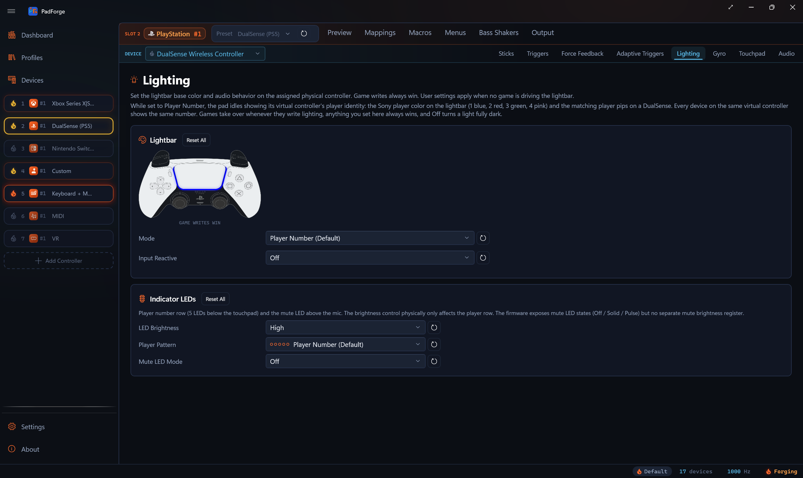
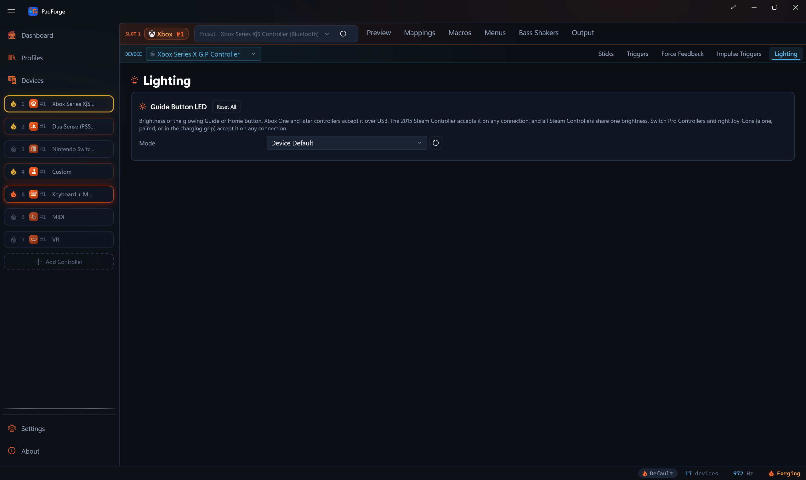
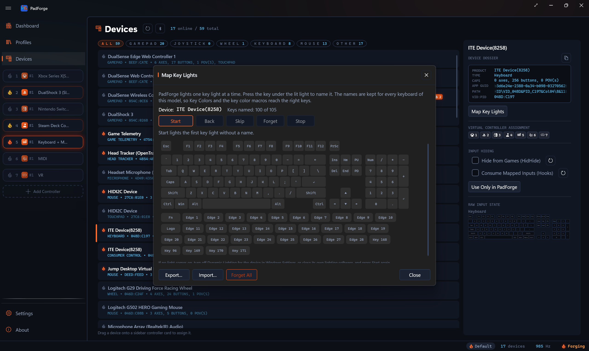

# Lighting

*Lightbar control for DualSense and DualShock 4 with fifteen base modes and three per-press Input Reactive overlays, the player and mute LEDs on DualSense, the Guide button LED on Xbox, 2015 Steam Controller, and Switch pads, and the same modes on the keyboards, mice, headsets, light strips and vendor rows assigned to a virtual controller, with a color for each key where the device allows it.*

<!-- SCREENSHOT: pad-lighting -->

<figure class="pf-video">
<video controls playsinline preload="none" width="1920" height="1080"
       poster="/assets/video/padforge-tutorial-dualsense-triggers-light-sound-poster.jpg"
       aria-label="Video: a DualSense's adaptive triggers, lightbar and speaker, recorded live in PadForge 5.2.1">
<source src="/assets/video/padforge-tutorial-dualsense-triggers-light-sound.mp4" type="video/mp4">
<track kind="captions" srclang="en" label="English" src="/assets/video/padforge-tutorial-dualsense-triggers-light-sound.vtt" default>
</video>
<figcaption>The left trigger set to Weapon, the lightbar to Rainbow Cycle, and the PC's sound mirrored to the DualSense speaker, recorded live in PadForge 5.2.1 in 57 seconds. The narration is a generated voice, with English captions. <a href="/assets/video/padforge-tutorial-dualsense-triggers-light-sound-transcript.txt">Read the transcript</a>.</figcaption>
</figure>

---

## When the tab shows

The Lighting tab appears for these devices:

- DualShock 4, DualSense, and DualSense Edge, for full lightbar control
- A PlayStation Move controller, whose sphere is driven as its lightbar
- Microsoft Xbox One, Elite, and Series pads, for the Guide button LED only
- A 2015 Steam Controller, for the Home button LED only
- A Switch Pro Controller or right Joy-Con (alone, in a pair, or in the charging grip), for the HOME button LED only
- A mouse or keyboard that PadForge can light, of any brand and analog keyboard rows included, a lit device with a row of its own on the Devices page (a headset, a mousepad, a monitor, a light strip, a laptop light bar), and the Razer Chroma, Logitech LIGHTSYNC, SteelSeries GG, ASUS Aura, MSI Mystic Light and Corsair iCUE rows

On a Sony pad it controls:

- The lightbar base color and modes
- An Input Reactive overlay layered on top
- Audio-driven color modulation
- Palette-based color cycling
- The player-indicator LEDs below the DualSense touchpad
- The mute LED above the DualSense microphone

On a Microsoft Xbox One, Elite, or Series pad, a 2015 Steam Controller, or a Switch pad with a HOME LED, the tab shows only the Guide button LED card. The lightbar controls stay hidden.

On a mouse, keyboard or vendor row, the tab shows the lightbar mode card and a line naming where the colors go. A mouse or keyboard also gets the **Lighting Control** card, whose checkbox lets this virtual controller light it. A device whose lights PadForge knows one by one gets the **Key Colors** card, or **Zone Colors** where its lights are zones, and a device with addressable headers gets the **LED Strips** card. See [Mice, keyboards and vendor rows](#mice-keyboards-and-vendor-rows) below.

The tab is per pad per slot. Pick a different physical device in the assigned-devices dropdown and the tab re-binds to that device's config. Two Sony pads on the same slot can carry different modes, palettes, and overlay variants. Macro lightbar actions stay slot-level. They fan out across every Sony pad on the slot and every mouse, keyboard or vendor row the slot lights, each rendering with its own per-device settings.

### Priority chain

A [web controller](../guides/web-controller.md) showing the DualShock 4 or DualSense layout gets this tab too, and it behaves the same: the phone draws the pad's own lightbar in whatever color and mode you pick, animations included. The DualSense layout also carries its player indicator row.

On a virtual DualSense, game writes always win at packet level. A virtual DualShock 4 does not forward the game's lightbar writes to the physical pad, so the settings on this tab stay in charge there. Macro lightbar overrides beat user settings. The Input Reactive overlay layers on top of the base mode. User settings apply when nothing else is driving the lightbar.

A [game mod made for DSX](game-mods.md) sets the lightbar on a DualSense or DualShock 4, and the player lights and mute light on a DualSense, below a game's own writes and above macro overrides and this tab's settings. An orange line under the tab's hint names the program while it does. When the mod's effects end, this tab's settings return.

---

## Lightbar base modes

A single dropdown selects the active base mode. Fifteen entries. Player Number is the default and sits at the top of the list.

| Mode | What it does |
|---|---|
| Player Number (Default) | The lightbar idles showing the virtual controller's player identity. The Sony player color is 1 blue, 2 red, 3 green, 4 pink, with matching pips on a DualSense. A game that writes lighting through a virtual DualSense takes over. A DualSense keeps the game's last color until 15 seconds pass with no output from the game, and then the player color returns. A DualShock 4 shows the game's color only within 1.5 seconds of each game write. |
| Off | Paints the lightbar fully dark whenever no game is driving it. A deliberate hard-off with no idle color, and a game's color goes dark again once the game stops writing it. The Input Reactive overlay can still flash on the black base. |
| Static Color | Solid color from the configured RGB. |
| Breathing (Single Color Fades) | One color fades in and out at the configured period. |
| Strobe: Square-Wave Flash | Hard on/off square-wave flash at the configured period. |
| Rainbow Cycle | Smooth hue rotation through the full color wheel. |
| Color Cycle | Steps through the configured palette. Smooth blend is a toggle. |
| Battery: Gradient by Charge Level | A linear blend between the configured Low Battery and Full Battery colors, driven by the pad's reported battery percent. Defaults red at 0 % and green at 100 %. DualSense and DualShock 4 battery reads. |
| Screen Color | Follows the colors in one area of one display. On a device with many lights, such as a keyboard, it can spread the screen across them. [Screen Color](screen-color.md) covers its settings. |
| Audio Pulse: Static Color | Modulates the configured base color by the system audio peak. |
| Audio Pulse: Random Color per Beat | A new random hue on each detected onset. |
| Audio Pulse: Rainbow Cycle | Hue rotation modulated by audio peak. |
| Audio Bands: Three Colors, Hard Transitions | Three colors (Quiet / Medium / Loud) with instant switching at thresholds. |
| Audio Bands: Three Colors, Smooth Gradient | Same three colors with linear blending between thresholds. |
| Audio Bands: Three Colors, Crossfade at Boundaries | Same three colors with a configurable crossfade width at each threshold. |

Sub-sections below the picker show only the controls the active mode needs (period, palette, audio bands, and so on).

---

## Input Reactive overlay

A second dropdown sits under the base picker. The overlay is independent of the base. Pick any base (Static, Rainbow, Audio Pulse, Off) and layer per-press flashes on top.

| Variant | What it does |
|---|---|
| Off | No overlay. Base mode renders alone. |
| Random Color per Press | Each button press rolls a fresh random hue and flashes it over the base. |
| Cycle Through Palette | Each press steps to the next color in the overlay's own palette. That palette is separate from the Color Cycle base mode palette. Editing one leaves the other alone. |
| Base Color per Press | Each press flashes a fixed RGB. The flash color has its own picker, separate from the base. A Static-blue base with a white per-press flash works. So does any other pairing. |

The flash blends the overlay color over the base. At full flash the overlay color is solid. The flash then fades to nothing over the configured Hold plus Decay window, and the base mode shows through again.

Macro lightbar overrides still beat the overlay. On a virtual DualSense, game-driven writes still win at packet level.

PadForge watches for button presses on the slot's combined output, including the DualSense touchpad click. Any button on any device mapped to the slot fires a pulse.

### Pulse Hold and Pulse Decay

Two sliders below the overlay dropdown apply to all three non-Off variants.

| Slider | Range | Default | What it does |
|---|---|---|---|
| Pulse Hold | 0–5000 ms | 0 | The flash holds at full intensity for this long after the press. 0 starts the decay immediately at the rising edge. |
| Pulse Decay | 0–5000 ms | 600 | After the hold window, the flash fades linearly to 0 over this many milliseconds. 0 cuts off hard at the end of the hold. Useful with a non-zero Hold for a clean on/off blink. |

---

## Single color picker

Visible for Static Color, Breathing, Strobe, and the static-color Audio Pulse mode. A color picker, a row of eight one-click preset swatches, hex input, R/G/B sliders, and a swatch preview live in a bordered card. Each channel has its own reset button. Strobe square-waves between this color and black.

The hex input takes six-digit RGB (`RRGGBB` or `#RRGGBB`). Press Enter or click away to apply.

---

## Period

Visible for Breathing, Rainbow Cycle, Color Cycle, Strobe, and the rainbow-cycle Audio Pulse mode. Range is 250–10000 ms. Default is 3000 ms (a 3-second cycle). Reset returns to the default. For Strobe it sets the on/off flash cadence.

---

## Rainbow brightness

Visible for Rainbow Cycle only. Range 0–100. Default 100. Scales the hue rotation's brightness so you can dim Rainbow without touching any other mode's colors. Separate from Period, which sets the rotation speed.

---

## Battery colors

Visible for Battery: Gradient by Charge Level only. Two bordered cards side-by-side: Low Battery and Full Battery, laid out like the audio-band cards. Each has a color picker, a swatch preview, and R/G/B sliders with per-channel reset buttons. These cards have no hex input.

The lightbar blends linearly from the Low Battery color at 0 % charge to the Full Battery color at 100 %, following the pad's reported battery level. Defaults are red at empty and green at full. The blend is a straight linear mix with no separately configurable midpoint.

---

## Color cycle palette

The Color Cycle base mode and the Cycle Through Palette overlay each keep their own palette. The Color Cycle palette shows below the mode dropdown when Color Cycle is the base mode. The overlay palette shows below the Input Reactive dropdown when the overlay is set to Cycle Through Palette. With Color Cycle as the base and Cycle Through Palette as the overlay, both editors show, one per palette. Editing one leaves the other untouched.

Each palette is a wrapping list of swatches. Each entry has an in-place color picker with hex and RGB sliders, plus a remove button.

- **Add Color** appends a new swatch picked to differ from the last entry. It steps through the four primaries: a red last entry adds green, green adds blue, blue adds yellow, anything else adds red.
- **Reset Palette** restores the four default colors (red, green, blue, yellow).

A palette can hold any number of entries. No upper cap. The remove button refuses to drop the last swatch, so a palette never goes empty.

Color Cycle exposes a **Blend Smoothly Between Palette Colors** checkbox. On, the bar lerps between consecutive palette entries. Off, it hops to the next entry every Period divided by the palette size (750 ms per color with the default four-color palette at 3000 ms), so one full Period walks the whole palette.

---

## Audio-driven settings

Visible for every Audio Pulse and Audio Bands mode.

### Sensitivity

Slider 1.0–20.0. Default 4.0. Multiplies the captured system-audio peak before the lightbar reacts, so quiet content can still drive a noticeable response. The lightbar reads the same system-audio capture as Audio Rumble. The lighting path reads the full waveform with no bass-cutoff filter.

### Audio bands

Visible only for the three Audio Bands modes. Three bordered cards side-by-side: **Quiet Color**, **Medium Color**, **Loud Color**. Each card has a color picker, hex input, R/G/B sliders, and per-channel reset buttons.

Above the cards are the **Low-to-Mid Boundary** and **Mid-to-High Boundary** thresholds, set as a percent of the peak range. Defaults are 33% and 66%. Each threshold has a reset button. For the Crossfade mode, a **Crossfade Width** slider sets the half-width of the blend zone at each threshold (0–50%, default 5%). A peak within that percent on either side of a threshold blends between the two colors, so the full blend zone spans twice the set value. PadForge caps the half-width at half the narrowest band, 16.5% with the default 33% and 66% boundaries, so a larger setting blends no wider than the cap.

---

## Indicator LEDs (DualSense)

A separate card below the lightbar mode picker. Five small white LEDs below the DualSense touchpad show a player-slot pattern. One mute LED sits above the microphone.

| Control | Values |
|---|---|
| Player Pattern | Player Number (Default), Off, Player 1, Player 2, Player 3, Player 4, All, Battery Level |
| Mute LED Mode | Off, Solid, Pulse, Follow Audio Device |
| LED Brightness | High, Medium, Low. Affects the player row. Firmware exposes no separate brightness register for the mute LED. |

Player Number lights the pips for the virtual controller's number. It is the default.

Battery Level shows the pad's charge as a bar that fills from the left, one pip for each fifth: 1 to 20 % lights one pip, 81 to 100 % lights all five, and 0 % lights none. A charge the pad has not reported reads as full, as it does in the Battery lightbar mode.

Follow Audio Device mirrors a chosen audio endpoint's mute state. Picking it reveals an **Audio Device** dropdown that lists the active input and output devices. The mute LED lights when that device is muted and turns off when it is unmuted.

Each dropdown on this card has a one-click reset button. Player Pattern resets to Player Number, Mute LED Mode to Off, and LED Brightness to High.

---

## DualShock 4

The DS4 lightbar sits above the touchpad as a single LED strip. The same RGB PadForge writes is the color of the touchpad-area light.

DS4 supports all fifteen base modes (Player Number, Off, Static, Breathing, Rainbow, Color Cycle, the three Audio Pulse variants, the three Audio Bands variants, Battery, Screen Color, Strobe) and the Input Reactive overlay. In Player Number mode the DS4 lightbar idles on the player color. PadForge computes the DS4 lightbar colors with the same mode code it uses for the DualSense. The DS4 packet always carries the lightbar, so a game's color shows on a DS4 only within 1.5 seconds of each game write, and then the configured mode or the player color returns.

The DualSense-only fields (player-indicator row, mute LED, adaptive triggers) are dropped when the assigned device is a DS4. Those controls stay hidden on the tab.

---

## Guide Button LED

The Lighting tab shows this card instead of the lightbar controls when the assigned device is a Microsoft Xbox One, Elite, or Series pad, a 2015 Steam Controller, or a Switch pad with a HOME button LED: a Pro Controller, a right Joy-Con, a combined Joy-Con pair, or the charging grip. It sets the brightness of the glowing Guide or Home button.

<!-- SCREENSHOT: pad-lighting-guide-led -->

| Control | Values |
|---|---|
| Mode | Device Default, Fixed Brightness, Battery Level |
| Brightness | 0–100 %. Shown only for Fixed Brightness. |

- **Device Default** writes nothing. The controller firmware keeps its own LED.
- **Fixed Brightness** holds the level set by the Brightness slider.
- **Battery Level** makes a fuller battery brighter and never drops below 10 %.

Connection rules differ by family:

- Xbox controllers accept Guide LED commands over USB only. The setting has no effect on a Bluetooth connection.
- Switch Pro Controllers and right Joy-Cons (alone, paired, or in the charging grip) accept it on any connection, with genuinely variable brightness. A left Joy-Con has no HOME LED, so a left Joy-Con alone in the charging grip gets the card but the write does nothing.
- Every 2015 Steam Controller in the session shares one brightness, and so do all USB Xbox pads on the PC, where the last value configured wins. Switch pads set it per device.

Guide and Home LED brightness also reaches a pad shared from another PC over Remote Link. The Xbox USB-only limit still applies at that pad's own PC.

---

## Mice, keyboards and vendor rows

A mouse or keyboard assigned to a virtual controller takes that controller's lighting through its own Lighting tab, the way a DualSense does, once **Control This Device’s Lighting** is on. While its maker's program is closed, PadForge lights the device on its own, each device in its own virtual controller's color: Logitech devices over HID++, Razer and SteelSeries devices through their own reports, more than a hundred other families of keyboards, mice, headsets, mousepads, monitors, laptop keyboards and light strips through the reports OpenRGB, SignalRGB's plugins and other open projects send them, and any device Windows Dynamic Lighting can drive over HID LampArray. While the maker's program runs, PadForge either lights the device through that program, or leaves it to the program and says so. [Programs PadForge stands aside for](#programs-padforge-stands-aside-for) lists them. See [Mice, Keyboards and Vendor Rows](peripherals.md) for each path, the device families and what each needs.

The tab carries the same mode card, with every base mode and the Input Reactive overlay, set for this virtual controller alone. The macro lightbar actions reach the device too. The tab has no controller art, indicator LEDs card or Guide button LED card.

**Control This Device’s Lighting** sits on the **Lighting Control** card above the mode card and is off by default, so assigning a keyboard for its keys never repaints it. Off, this virtual controller leaves the device alone. A vendor row, or another device of its kind lit through the same software, can still set its color, and a [Set Chroma Color](../guides/macros.md#set-chroma-color) macro on this virtual controller still paints a Razer device. The vendor rows and the rows of lit devices with no inputs have no such card, since lighting is all they carry.

On a DualShock 4 or DualSense virtual controller, the game's lightbar wins for 1.5 seconds after each write. A device left at Player Number with the overlay off keeps the game's last color until 15 seconds pass with no output from the game, and then the player color returns. When two virtual controllers light one device, the one with the smaller player number sets its color.

Battery mode reads a Logitech device's charge over HID++, whichever path lights it. Every other device and the vendor rows report no charge to PadForge, so Battery holds them at the Full Battery color.

A line above the mode card says where the colors go, such as *Colors go through Razer Synapse.* When the colors do not show, or show only in part, it says why: the maker's program is not running or lights the device itself, a device has not answered yet, another virtual controller or another row of the same device sets the color, another device or a vendor row sets it for every device of its kind, Windows Dynamic Lighting lights the device, another program has the device open, or the device stores each picture and shows only colors that stay the same. The line is empty while PadForge's input engine is stopped. On a virtual controller that is not live, such as one that is turned off, it does not say where the colors go. [The route line](peripherals.md#the-route-line) lists every wording.

Earlier versions mirrored a game's lightbar to Razer Chroma and Logitech LIGHTSYNC from two Dashboard toggles. A toggle that was on now assigns its row to the first DualSense or DualShock 4 virtual controller, if there is one.

### Key Colors

A device whose lights PadForge knows one by one gets a **Key Colors** card below the mode card. A device whose lights are zones, such as a mouse or a four-zone laptop keyboard, gets the same card titled **Zone Colors**. The card is per virtual controller and per device, like the rest of the tab. It shows once the device has answered, and while the device sleeps or is unplugged the card waits and the colors stay saved.

These keyboards are lit key by key where their device or their references give each key a light:

- Logitech keyboards with per-key lighting over HID++, and through the LED engine of G HUB or Logitech Gaming Software
- Razer and SteelSeries keyboards, on their own and through Razer Synapse and SteelSeries GG
- Any HID LampArray device, lamp by lamp
- Lenovo Legion laptop keyboards, ASUS laptop keyboards where they allow it, and the keyboards of MSI's laptops
- Wooting, HyperX, Das Keyboard, Roccat Vulcan, Corsair and Cooler Master keyboards, the ASUS keyboards OpenRGB lights, and the smaller keyboard families OpenRGB drives key by key
- QMK keyboards, by asking the firmware for its lights, with no list of models, and Keychron and VialRGB keyboards by the keys they report
- Devices lit through Corsair iCUE, the ASUS Aura SDK, MSI's Mystic Light SDK or OpenRGB's SDK Server, LED by LED

Select lights on the picture by clicking or dragging, or with the buttons below it: **All Keys**, **Number Row**, **F Keys**, **Number Pad**, **Arrow Keys** and **WASD** on a keyboard, **Edge** and **Logo** where the device has those lights, **All Lights** and **Clear Selection**. With **Select by Pressing Keys** on, a key pressed while the picture has focus selects its lights, and pressing it again clears them. **Ctrl+Tab** leaves the picture.

The color block under the buttons is the Lightbar card's: a picker, eight swatches, a hex box and R, G and B sliders. A change of color reaches the selected lights at once.

| Button | What it does |
|---|---|
| **Apply Color** | Gives the selected lights the color above, for lights selected after the color was set |
| **Remove Color** | Takes the selected lights' colors away on this layer, so they show what **Other Lights** says |
| **Remove All Colors** | Removes every color from this layer and sets **Other Lights** back to how the layer starts |
| **Reset All** | Removes the colors from every layer |

The **Other Lights** picker says what the lights without a color of their own show on this layer:

| Choice | What those lights show |
|---|---|
| **Same as Lightbar** | The mode card's color, a game's lightbar or a macro color included. The Base layer starts here |
| **Off** | Nothing |
| **One Color** | One color, from a picker that appears below the choice |
| **Base Layer Colors** | On a shift layer only: what the Base layer shows, light by light. A shift layer starts here. The choice takes the Base layer's name from the Mappings tab |

When the virtual controller has [shift layers](../guides/shift-layers.md), the card shows a chip for each, the Mappings tab's chips with a choice of their own, so picking the layer to color never changes the layer being mapped. Each layer keeps its own colors, and they show while that layer is engaged.

A light with its own color shows it over whatever the mode, a game or the Input Reactive overlay sets. The [Set Key Colors](../guides/macros.md) macro action paints keys over the card's colors for as long as it runs, and **Clear Key Colors** ends it. A keyboard or mouse takes either only while its **Control This Device’s Lighting** is on. Keys are saved by what they are, so a color on W reaches the W key of any keyboard. A light chosen by its number on the picture, such as a single zone or an edge light, belongs to that device alone.

### LED Strips

A device that drives addressable strips of a length only its user knows gets an **LED Strips** card above the Key Colors card: the ASUS Aura USB controllers' headers, Cooler Master's ARGB controllers, the Razer Chroma ARGB controller, GaiZhongGai's hubs, and Corsair's LT100 towers and LS100 strips. Each header has a row with the number of LEDs on what is plugged into it, from 0 up to the most the header takes, and a reset button. With a count, each LED takes its own color and shows on the Key Colors card. At 0, the header lights without one. **Reset All** sets every header back to 0.

The LT100 has one row for its chain of towers, 27 LEDs to a tower, so two towers are 54 and four are 108. The LS100 has a row for each of its two strips. PadForge sends these two each color at half strength at most, as Corsair iCUE does, and leaves them to iCUE while iCUE runs.

### Map Key Lights

Some keyboards describe their lights without saying which key sits over each one, and some references name a key wrong. **Map Key Lights** names them. Select the keyboard on the [Devices](devices.md) page and click **Map Key Lights** in its details. The button shows for a connected device whose lights PadForge knows one by one, at least one of them a key, for a model it can tell apart from others. The device does not have to be assigned to a virtual controller, but PadForge's input engine has to run.

<!-- SCREENSHOT: map-key-lights -->

The window names the device and counts the key lights named so far, *Keys named: 52 of 104* for example.

1. Click **Start**. PadForge lights the first key light without a name white and every other light dark, ahead of every virtual controller's colors. When every key light has a name, Start lights the first one.
2. Press the key under the lit light. The light takes that key's name, and the next light without a name comes on. A key already named for another light moves to this one, since naming a key again corrects it.
3. When the last light without a name is named, the lights go back to the virtual controllers' colors.

| Button | What it does |
|---|---|
| **Back** | Lights the key light before the lit one |
| **Skip** | Leaves the lit light without a name and lights the next one |
| **Forget** | Removes the name learned for the lit light |
| **Stop** | Ends the mapping and gives the device back its colors. **Ctrl+Tab** does the same |
| **Export…** | Saves this model's names as a JSON file, named after the device and ending in `-key-lights.json` |
| **Import…** | Loads such a file in place of the names its model has. A file made for another model loads for that model, and the window says which |
| **Forget All** | Removes every name learned for this model |

Clicking a key light on the picture lights it next. A key is found by where it sits, whatever the keyboard layout Windows uses. If no light comes on, turn off Dynamic Lighting for the device in Windows Settings, or close its own lighting software, and click **Start** again.

The names belong to the model, so every keyboard of that model on this PC takes them, and they go into the settings file, PadForge.xml. A learned name outranks the names the device and PadForge's tables give, so **Key Colors**, **Select by Pressing Keys** and the key color macros reach the right keys.

### Programs PadForge stands aside for

Two programs that write one device's lights fight over it. PadForge reads the names of the running processes to tell which lighting programs run, every 5 seconds, and about twice a second while it lights a device such a program could take. When one starts, PadForge stops writing to the devices it lights at once and sends them no parting color, since the program has taken them. When it closes, PadForge lights them on its own again.

While these programs run, PadForge lights their devices through them:

| Program | Devices | How PadForge lights them while it runs |
|---|---|---|
| Razer Synapse or Razer Central | Razer devices | Through Synapse's Chroma SDK |
| Logitech G HUB or Logitech Gaming Software | Logitech devices | Through the program's LED engine |
| SteelSeries GG | SteelSeries devices | Through GameSense |
| Armoury Crate | ASUS devices | Through the ASUS Aura SDK, where Armoury Crate registered it |
| Mystic Light | MSI devices | Through the Mystic Light SDK, in the x64 build |
| Corsair iCUE | Corsair devices | Through the iCUE SDK, in the x64 build, once **iCUE SDK** is on in iCUE's settings |
| Wootility | Wooting keyboards | Through the Wooting RGB SDK's reports, beside Wootility |
| OpenRGB | Every device OpenRGB holds | Through OpenRGB's SDK Server, once it is turned on in OpenRGB. A device OpenRGB holds that has no Direct mode stays with OpenRGB |

While these run, PadForge leaves their devices to them, and the Lighting tab's line names the program:

| Program | Devices it lights |
|---|---|
| Lenovo Vantage, Legion Space, Legion Zone | Lenovo Legion laptop keyboards. Lenovo Vantage alone for the four-zone keyboards. Lenovo Vantage and Corsair iCUE for the per-key keyboards of the Legion Y740 to the Legion 7 Gen 6 |
| Legion Accessory Central | The Lenovo Legion K500 keyboard and M300 mouse |
| OMEN Gaming Hub | HP Omen laptop keyboards |
| Bazecor | The Dygma Raise |
| MasterPlus | Cooler Master keyboards, mice, mousepads and controllers |
| NGENUITY | HyperX keyboards |
| Alienware Command Center | Dell G series laptops and Alienware keyboards |
| ROCCAT Swarm | Roccat keyboards, mice, mousepads and headsets |
| Turtle Beach Swarm II | The Command Series KP7 keypad, the Vulcan II keyboards and the AIMO Pad Wide |
| XPG Prime | The XPG Summoner |
| Glorious CORE | The Glorious Model I, the Model O and Model D Wireless and the Model O Eternal |
| AORUS ENGINE, RGB Fusion | The Gigabyte Aorus M2 |
| NZXT CAM | The NZXT Lift |
| Viper Gaming Mouse | The Patriot Viper V550 |
| Skydimo | Skydimo's headset stand and light strips |
| HYTE Nexus | The HYTE CNVS mousepad |
| Luxafor | The Luxafor Flag |
| amBX | The Mad Catz Cyborg Gaming Light |
| Blink1Control | The blink(1) |
| Stream Deck | Elgato's Stream Deck |
| ORIOS | Speedlink's ORIOS devices |
| TT iTAKE | The Thermaltake Level 20 desk |
| Teclado Mecanico Gamer | KBM! keyboards |

Some devices of the first table's makers are left to the program the same way when PadForge has no route through it, such as a Razer Kraken headset while Synapse runs or an MSI laptop's SteelSeries keyboard while GG runs.

---

## Tips

- Keep Sensitivity in the 4–8 range for the best audio response. Above 12 the bar sits at peak most of the time.
- For Color Cycle, Blend Smoothly lerps between neighboring palette entries. With the blend off, the bar holds each entry for Period divided by the palette size, then hops to the next. Either way the dispatcher runs at the same cadence.
- Only the Input Reactive Cycle variant reads the overlay palette. The Random and Base Color variants ignore it.
- If you drag Mid-to-High below Low-to-Mid, PadForge treats Mid-to-High as equal to Low-to-Mid, so the bar turns Loud at that single boundary. In the Hard Transitions mode the Medium color then never shows.

---

## Related pages

- [Force Feedback](force-feedback.md): rumble and audio bass body rumble (the audio capture is shared with the lightbar's Audio modes).
- [Adaptive Triggers](adaptive-triggers.md): DualSense trigger effects on the same physical pads that drive the lightbar.
- [Macros](../guides/macros.md): the Set Lightbar Color, Set Lightbar Mode, Cycle Lightbar Modes, Set Guide LED Brightness, Set Chroma Color, Set Key Colors and Clear Key Colors macro action types.
- [Mice, Keyboards and Vendor Rows](peripherals.md): each lighting path for a mouse, keyboard or vendor row, the device families, and what each needs.
- [Screen Color](screen-color.md): the base mode that follows the colors on a display.
- [Shift Layers](../guides/shift-layers.md): the layers Key Colors gives their own colors.
- [Devices](devices.md): where Map Key Lights opens.

---

*Last updated for PadForge 5.3.1.*
