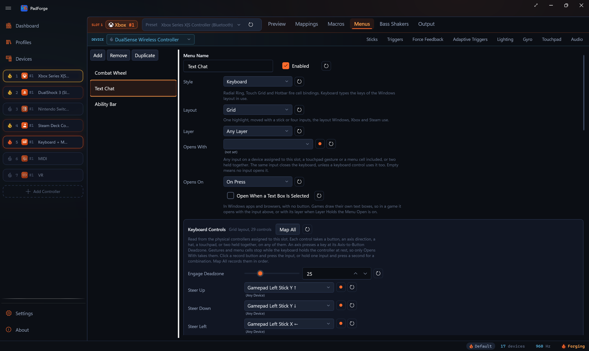

# On-Screen Keyboard

*Type into any Windows program from a controller: a keyboard of the Windows layout in use, laid out as a grid, two split halves or a daisy wheel, opened by any input you pick.*

The On-Screen Keyboard is a menu style. A slot's **Menus** tab lists it beside the Radial Ring, Touch Grid and Hotbar menus, and it takes the same **Layer** and **Menu Overlay** settings they do. Instead of cells it has keys: the keys of the keyboard layout of the window you are typing into, so a French AZERTY window gets AZERTY keys and a German window gets QWERTZ.

<!-- SCREENSHOT: pad-menus-keyboard -->

The keyboard window never takes focus, so the program you type into keeps it. It does take mouse clicks: click a key to type it, drag the top bar to move the keyboard, drag the corner grip to resize it, or click the close button.

---

## Adding a keyboard

1. Open a slot and switch to its **Menus** tab.
2. Click **Add**, then set **Style** to **Keyboard**.
3. Pick a **Layout**.
4. Set **Opens With** to the input that opens it, or turn on **Open When a Text Box Is Selected**.

A new keyboard has no **Opens With** input, so nothing opens it until you set one. Switching a menu to **Keyboard** moves its **Screen Position** to the bottom of the screen (Y 100) and its **Engage Deadzone** to 50, when those still hold a ring's defaults (Y 50, deadzone 25). Switching back restores the ring's defaults the same way. Values you set yourself stay.

---

## Layout

| Layout | How a controller types |
|---|---|
| **Grid** | One highlight, moved with a stick or four inputs, the layout Windows, Xbox and Steam use. |
| **Split** | Each half of the keyboard gets its own steering input and its own type input. Both type inputs within 90 ms of each other type a space. |
| **Wheel** | The daisy wheel: pick one of eight groups, then one of its four characters. Holding **Capitals and Symbols (Hold)** or **Numbers and Brackets (Hold)** switches the set, and holding both shows the keys set: modifiers, navigation keys, Esc, Tab, Delete, Caps Lock and F1 to F12. |

The keyboard's own layout key switches Grid, Split and Wheel in turn, and its Fn key shows or hides the function row. Both changes save to the menu.

On a US layout the wheel's letter, capital and number sets are daisywheeljs's sets. Another layout fills the first two sets with its own letters in its language's order.

---

## Opening and closing

### Opens With

**Opens With** takes any input on a device assigned to the slot, a touchpad gesture or a menu cell included, or two held together. Pick it from the list or click the record button and press it. A combination is recorded by holding one input and pressing a second. The same input closes the keyboard, unless a keyboard control uses that input too: then the press belongs to the control. The [Desktop](#the-desktop-starter-and-steam-imports) starter opens its keyboard on X, which is also **Backspace** in the Grid layout, so X types Backspace while the keyboard is open and B closes it.

An analog input gets a press point, 50% of its travel unless you change it.

**Opens On** sets which press of **Opens With** acts, with the press modes a macro trigger has:

| Opens On | Opens or closes the keyboard |
|---|---|
| **On Press** (default) | As soon as Opens With is pressed. |
| **On Release** | When Opens With is let go. |
| **While Held** | Opens while Opens With is held and closes when that press is let go. |
| **On Long Press** | Once Opens With is held for the **Hold Time** (default 500 ms). A shorter press does nothing. |
| **On Short Press** | When Opens With is let go before the **Hold Time**. A longer press does nothing. |
| **On Double Press** | When Opens With is pressed twice within the **Press Window** (default 442 ms). |
| **On Triple Press** | When Opens With is pressed three times within the **Press Window**. |
| **On Single Press** | When the **Press Window** ends after one press. A second press inside the window cancels it. |

The time takes 50 to 10,000 ms. An input already held when PadForge first sees the menu waits for its release before it can act.

### Open When a Text Box Is Selected

With **Open When a Text Box Is Selected** on, the keyboard opens when focus moves into a text box in a Windows app or a browser, and closes when focus leaves text boxes. Moving from one text box to another opens it again if you closed it in the first. It leaves alone a keyboard that opened another way. A text box is an edit control or a document that is not read-only.

It is off by default. PadForge learns where focus is through UI Automation, and a focus watcher makes every program that answers UI Automation report each focus change. That costs the browser CPU on every focus change, and Firefox answers through a slow proxy (Mozilla bug 1777875). PadForge listens only while at least one enabled keyboard menu has this on.

Games draw their own text boxes, which UI Automation cannot see. In a game, open the keyboard with **Opens With**, or with its layer when **Layer Holds the Menu Open** is on.

When several menus ask for text boxes, the first enabled one in slot order, and in each slot's menu order, whose layer is open takes it.

### Layer and Layer Holds the Menu Open

The **Layer** picker works as it does on every [menu](../guides/menus.md#menus-and-shift-layers). **Opens With** and text-box opening act only while the menu's layer is open.

With **Layer Holds the Menu Open** on and a named layer picked, entering the layer opens the keyboard and leaving it closes the keyboard. The keyboard holds its controllers at rest the moment it opens (see below), which ends a layer held by a button on one of them. A layer that ends within 100 ms of the opening is that, not you leaving it, so the keyboard stays open until it is closed another way.

### Other ways it closes

- The **Close** control, or the close button on the window.
- **Opens With** on another keyboard menu takes the keyboard over for that menu.
- The last controller the keyboard holds goes offline.
- The menu is turned off, removed, or switched to another style.
- A [Remote Link](../guides/remote-link.md) peer whose devices are restricted starts feeding the slot. A slot such a peer feeds cannot open the keyboard, because the keyboard types on this PC.

---

## The controller at rest

While the keyboard is open, the controllers that drive its menu drive only the keyboard. Everything else reads them at rest: mapping rows, macros, other menus, touchpad gestures and layer holds, in every slot those controllers feed. A game sees the virtual controller sitting still. Each axis holds at its rest: a gamepad's sticks centered and triggers released, a mouse's motion still. An axis with no rest PadForge can name, such as a flight stick's throttle, holds where it was when the keyboard opened.

When the keyboard closes, whatever was held at that moment stays silent until it is let go, so the button that closed the keyboard never reaches the game. An axis with no rest to name, such as a throttle, is released at once. A controller that starts driving the menu while the keyboard is open is held at rest too.

This is why touchpad gestures and menu cells can open the keyboard but cannot be keyboard controls: once the keyboard holds the controller, neither fires.

---

## Keyboard Controls

The **Keyboard Controls** card lists every control of the chosen layout, with the layout's name and the control count beside its title ("Grid layout, 29 controls"). Each control reads any input on any device assigned to the slot: a button, an axis direction, a hat, a touchpad, or two held together. Pick an input from the control's list, or click its record button and press the input. **Map All** records every control of the layout in order, and its status line names the control to press an input for. The reset beside the title returns every control of the layout to its default, and each row has its own reset.

Each layout keeps its own controls, so switching layouts never loses what you recorded for another.

**Engage Deadzone** at the top of the card sets how far a steering control is pushed before the highlight moves, 1 to 95, default 50. Steering counts as let go under 70% of it. A button moves the highlight at once.

A key control on an analog input presses at that row's **Axis-to-Button Deadzone**, 50% unless set, and lets go below 70% of it, so a trigger resting near the point does not type twice. Steering controls read an axis's depth instead, against the **Engage Deadzone**.

Defaults are recorded by position, in Xbox labels, and read the same position on any gamepad on the slot: A is Cross on a DualSense. They come from the keyboards people already use: Windows' gamepad keyboard (X Backspace, Y Space, Menu Enter), Steam's B to close, the CHI 2006 dual-stick keyboard for Split, and daisywheeljs for Wheel. The keyboard's hint bar shows each control with the label your controller gives it.

### Grid

| Control | Default |
|---|---|
| **Steer Up**, **Steer Down**, **Steer Left**, **Steer Right** | Left stick |
| **Move Up**, **Move Down**, **Move Left**, **Move Right** | D-pad |
| **Type Key** | A |
| **Backspace** | X |
| **Space** | Y |
| **Enter** | Menu (Start) |
| **Shift for the Next Key** | Left trigger |
| **Symbols Page** | Right trigger |
| **Cursor Left**, **Cursor Right** | Left and right bumper |
| **Suggestion 1**, **Suggestion 2**, **Suggestion 3** | Right stick left, up, right |
| **Close** | B |
| **Move the Keyboard (Hold)** | View (Back) |
| **Pointer 1 X**, **Pointer 1 Y**, **Pointer 1 Touch**, **Pointer 1 Click** | Touchpad 1: the finger's place, its touch, the pad's click |
| **Pointer 2 X** to **Pointer 2 Click** | Touchpad 2, the same way |

### Split

| Control | Default |
|---|---|
| **Steer Up, Left Hand** to **Steer Right, Left Hand** | Left stick |
| **Steer Up, Right Hand** to **Steer Right, Right Hand** | Right stick |
| **Type Left Half**, **Type Right Half** | Left and right trigger |
| **Backspace**, **Space** | X, Y |
| **Shift for the Next Key, Left Hand**, **Shift for the Next Key, Right Hand** | Left and right stick click |
| **Symbols Page** | View (Back) |
| **Arrow Up**, **Arrow Down**, **Arrow Left**, **Arrow Right** | D-pad |
| **Cursor Left**, **Cursor Right** | Left and right bumper |
| **Enter** | Menu (Start) |
| **Close** | B |
| **Move the Keyboard (Hold)** | View (Back) |
| **Pointer 1** and **Pointer 2** controls | Touchpads 1 and 2, as in Grid |

### Wheel

| Control | Default |
|---|---|
| **Steer Up**, **Steer Down**, **Steer Left**, **Steer Right** | Left stick: points at a group, north first, then clockwise |
| **Pick West**, **Pick North**, **Pick East**, **Pick South** | X, Y, B, A |
| **Backspace**, **Space** | Left and right bumper |
| **Capitals and Symbols (Hold)** | Right trigger |
| **Numbers and Brackets (Hold)** | Left trigger |
| **Cursor Left**, **Cursor Right** | D-pad left and right |
| **Home**, **End** | D-pad up and down |
| **Enter** | Menu (Start) |
| **Suggestion 1**, **Suggestion 2**, **Suggestion 3** | Right stick left, up, right |
| **Close** | View (Back) |
| **Move the Keyboard (Hold)** | View (Back) |

The wheel has no pointers.

A control that shares its input with **Move the Keyboard (Hold)** acts on a tap, when the input is let go without the keyboard having moved. Holding the input and steering moves the keyboard instead. That is how View (Back) can be both **Symbols Page** and the move hold on Split, and both **Close** and the move hold on Wheel. A full push moves the keyboard 60% of the screen per second.

**Shift for the Next Key** shifts the next key typed. A second press locks Shift, and a third turns it off.

A pointer points at the key under the finger while its touch input is held, and its click types that key. With one touchpad, its pointer spans the whole Grid keyboard, or both halves of Split. With two, each points at its own half.

The highlight wraps from one end of a row to the other and from the bottom row to the top, and up and down keep its column.

The Move, Steer, Arrow, Type Key, Backspace, Space and cursor controls repeat while held. Moving repeats after 380 ms, every 90 ms. Typing repeats at Windows' own keyboard repeat delay and rate.

---

## Keyboard

The **Keyboard** card sets where the keys go and what the keyboard shows.

### Types Through

| Choice | What programs see |
|---|---|
| **Windows Input** (default) | Each key typed through Windows. Programs can tell it came from software. |
| **Same Keyboard as** a Keyboard + Mouse slot | The key typed the way that slot's **Keyboard** setting types it. |
| A HIDMaestro keyboard model | The key typed by a virtual keyboard of that model, which programs see as hardware. The keyboard menu makes that keyboard itself, so it needs no Keyboard + Mouse slot. It exists while the menu is enabled and the engine runs. |

A key the chosen keyboard lacks, and a character no key types (a symbol-page character, a letter the layout has no key for), still go through **Windows Input**, as Unicode text. A slot that is no longer Keyboard + Mouse shows as **Keyboard of a slot that is no longer Keyboard + Mouse**, and a keyboard model this PC lacks shows with **(not on this PC)**.

Keys type in the layout of the window that has focus. While the keyboard is open, PadForge reads that layout four times a second, so switching windows or languages changes the keys within a quarter second.

### Function Row

**Function Row** adds Esc, F1 to F12 and Delete above the keys. Off by default. The Fn key on the keyboard switches it too.

### Word Suggestions

**Word Suggestions** shows up to three words, from the text prediction in Windows, for the languages installed in Windows. A language Windows has no prediction for shows none. On by default. Pick one with a **Suggestion** control or a click. With no word started, they predict the next word.

### Symbols Page

**Symbols Page** holds the characters of the keyboard's symbols page, typed as Unicode characters. The default set holds currency and other signs, accented letters, typographic punctuation, fractions and math signs, in the places of the letter keys. The **Symbols Page** control, or the keyboard's **&123** key, switches to it, and **abc** switches back. Its reset restores the default set.

---

## Place, size and opacity

The **Menu Overlay** card carries the rows every menu has: **Screen Position** (X and Y, in percent of the main display's work area), **Size** (10% to 400%) and **Opacity** (5% to 100%). Dragging the keyboard's top bar or corner grip, or holding **Move the Keyboard (Hold)**, sets them too. A keyboard larger than the work area shrinks to fit, so its close button stays on screen.

---

## The Desktop starter and Steam imports

The **Desktop** [starter profile](../guides/starter-profiles.md) carries a keyboard menu named Keyboard, in the Grid layout with its default controls, opened by X on press. That is where Valve's desktop scheme puts Show Keyboard. **Open When a Text Box Is Selected** is off.

A [Steam Workshop](../guides/steam-workshop-import.md) config's Show Keyboard binding imports as a keyboard menu. Its input becomes **Opens With**, with a second input held with it when the binding had one, and the trigger threshold of a half-axis input as the press point. Steam's Long Press, Double Press and Release activators become **On Long Press**, **On Double Press** and **On Release** with their times, so a short press of the same input keeps its own binding. The binding's layer becomes the menu's **Layer**. The menu goes on one slot, the Xbox slot when the import made one, so a split config does not answer one press twice.

---

## Related pages

- [Menus](../guides/menus.md): the other menu styles and the settings all menus share.
- [On-Screen Keyboard Internals](../reference/on-screen-keyboard-internals.md): how the code does it.
- [Shift Layers](../guides/shift-layers.md): layers that gate or hold the keyboard open.
- [Macros](../guides/macros.md): the press modes **Opens On** borrows.
- [Steam Workshop Config Import](../guides/steam-workshop-import.md)
- [Starter Profiles](../guides/starter-profiles.md)

---

*Last updated for PadForge 5.3.0.*
