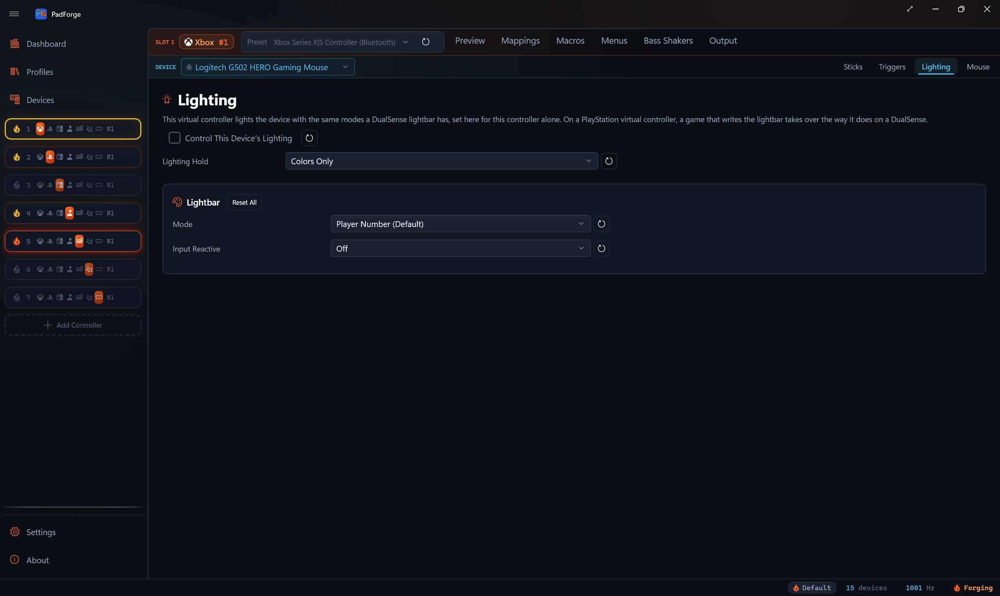

# Mice, Keyboards and Vendor Rows

*A mouse or keyboard assigned to a virtual controller takes that controller's lighting and rumble on its own Lighting and Force Feedback tabs, the way a DualSense does. PadForge lights Logitech, Razer and SteelSeries devices itself while their software is closed, and through that software while it runs. Vendor rows reach the headsets, mousepads, speakers and Razer Sensa HD gear that PadForge does not read.*

---

## Setting one up

A mouse or keyboard assigned to a virtual controller becomes one of its output devices. It gets a **Lighting** tab when PadForge has a way to light it and a **Force Feedback** tab when it can vibrate.

1. On the [Devices](devices.md) page, select the mouse or keyboard and click a virtual controller's number under **Virtual Controller Assignment**.
2. Open that virtual controller from the sidebar and pick the device in the assigned-devices dropdown.
3. On the **Lighting** tab, check **Control This Device’s Lighting** and pick a mode. Rumble is on from the start, as it is for a gamepad.

Settings belong to one virtual controller and one device, so a keyboard on two virtual controllers keeps separate settings for each. Assignments and both tabs' settings belong to the active [profile](../guides/profiles.md), as a gamepad's do. The row that **Read Analog Keyboards** adds for an analog keyboard counts as a keyboard here.

| Brand | Lit by PadForge on its own | Lit through the vendor's software | Rumble |
|---|---|---|---|
| Logitech | Over HID++, while neither G HUB nor Logitech Gaming Software runs: mice and keyboards that report lighting feature 0x8070 or 0x8071 | Through the LED engine of G HUB or Logitech Gaming Software while one of them runs, one color for each kind: keyboard, mouse, mousepad, headset, speaker | MX Master 4, over HID++. iFeel Mouse and iFeel MouseMan, after a driver switch |
| Razer | Through the device's own reports, while neither Razer Synapse nor Razer Central runs: 180 product IDs | Through Razer Synapse while it runs, one color for each kind: keyboard, mouse, headset, mousepad, keypad, Chroma Link | Sensa HD devices, through the Razer Sensa row |
| SteelSeries | Through the device's own reports, while SteelSeries GG is closed: 82 product IDs | Through SteelSeries GG while it runs, one color for each kind: mouse, keyboard, headset | Rival 500, 700 and 710, through SteelSeries GG |
| Any brand | Over HID LampArray, for a device Windows Dynamic Lighting can drive, while Dynamic Lighting is turned off for it | | |

A device PadForge lights on its own shows its own virtual controller's color. Devices lit through a vendor's software share one color for each kind.

PadForge finds Logitech devices over HID++ by the features they report, with no model list. A Razer or SteelSeries mouse or keyboard gets its Lighting tab when PadForge can light it on its own, and otherwise once Razer Synapse or SteelSeries GG is installed. A device PadForge found keeps its tabs while it sleeps. The MX Master 4 gets its Force Feedback tab once PadForge finds its haptic motor, a Rival 500, 700 or 710 once GG is installed, and an iFeel mouse once it is on PadForge's driver.

---

## Lighting

### Taking over a device's lighting

A mouse or keyboard's Lighting tab opens with a **Control This Device’s Lighting** checkbox, off by default. Assigning a keyboard for its keys never repaints it: until the box is checked, this virtual controller leaves the device's lighting alone. The checkbox's tooltip reads: *Off stops this virtual controller from lighting the device. A vendor row, or another device of its kind lit through the same software, can still set its color. A Set Chroma Color macro on this virtual controller still paints a Razer device.*

The vendor rows have no checkbox. Assigning one is enough.

A device that nothing lights any more goes back to its own lighting, where it has a way back, and so does every device when PadForge's input engine stops. [Letting go of a device](#letting-go-of-a-device) lists the devices that keep the last color. PadForge reaches Synapse, G HUB, Logitech Gaming Software and GG only while something assigned needs them, or while the rumble mark on the [Devices](devices.md) page buzzes a Rival or the Razer Sensa row.

### Modes

The tab's lightbar card is the one a DualSense gets, without the controller art: all fourteen base modes and the **Input Reactive** overlay. The macro lightbar actions reach the device too. [Lighting](lighting.md) covers every mode and setting. On a mouse or keyboard:

| Mode | What the device shows |
|---|---|
| Player Number (Default) | The virtual controller's player color |
| Off | The device stays dark. To give it back to its own software, uncheck Control This Device’s Lighting instead |
| Battery: Gradient by Charge Level | A Logitech device's charge, read over HID++ whichever way it is lit. PadForge reads no charge from any other device, so those and the vendor rows hold the Full Battery color |

### A game's lightbar

On a virtual DualSense, DualSense Edge or DualShock 4, a game that writes the lightbar takes over every device the virtual controller lights, the way it does on a DualSense:

- For 1.5 seconds after each write, the game's color shows over the tab's mode and over a macro's lightbar color.
- A device left at Player Number, with the Input Reactive overlay off and no macro color running, then keeps the game's last color until 15 seconds pass with no output from the game. Then the player color returns.
- A device set to any other mode goes back to it 1.5 seconds after the last write.

No game writes a lightbar to the other virtual controller types, so there the tab's own settings set the color.

### Which way a device is lit

PadForge lights a device one way at a time, and picks it in the same order for every brand:

1. While the brand's own software runs, the device lights through it, and PadForge sends the device nothing itself. Two programs that drive one device fight over it.
2. While Windows Dynamic Lighting lights the device, PadForge leaves it alone, and the Lighting tab says so.
3. Otherwise PadForge lights the device on its own: over the device's own protocol where PadForge speaks it, and over HID LampArray where the device offers that instead.
4. A Razer or SteelSeries device PadForge cannot light on its own waits for Razer Synapse or SteelSeries GG.

PadForge looks for the vendors' programs by process name, about twice a second while it lights a device on its own. When one starts, PadForge stops writing to that brand's devices at once and sends no parting color, since the program has taken them. When it closes, PadForge lights them again.

### Logitech devices

While neither G HUB nor Logitech Gaming Software runs, PadForge lights a Logitech mouse or keyboard straight over HID++ when the device reports lighting feature 0x8070 (zone lighting) or 0x8071 (RGB effects). A keyboard with per-key lighting takes the color on every key, its media keys and G-keys included. A mouse is lit through its zones. PadForge takes the lighting from the device's own effect while it lights the device, and hands it back afterward.

Over Bluetooth a device confirms no color, so PadForge sends the color again with its next keep-alive, about every 5 seconds.

While G HUB or Logitech Gaming Software runs, that program owns the devices, so they light through its LED engine instead, one color for each kind. PadForge loads the engine the program installed and ships no Logitech code. When PadForge starts painting through the engine, it saves the program's lighting, and it restores that lighting when it stops. A Logitech device that reports lighting over HID++ in a way PadForge does not drive lights only through the LED engine, so its Lighting tab shows while G HUB or Logitech Gaming Software runs.

Two devices behave in ways worth knowing:

- On a G903 the DPI indicator goes dark while PadForge lights the mouse and comes back when PadForge lets go. The indicator is a lighting zone of its own that takes a color and never shows it, as OpenLogi reports for that mouse.
- On a keyboard of the G810 class, the lock indicators keep following Caps Lock and its neighbors, in the virtual controller's color. PadForge hands these boards back with white indicators and media keys, whatever color they had before.

### Lighting Hold

A Logitech device lit through feature 0x8071 can be held more firmly than by its colors alone. Where the device offers it, the Lighting tab shows a **Lighting Hold** picker:

| Option | What PadForge holds while the device is lit |
|---|---|
| **Colors Only** (default) | The colors. The device's power saving and its saved profile keep running |
| **Colors and Lighting Power** | Also the device's lighting power, so it stops dimming its lights by itself |
| **Colors, Lighting Power, and On-Board Memory Mode Off** | Also the device's mode. Its on-board memory mode goes off while it is lit and back on when it stops. While it is off, the profile saved on the device (its buttons, DPI, and report rate) does not apply |

Choose the second option when the device's own idle effect takes the color away, and the third when the device shows its own profile's lighting over the color. A device that would lose keys with its on-board memory mode off, the G915 TKL, has the first two options only.

PadForge reads the device's mode before it changes it, leaves a device that is already out of on-board memory mode as it found it, and puts back the mode it read. The hold belongs to one virtual controller and one device. When two virtual controllers light the same device, the hold of the one whose color shows applies. Profiles carry the hold. **Copy From** and **Paste** carry it to the same device only, and **Reset All** leaves it. Its own reset button sets Colors Only.

If PadForge is ended by force while it holds a device with on-board memory mode off, the device stays that way until G HUB runs or the device restarts. A normal exit and a crash both put the mode back.

### Razer devices

While neither Razer Synapse nor Razer Central runs, PadForge lights a Razer mouse, keyboard or keypad through the device's own feature reports. 180 product IDs have a color PadForge can set, read out of OpenRazer and OpenRGB. PadForge takes the lock that OpenRGB and other third-party Razer tools share around each report it sends, as those tools do.

- PadForge never changes a device's brightness. A device whose own brightness is 0 shows no color while PadForge lights it.
- Every color goes out with the report's no-store setting where the report has one, which asks the device not to save it.
- The Orochi (wired), the Tartarus and the products that fall back to the same report are painted by a report with no such setting. They take a color only once it has held for a second, so a color that keeps moving writes nothing to them, and a **Set Chroma Color** press shorter than a second shows nothing on them.
- While PadForge lights a Razer laptop's keyboard, it reads the keyboard every 2.5 seconds of quiet, which keeps the keyboard from falling back to its own lighting.
- A lighting zone that a device names itself and then refuses a color for is left on the device's own lighting.

While Synapse runs, Razer devices light through the Chroma REST server that Synapse runs, one color for each Chroma category: keyboard, mouse, headset, mousepad, keypad and Chroma Link. A Tartarus, Orbweaver or Nostromo lights as a keypad.

### SteelSeries devices

While SteelSeries GG is closed, PadForge lights a SteelSeries mouse or keyboard through the device's own control collection: one color on every LED or zone, for 82 product IDs. It sends the color again every 5 seconds, every 30 on a Rival 3 Wireless and a Rival 650, and when Windows resumes from sleep.

- PadForge never writes the device's stored brightness or its other settings. On a Rival 3 Gen 2 and an Apex 3 TKL the stored brightness scales the color, and a wireless Aerox keeps dimming after its stored idle time.
- A wireless mouse that is switched off or asleep says so through its dongle. PadForge leaves it alone for a second and then sends the whole color again, so the color shows within about a second of the mouse waking.
- No SteelSeries device is lit on its own over Bluetooth.
- A device that another program has opened for itself alone is tried again every 5 seconds, and nothing is written to it meanwhile. A program that opens the device shared, as OpenRGB does, keeps writing beside PadForge, and the device shows whichever wrote last.
- The Apex Pro TKL, Apex 9 Mini, Apex 9 TKL and wired Apex Pro TKL (2023) are asked for their firmware version each time PadForge opens them. On the 2023 board the question also puts the stored configuration back over unsaved changes, such as an actuation preview made in another program.
- These have no color to set and stay with GG: the Sensei RAW and its editions, the Kana v2, the Kinzu v2, the Rival 95 and its editions, the Rival 100 PC Bang and the Rival 3 Wireless Gen 2.

While GG runs, SteelSeries devices light through GameSense, one color for each device type: mouse, keyboard and headset. PadForge shows up in GG as a game named PadForge.

### Windows Dynamic Lighting devices

A device that Windows Dynamic Lighting can drive speaks HID LampArray, and PadForge lights it over the same reports, whatever its brand. It does so only while Windows does not light the device itself. Turn Dynamic Lighting off in Windows Settings under Personalization, for every device or for that one. PadForge reads the switch once a second and never changes it.

- While PadForge lights a device, the device's own effect stops, and PadForge sends its claim and color again every 4 seconds.
- Before the first color after a device arrives, PadForge reads each of its lamps once.
- A Logitech, Razer or SteelSeries device that also speaks LampArray is lit over its own protocol first.
- On a laptop whose own keyboard is a LampArray device, turning Dynamic Lighting off for it can leave the keyboard dark while PadForge is not lighting it.
- The keyboard of the Lenovo Legion Pro 5 16IAX10 is reported to take a host's colors and keep painting its own effect over them, so PadForge leaves it alone.

A light strip, a headset, a mousepad or another LampArray device that no mouse or keyboard row reaches gets a row of its own on the Devices page about five seconds after PadForge finds it. The row has no inputs. Assigned to a virtual controller, it takes that controller's lighting on its Lighting tab, one color for the whole device. A Logitech, Razer or SteelSeries device gets no such row while that brand's program runs.

### Shared lighting

Synapse, G HUB, Logitech Gaming Software and GG take one color for each kind of device and show it on every device of that kind. Two Razer mice on two virtual controllers show one color between them while Synapse runs. When more than one assigned device or vendor row lights the same kind:

1. A device lit from its own Lighting tab beats a vendor row, whatever the virtual controller numbers.
2. Otherwise the lower-numbered virtual controller sets the color.

A device on two virtual controllers follows the same rule: the lower-numbered one sets its color. Devices PadForge lights on its own do not share a color. Each shows the one its own virtual controller sets.

### Letting go of a device

When nothing lights a device any more, PadForge hands it back to its own lighting and closes it. What the device shows next depends on what it lets a host send:

| Device | After PadForge lets go |
|---|---|
| Logitech, over HID++ | Its own effect |
| Razer with single LEDs or zones | The effect each LED reported when PadForge took it, or the spectrum effect where the device would not say. A few models have no spectrum effect and keep the last color then |
| Razer keyboards and mice painted as a whole frame, 60 product IDs | The last color. No known report returns such a device to its own effect. A laptop may go back to its own lighting when its firmware's idle time runs out. The others keep the color until they lose power |
| SteelSeries Rival 3 Gen 2, Rival 5, Aerox, Apex 3 TKL, Apex Pro, Apex 9 and their wireless kin | Its own lighting |
| The other SteelSeries models, 47 product IDs | The last color, until the device loses power. No public source has a report that gives them back their own lighting |
| A Windows Dynamic Lighting device | Its own effect. A device with no effect of its own goes dark |

A device that stops answering while PadForge lights it, such as a wireless mouse that falls asleep, is not forgotten. PadForge hands it back when it answers again, before it sends the device anything else, whether or not anything lights the device by then. The same goes out when PadForge exits. Nothing is handed back once the brand's own program runs, or once the device is unplugged.

If PadForge is ended by force, a device it lit on its own keeps the last color until something else lights it, PadForge lights it again and lets go, or it loses power. A crash is different: PadForge hands back the devices it lights on its way out, inside three quarters of a second.

---

## Rumble

A mouse that can vibrate takes its virtual controller's rumble through the Force Feedback tab a gamepad gets, and [Force Feedback](force-feedback.md) covers its settings. Macro rumble reaches it too, and **Test Rumble** plays on the selected device. Each of these devices plays one strength at a time: the stronger of the left and right motors, after the tab's settings. The tab leaves out **Swap Left and Right Motors** for them and for the Razer Sensa row, since swapping the two changes nothing. A device on several virtual controllers takes the strongest rumble among them.

| Rumble strength | MX Master 4 | Rival 500, 700 and 710 |
|---|---|---|
| Under 5% | Nothing | Nothing |
| 5% to 32% | Subtle collision waveform | A 30 ms pulse 5 times a second |
| 33% to 65% | Damp collision waveform | A 55 ms pulse 7 times a second |
| 66% and up | Sharp collision waveform | An 80 ms pulse 10 times a second |

A level drops back only once rumble falls 2 to 3 points below the threshold that raised it, so rumble that hovers on a boundary does not flicker between levels.

### Logitech MX Master 4

PadForge plays Logitech's own haptic waveforms on the mouse over HID++ (feature 0x19B0). No Logitech software is needed, and any other Logitech device that reports the same feature plays the same way. The waveform repeats every 250 ms at the faintest rumble and every 80 ms at full strength, and new rumble plays its first pulse at once. When the mouse lacks a level's waveform, PadForge plays the nearest one it has.

PadForge never changes the mouse's haptic settings. With haptic feedback turned off in Logi Options+, the mouse plays nothing until you turn it back on there.

### SteelSeries Rival 500, 700 and 710

These vibrate through the tactile handler in SteelSeries GG, which has to be running. GG drives every tactile Rival at once, so the Rival on the lowest-numbered virtual controller sets the rumble for all of them. Clicking the rumble mark of any tactile Rival on the Devices page buzzes all of them, whether or not that Rival is assigned. When no Rival is assigned any more, the motor stops at once. Two seconds after no Rival is assigned and no virtual controller lights a SteelSeries device or the SteelSeries GG row, PadForge ends its GameSense game and GG's own effects come back.

### Logitech iFeel mice

The iFeel Mouse and the iFeel MouseMan carry a motor that Logitech's old driver buzzed, and no driver for it runs on 64-bit Windows. PadForge plays rumble on these mice itself, once the mouse is on Windows' WinUSB driver. The switch is yours to make, one mouse at a time:

1. On the [Devices](devices.md) page, select the mouse and click **Play Rumble on This Mouse**.
2. Read the **Switch to PadForge's Driver** dialog and confirm with **Switch Driver**.

The switch has a cost, and the dialog states it. Windows stops using the mouse as a pointer until its driver is restored. PadForge moves the pointer from the mouse only while PadForge runs and the mouse is assigned to a Keyboard + Mouse virtual controller. **Restore the Windows Driver**, in the same place, puts Windows' own driver back.

- The switched mouse is a new row on the Devices page, since PadForge now reads it over WinUSB. Its old row goes offline, and an assignment of the old row does not carry over.
- The switch belongs to the USB port, because these mice have no serial number. On another port the mouse is a Windows mouse again, and PadForge says so when it starts.
- With a second mouse of the same model plugged in, PadForge refuses the switch and asks you to unplug the others first. Windows would move every plugged-in mouse of that model at once.
- Rumble plays at the stronger of the virtual controller's two motors, on the scale Logitech's driver used for each model. Under 2% nothing plays. Each frame plays for at most 300 ms, so the motor stops within a third of a second if PadForge stops abnormally.
- The Force Feedback tab's route line reads *Rumble plays on* the mouse's name *as a buzz, sent straight to the device.*

PadForge offers the switch to an iFeel MouseMan, and to the iFeel Mouse that Windows lists as the iFeel Mouse+, only when the mouse's own descriptor shows the buzz report. The HP, Saitek, Belkin and Kensington mice built on Immersion TouchSense are not offered it.

### Razer Sensa HD

The Razer Sensa row plays rumble on Razer Sensa HD devices such as the Wolverine V3 Pro, the Kraken V4 Pro and the Freyja. It appears on the Devices page once Razer Synapse is installed. Assign it to a virtual controller and it takes that controller's rumble on its Force Feedback tab. Its engine runs only while the row is assigned, or while the rumble mark on the Devices page buzzes it.

The row plays through the Interhaptics engine and its Razer provider, which ship unmodified inside PadForge, and through Razer Synapse 4 with Sensa HD Haptics. In Synapse, set the device's Haptic Source to Sensa HD Games. A Wolverine V3 Pro renders Sensa only on a PC, in PC mode, with firmware v2.02 or later ([Razer's firmware updater](https://mysupport.razer.com/app/answers/detail/a_id/14630)). Hold Function, Menu and A together for two seconds to switch it to PC mode.

Sensa takes one strength and plays it as one looping effect in the 65 to 300 Hz band, the same on every Sensa device.

---

## Vendor rows

Four rows on the [Devices](devices.md) page stand for output a vendor's software delivers to devices PadForge does not read. Each appears once its software is installed, with **Lighting** or **Haptics** as its type. A row has no inputs, so it adds nothing of its own to a virtual controller's mappings. Assigned to a virtual controller, it takes that controller's lighting on its Lighting tab, or its rumble on its Force Feedback tab.

| Row | Appears once this is installed | What it reaches |
|---|---|---|
| Razer Chroma | Razer Synapse | Every Chroma category that no assigned Razer device lights from its own Lighting tab: headsets, mousepads, and Chroma Link strips, and Razer mice, keyboards and keypads while no virtual controller lights a Razer device of that kind |
| Logitech LIGHTSYNC | G HUB or Logitech Gaming Software | Every LED engine kind that no assigned Logitech device lights from its own Lighting tab: headsets, mousepads, and speakers, and Logitech mice and keyboards while no virtual controller lights a Logitech device of that kind. Also, in one color, the devices Logitech's LED SDK manual lists without zones: the G710+, G600, G510, G110, G19, G105, G300, G11, G13 and G15 |
| SteelSeries GG | SteelSeries GG | Headsets, and SteelSeries mice and keyboards while no virtual controller lights a SteelSeries device of that kind |
| Razer Sensa | Razer Synapse, in the x64 build | Rumble on Razer Sensa HD devices, covered under Rumble above |

A lighting row lights only while its software runs, and its tab says it is waiting until then. A device lit from its own Lighting tab outranks a vendor row on its kind, whatever the virtual controller numbers. A vendor row removed from the Devices page comes back while its software stays installed.

---

## The route line

Both tabs carry a line in the accent color that says where the output goes and, when it does not arrive, why. On the Lighting tab it sits above the mode card, and with the checkbox off it shows only when something else lights the device. On the Force Feedback tab it sits at the top.

Neither tab shows the line while PadForge's input engine is stopped. On a virtual controller that is not live, such as one that is turned off, the Force Feedback tab shows no line. The Lighting tab there shows only a line that names what else lights the device, or the Logitech LIGHTSYNC row's line for an LED engine that will not load. One line always shows: *Not Available on ARM64*, on a Razer Sensa row that the x64 build's settings carried into the ARM64 build.

| The Lighting tab reads | When |
|---|---|
| *Colors go straight to* and the device's name | PadForge lights the device on its own. |
| *Colors go straight to* the device's name. *It does not dim its lights by itself while it is lit.* | A Logitech device held with Colors and Lighting Power. |
| *Colors go straight to* the device's name. *Its on-board memory mode is off while it is lit.* | A Logitech device held with its on-board memory mode off. |
| *Colors go through Razer Synapse.* | The device lights through Synapse and PadForge has no way to light it on its own. Through Logitech's LED engine or GG, the line names the program that runs instead: Logitech G HUB, Logitech Gaming Software or SteelSeries GG. |
| *Colors go through Razer Synapse, which lights every device of this kind at once. While Razer Synapse is not running, PadForge lights this device on its own.* | The device lights through the vendor's program for as long as that program runs. The line names the program that runs. |
| *Windows Dynamic Lighting lights this device. Turn Dynamic Lighting off for it in Windows Settings and PadForge lights it.* | Windows lights the device. For a laptop's own keyboard the line adds: *On some laptops the keyboard then stays dark while PadForge is not lighting it.* |
| *Waiting for SteelSeries GG. Colors show once it runs.* | The software that lights the device does not answer. |
| *Razer Synapse lights every device of this kind at once, so the one on Virtual Controller 1 sets their color.* | Another device of the same kind sets the color. |
| *Razer Synapse lights every device of this kind at once, so the Razer Chroma row on Virtual Controller 1 sets their color.* | The checkbox is off, or this virtual controller is not live, and a vendor row lights this kind of device. |
| *Virtual Controller 1 also lights this device, and its color shows.* | The same device, or the same vendor row, is lit from a lower-numbered virtual controller too. |
| *Virtual Controller 1 lights this device.* | The checkbox is off here, or this virtual controller is not live, and another virtual controller lights the device. The Logitech LIGHTSYNC row never reads this while its engine will not load. |
| *Another row of this device on this virtual controller sets its color.* | A device PadForge lights on its own has two rows on this virtual controller, such as a mouse row and a keyboard row, and the other one sets the color. |
| *Another row of this device on this virtual controller lights it.* | This row's checkbox is off, and another row of the same device on this virtual controller lights it. |
| *This device has not answered yet. Its colors show once it wakes up.* | A device PadForge lights on its own is asleep, unplugged or not answering. |
| *The Logitech LED engine on this PC cannot light this kind of device.* | The LED engine G HUB or Logitech Gaming Software installed lacks the call this kind of device needs, or will not load while that program runs. The Logitech LIGHTSYNC row reads it too when the engine will not load. In the ARM64 build, an engine that will not load reads *Not Available on ARM64* instead. |
| *Lights the devices Razer Synapse reaches that no assigned device lights on its own, such as headsets, mousepads, and Chroma Link strips.* | The Razer Chroma row, while Synapse answers. The Logitech LIGHTSYNC row names Logitech G HUB or Logitech Gaming Software, whichever runs, with headsets, mousepads, and speakers, and the SteelSeries GG row names SteelSeries GG with headsets. |
| *Waiting for Razer Synapse. Once it runs, this row lights the devices it reaches that no assigned device lights on its own, such as headsets, mousepads, and Chroma Link strips.* | The Razer Chroma row, while Synapse does not answer. |

| The Force Feedback tab reads | When |
|---|---|
| *Rumble plays through the tactile handler in SteelSeries GG.* | A Rival, while GG answers. |
| *SteelSeries GG drives every tactile Rival at once, so the one on Virtual Controller 1 sets their rumble.* | A Rival on a lower-numbered virtual controller sets the rumble. |
| *Waiting for SteelSeries GG. Rumble plays once GG runs.* | A Rival, while GG does not answer. |
| *Rumble plays on* the mouse's name *as a buzz, sent straight to the device.* | An iFeel mouse on PadForge's driver. |
| *This device has not answered yet. Its rumble plays once it wakes up.* | A Logitech haptic mouse or an iFeel mouse is asleep, unplugged or not answering. |
| *Rumble plays on your Razer Sensa HD devices through Razer Synapse.* | The Razer Sensa row, once its engine reaches Synapse's Sensa runtime. |
| *Waiting for Sensa HD Haptics in Razer Synapse 4. Set the device’s Haptic Source to Sensa HD Games in Synapse.* | The Razer Sensa row cannot reach Synapse's Sensa runtime. |

On an MX Master 4 the line names the mouse and says its rumble plays as haptic pulses, or that its haptic feedback is turned off in Logi Options+.

---

## Set Chroma Color

The **Set Chroma Color** macro action paints the Razer devices assigned to its virtual controller. While it runs, it paints over any virtual controller's Lighting tab, even on a device whose Control This Device’s Lighting checkbox is off. When macros on two virtual controllers paint the same device, or the same kind of device, the lower-numbered virtual controller wins.

- While Razer Synapse runs, the action goes through Synapse. It also paints every other Razer device of the same kinds, and every Razer device when the Razer Chroma row is assigned to its virtual controller. It lets go within 120 ms of the action ending.
- While Synapse is closed, the action paints the assigned Razer devices PadForge lights on its own, and hands each back when the action ends.

See [Macros](../guides/macros.md#set-chroma-color).

---

## Remote Link

A haptic mouse or keyboard shared from another PC over [Remote Link](../guides/remote-link.md) gets a Force Feedback tab, and its rumble plays on the PC it is plugged into. Its lighting stays with that PC, and so do the vendor rows. An iFeel mouse on PadForge's driver shares its motion as any mouse does.

---

## The old Dashboard switches

Earlier versions mirrored a game's lightbar to Razer Chroma and Logitech LIGHTSYNC from the Dashboard's Lightbar Mirrors section, and sent rumble to Sensa HD devices from its Razer Sensa HD Haptics section. Both sections are gone, along with their settings. PadForge turns a switch that was on into an assignment the first time it loads your settings:

- A Razer Chroma or Logitech LIGHTSYNC mirror that was on assigns its row to the first virtual controller, in display order, set to a DualSense, DualSense Edge or DualShock 4. With no such virtual controller, the row stays unassigned.
- In the x64 build, a Sensa switch that was on assigns the Razer Sensa row to the lowest-numbered virtual controller.

The same happens in each saved profile where a switch was on, and in a profile file from an earlier version when you import it. A migrated lighting row starts at Player Number, so it shows the game's lightbar the way the mirror did, and the controller's player color while no game writes one.

---

## On ARM64

The ARM64 build has no Razer Sensa row, because Razer ships no ARM64 engine. Logitech's LED engine lights devices there only if G HUB or Logitech Gaming Software installs an ARM64 version of it.

---

## Related pages

- [Lighting](lighting.md): every mode and setting on the Lighting tab.
- [Force Feedback](force-feedback.md): the Force Feedback tab's settings and Test Rumble.
- [Devices](devices.md): assigning a device to a virtual controller, and the Switch Driver buttons.
- [Macros](../guides/macros.md): Set Chroma Color and the lightbar actions.
- [Analog Keyboards](analog-keyboards.md): analog keyboard rows, which count as keyboards here.
- [Profiles](../guides/profiles.md): how a profile carries assignments and tab settings.
- [Remote Link](../guides/remote-link.md): sharing devices with another PC.
- [Peripheral Outputs Internals](../reference/peripheral-outputs-internals.md): the HID++, Razer, SteelSeries, LampArray, TouchSense, Chroma, LED engine, GameSense and Interhaptics paths, for whoever changes the code.

---

*Last updated for PadForge 5.1.0.*
