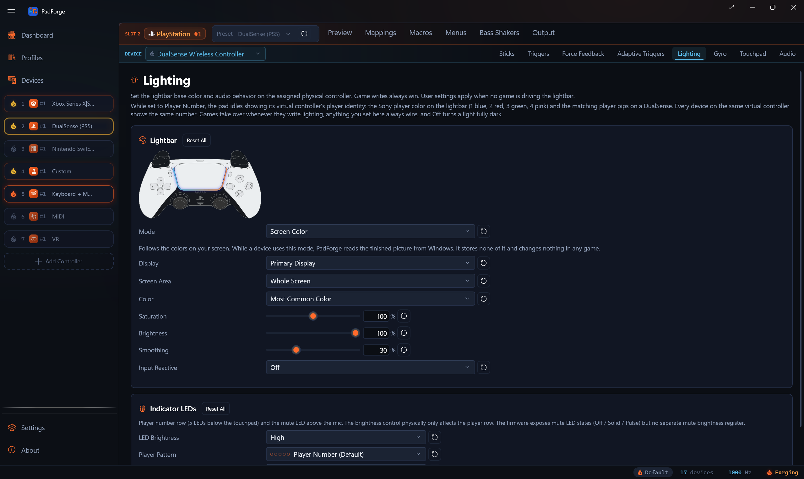

# Screen Color

*A lighting mode that follows the colors on your screen: one color for a lightbar, or the screen spread across a keyboard's keys.*

Screen Color is a base mode on a device's [Lighting](lighting.md) tab. Pick **Screen Color** in the **Mode** box and the device takes its color from one area of one display. PadForge reads the finished desktop picture from Windows while a device uses the mode. It stores none of it, and it reads nothing from a game and writes nothing into one.

<!-- SCREENSHOT: pad-lighting-screen-color -->

---

## Where it works

Every device whose Lighting tab has the **Mode** box can use it: a DualSense, DualSense Edge or DualShock 4 lightbar, a PS Move sphere, the lightbar a [Web Controller](../guides/web-controller.md) draws, and a mouse, keyboard or lighting row from [Mice, Keyboards and Vendor Rows](peripherals.md). The **Set Lightbar Mode** and **Cycle Lightbar Modes** macros offer it too.

A game's lightbar, a [game mod's](game-mods.md) color, a macro's color and the Input Reactive pulse cover Screen Color the way they cover any base mode, and it comes back when they end (see [Priority chain](lighting.md#priority-chain)).

The tab's preview shows a blue-to-orange wash for this mode. The preview reads nothing from the screen.

---

## The settings

| Setting | Default | Range | What it does |
|---|---|---|---|
| **Display** | **Primary Display** | **Primary Display**, then each display as **Display 2 (2560 x 1440)** and the like | The display to read. A saved display that is unplugged shows as **Display 2 (not connected)**, and the device reads the primary display meanwhile. Within a second of the display coming back, it reads that display again. |
| **Screen Area** | **Whole Screen** | **Whole Screen**, **Top Left**, **Top**, **Top Right**, **Left**, **Center**, **Right**, **Bottom Left**, **Bottom**, **Bottom Right**, **Custom** | The part of the display to read. Each of the eight edges and corners and **Center** is a third of the display on each side. |
| **Left Edge** | 25% | 0 to 99% | **Custom** only. Where the area starts, from the display's left edge. |
| **Top Edge** | 25% | 0 to 99% | **Custom** only. Where the area starts, from the display's top edge. |
| **Width** | 50% | 1 to 100% | **Custom** only. An area that would run past the right edge stops there. |
| **Height** | 50% | 1 to 100% | **Custom** only. An area that would run past the bottom edge stops there. |
| **Color** | **Most Common Color** | **Most Common Color**, **Average Color** | How the area becomes one color. |
| **Saturation** | 100% | 0 to 200% | 0% is the color's gray, 100% the color as it is, and above 100% a more vivid color. |
| **Brightness** | 100% | 0 to 100% | A share of the color's strength. |
| **Smoothing** | 30% | 0 to 100% | How slowly the light follows a change. 0% jumps at once. Each percent adds 1 ms to the fade's time constant, so 100% is 100 ms and the default settles within about 100 ms. |
| **Spread the Screen Across This Device's Lights** | On | On, off | Shown only for a device with more than one light. On, each light shows the part of the area under its own place on the device. Off, the whole device shows one color. |

The steps run in that order: the area, then **Color**, then **Saturation**, then **Brightness**, then **Smoothing**. Each row has a reset button.

**Average Color** is the mean of the area. **Most Common Color** counts the area's colors by hue and weighs each one by how colorful and bright it is. Grays and near-blacks count for little, so a dark scene with one strong color shows that color, and a scene with no strong color shows its gray.

### Spread across the lights

With the spread on, PadForge cuts the area into a picture of at most 32 by 16 cells, and every part of the area lands in one cell. Each light takes the cell under its place:

- A device that reports where each light sits, such as a Windows Dynamic Lighting keyboard, uses those positions.
- A keyboard that reports no positions uses the standard keyboard layout that holds the most of its keys.
- Zones and edge lights are placed in order from left to right.

A light with none of these shows the device's one color. A color set for a key, a group or a single light on the tab's [**Key Colors** or **Zone Colors**](lighting.md#key-colors) card stays over the picture. A game, mod or macro color covers the picture the way it covers the one color.

---

## What it needs

PadForge reads the screen through Windows' Desktop Duplication. Where that cannot run on a PC, such as a laptop with two GPUs or a PC where too many programs already duplicate the display, it reads through Windows.Graphics.Capture instead. That second way needs Windows 10 version 1903 or later.

- Windows.Graphics.Capture draws a yellow border around a captured display on builds that cannot turn it off. PadForge turns the border off wherever Windows allows it.
- On Windows 10 versions before 2004, the pointer shows in the picture Windows.Graphics.Capture hands over. Desktop Duplication never includes it.
- A rotated display is read the way it shows on screen.

While Windows holds the desktop, for a UAC prompt or the lock screen, the light keeps its last color and the tab says *Windows is holding the screen for now, so the light keeps its last color.* PadForge tries again at least once a second.

When neither way runs, the tab says *PadForge can't read the screen on this PC right now and keeps trying. Save Snapshot in Settings records the reason.* The waits between tries grow to 8 seconds. **Save Snapshot** on the [Settings](settings.md) page writes the reason Windows gave. A capture that ends three times in a row with no picture also brings that line up.

A display change, such as a new resolution, an HDR switch or a display unplugged, rebuilds the capture. The light keeps its last color meanwhile, and the tab shows no line unless the rebuild fails.

---

## HDR

On a display with HDR on, PadForge reads the desktop in 16-bit color and converts it against the white level Windows draws SDR content at, the **SDR content brightness** slider in Windows' HDR settings. A white window on the desktop shows as full white on the light. Anything brighter than that white clips to full, and a color outside sRGB clips at its edge. When Windows does not report the white level, PadForge uses 200 nits.

Through Desktop Duplication, a change to the slider takes effect the next time the capture starts. Through Windows.Graphics.Capture, PadForge reads the slider again every second.

---

## Speed and cost

- About 30 pictures a second at the most. When reading a picture takes longer than its share, PadForge spends no more than a quarter of its time reading.
- A screen that has not changed sends no new picture.
- The GPU shrinks the desktop to at most 64 cells across before PadForge reads it, so no full-size frame reaches the processor.
- One capture serves every device that reads the same display, and devices with the same settings share one calculation.
- The capture runs on its own thread at below-normal priority, only while a device reads it. It stops 2 seconds after the last device leaves the mode, the slot's profile changes it or the engine stops.

---

## Limits

- A keyboard or headset that stores each picture in its own memory is sent no changing colors, since a stored picture could only show them late, and each write wears the device's memory. It keeps its last steady color. A keyboard that also has a Windows Dynamic Lighting interface takes the changing colors through it, and its row's line says how to turn that interface on.
- A lightbar is one light, so the spread does nothing on a DualSense or DualShock 4.
- The light is black until the display's first picture arrives.

See the technical page, [Screen Color Internals](../reference/screen-color-internals.md). The capture follows Prismatik, AlkaidLab's foundation-sunshine fork of Sunshine, ScreenCapture.NET, RazerAmbilight, OpenRGBEffectsPlugin, Aurora and alienfx-tools, credited on PadForge's About page.

---

*Last updated for PadForge 5.3.0.*
