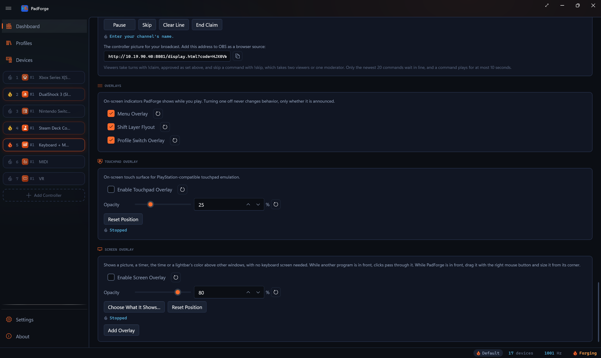

# Screen Overlay

*A window above your game that shows a picture, a timer, the time or a lightbar's color, with no keyboard screen needed.*

A Screen Overlay shows anything a [keyboard screen](keyboard-screens.md) can show, in a borderless window on the PC's own display. It needs no keyboard screen, opens no device and runs with **Drive Keyboard Screens** off. Up to eight overlays run at once, each with its own window and its own choice of what to show.

<!-- SCREENSHOT: dashboard-screen-overlay -->

---

## The card

The [Dashboard](dashboard.md#screen-overlay)'s **Screen Overlay** card starts with one overlay, off. The overlay windows show while the input engine runs.

| Control | What it does |
|---|---|
| **Enable Screen Overlay** | Shows the overlay's window. Off by default. |
| **Opacity** | How opaque the overlay's content is, 0 to 100%, 80% by default. The outline and grip that show while you arrange it keep theirs. |
| **Choose What It Shows…** | Opens the overlay's dialog, below. |
| **Reset Position** | Centers the overlay on the monitor it was last on. |
| **Remove** | Removes this overlay. Shown only while the card holds more than one. |
| **Add Overlay** | Adds an overlay, up to eight. |

Under each overlay a flame and a line show whether its window is up: **Running** or **Stopped**. A running overlay with nothing to show says why, as **Running, no picture chosen** or **Running, no lightbar color**.

With more than one overlay, each group is titled **Screen Overlay 1**, **Screen Overlay 2** and so on. A new overlay takes the lowest free number, and an overlay keeps its number when another is removed, so a macro that names overlay 3 always reaches the same window.

---

## What an overlay shows

**Choose What It Shows…** opens a dialog with a **Show** box and a preview in the shape of the overlay's window.

| Show | The overlay shows |
|---|---|
| **Off** | Nothing. |
| **Profile Name** | The active profile's name, following each profile switch. |
| **Profile Number** | The active profile's place in the profile list. The Default profile is 0. |
| **Profile Picture** | The active profile's own picture, or its name when it has none. Each profile keeps its own picture. The dialog's **Choose Picture for** button, which names the active profile, sets it, and **Remove Profile Picture** clears it. |
| **Clock** | The time of day. |
| **Play Time** | Hours and minutes since the active profile switched in. A profile tied to a game's program switches in when the game starts, so the count is that session. Under the Default profile it counts from the engine's start. |
| **Chosen Picture** | A picture you choose with **Choose Picture…**, such as a PNG, JPEG, BMP or GIF. |
| **Stopwatch** | The stopwatch the Stopwatch macro starts, pauses and resets, the same one every keyboard screen shows. |
| **Lightbar Color** | The color of the lightbar on the DualShock 4 or DualSense in the slot chosen in the **Slot** box, or with **Lowest Slot with a Color**, the lowest slot that has one. This is the default. |

Text is white on a black field, as large as the window holds, on as many lines as the words need. A picture scales up or down until it touches the window's edges, with its proportions and its transparency kept, so the parts of a PNG with no color show what is underneath. A lightbar color fills the window. Until a color has reached a lightbar, a **Lightbar Color** overlay shows nothing.

A **Chosen Picture** has a **Zoom** box, 100% by default and up to 2000%. Above 100% the window shows part of the picture, for a map, and **Pan X** and **Pan Y** set which part, in the picture's pixels. The Pan Keyboard Screen Picture macro moves it too, and so does dragging with the left mouse button while PadForge is in front. The pan stops at the picture's edges.

What each overlay shows is one setting per overlay number. Profiles do not change it, apart from each profile's own **Profile Picture**.

---

## Moving and sizing

While PadForge is the window in front, every overlay that is up shows an outline and a grip in its bottom-right corner, and takes the mouse:

- Drag with the right mouse button, or one finger on a touch screen, to move it.
- Drag the grip to size it. An overlay opens at 320 by 240 and goes no smaller than 80 by 60.
- An overlay with nothing to show says so in its middle: *No picture chosen.*, *No DualShock 4 or DualSense lightbar color to show.* or *Nothing to show yet. Choose what it shows on the Dashboard.*

While any other program is in front, the outline and grip go away and clicks pass through the overlay to the program beneath it. The overlay never takes the focus from a game and has no taskbar button. Once a second it goes back above a game that made its own window topmost after the overlay came up. PadForge's own radial menu and flyouts stay above it.

The overlay remembers the monitor you leave it on, and a new overlay opens centered on its monitor, each number a little further down and across than the one before. An overlay whose saved place no monitor shows, such as one on a display that was unplugged, comes back centered on its monitor. The window keeps its left-to-right layout in every language, so the grip stays in the bottom-right corner.

---

## Macros

A macro on any slot reaches the overlays, whether or not their windows are up, and needs neither **Drive Keyboard Screens** nor a Devices row. Each overlay action has an **Overlay** box: **Every Overlay**, or **Screen Overlay 1** to **Screen Overlay 8**. **Every Overlay** means each overlay on the card.

| Action | On an overlay |
|---|---|
| **Toggle Screen Overlay** | Turns the named overlay on or off. With **Every Overlay**, any that is on turns them all off, and none on turns them all on. The window comes up at once, so a macro that turns an overlay on and then shows a picture has the picture up in the same press. Listed under **Layers & Overlays**. |
| **Show Keyboard Screen** | With **Screen** set to **Screen Overlay**: up to eight pictures, a frame time of at least a tenth of a second and a repeat count. Each picture keeps its own shape, up to 800 pixels on its longer side. The pictures play over the overlay's mode, which returns when they end. A repeat count of 0 keeps them until the next Show Keyboard Screen or Keyboard Screen Mode macro. |
| **Keyboard Screen Mode** | With **Screen** set to **Screen Overlay**: switches what the overlay shows and keeps it as its setting. It also ends pictures held by a repeat count of 0. |
| **Pan Keyboard Screen Picture** | Moves a zoomed **Chosen Picture** left, right, up or down by its step, 16 pixels by default. A macro that names one overlay moves that overlay alone. **Every Overlay** also moves the keyboard screens that feed the macro's slot. |
| **Stopwatch** | Starts, pauses or resets the one stopwatch every overlay and keyboard screen shows. |

A show keeps its clock while its window is down, so a window that comes up shows the picture the show has reached. A pan or a mode change made while the window is down is there when it comes back. See [Macros](../guides/macros.md).

---

## Profiles

Each [profile](../guides/profiles.md) keeps the card's overlays: which exist, each one's switch, opacity, monitor, place and size. A profile switch puts up the overlays that profile has on and takes down the rest. A profile saved before 5.3.0 has one overlay, off.

---

## Imported profiles

A reWASD crosshair lives inside reWASD, so the [import](../guides/profile-import.md) cannot bring the crosshair's picture. A button that toggles crosshair 1 to 8 becomes **Toggle Screen Overlay** for the overlay of that number, and reWASD's crosshair command type 120 becomes **Toggle Screen Overlay** for **Every Overlay**. The import reports each one as Partial, *A crosshair lives inside reWASD. Show your own picture with a Screen Overlay.* Give the overlay your own picture with **Choose What It Shows…**. PadForge runs eight overlays, so a button for reWASD's ninth or tenth crosshair is skipped with its own line.

See the technical page, [Keyboard Screens Internals](../reference/keyboard-screens-internals.md#the-screen-overlay).

---

*Last updated for PadForge 5.3.0.*
