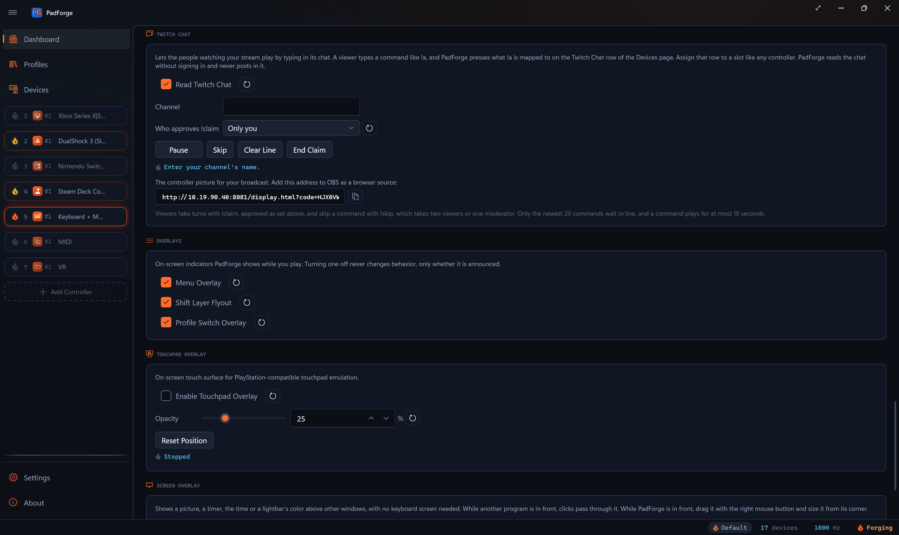
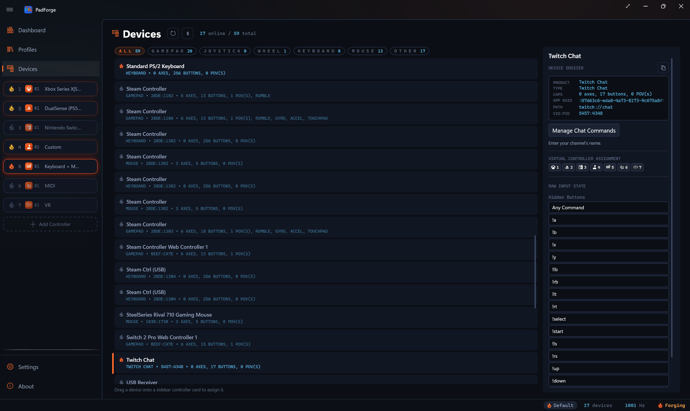
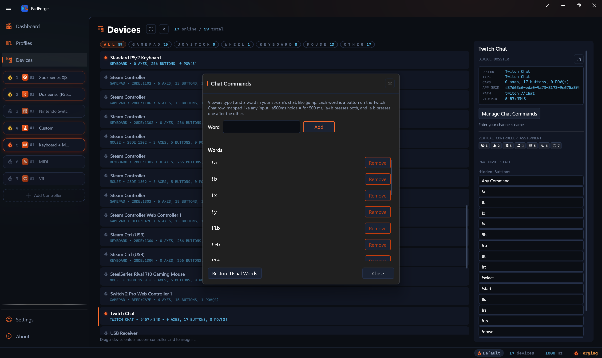

# Twitch Chat

*The people watching your stream play by typing commands in its chat. PadForge reads the chat and presses buttons on a controller slot.*

A viewer types `!a` in your channel's chat. PadForge presses whatever **!a** is mapped to on the **Twitch Chat** row of the [Devices](devices.md) page. The row is a controller like any other: assign it to a [slot](controller-slots.md), and the game sees a virtual controller that chat is pressing.

PadForge reads chat without signing in to Twitch and never posts in it. Nobody needs a bot account, a token or a password.

---

## Turning it on

1. On the [Dashboard](dashboard.md), find the **Twitch Chat** card.
2. Type your channel under **Channel**. The name works, and so does the channel's twitch.tv address. A channel name is 1 to 25 letters, digits and underscores.
3. Check **Read Twitch Chat**. It is off by default.
4. Start the input engine. The row opens only while the engine runs.

<!-- SCREENSHOT: dashboard-twitch-chat -->


The Twitch Chat switch, the channel and **Who approves !claim** belong to this PC. They are not part of any [profile](../guides/profiles.md), so switching profiles never opens or closes the connection.

### The status line

The card and the Twitch Chat row on the Devices page show the same line.

| Line | What it means |
|---|---|
| *Enter your channel's name.* | The switch is on and no channel is set. The row still opens, so you can map its buttons before you have a channel. |
| *Connecting to `<channel>`'s chat…* | PadForge is reaching Twitch. |
| *Reading `<channel>`'s chat.* | Joined. Commands play. The card's flame is lit. |
| *Could not reach `<channel>`'s chat. Trying again.* | The connection failed or dropped. PadForge retries after 1 second, then 2, then 4, up to 30 seconds between tries, and starts over once a connection joins. |
| *Twitch has no chat for `<channel>`. Check the channel's name.* | The channel does not exist or is suspended. PadForge asks again each minute. |
| *Paused.* | Added after any line above while you have chat control paused. |
| *Stopped* | The switch is off, the engine is stopped, or the row has not opened yet. |

---

## The Twitch Chat row

With **Read Twitch Chat** on, a **Twitch Chat** row appears on the Devices page. Its buttons are the command words. Button **Any Command** is held down for as long as any command plays, whatever it says. Every other button is named for its word, such as **!a** or **!jump**.

<!-- SCREENSHOT: devices-twitch-chat -->


Assign the row to a slot the way you assign any controller. The default mapping puts each preset word where its name says: **!a** on A, **!lt** on the left trigger, **!up** on D-pad up, and so on. A trigger word presses the trigger all the way. A preset word you removed binds nothing, and a word you added is mapped by hand. On a Nintendo slot the four direction words land on the D-pad, and the face words land by position, so **!a**, the south word, is Switch B.

Map the buttons in [Button and Axis Mappings](mappings.md) or use them as [macro](../guides/macros.md) triggers, the same as any other input. **Any Command** is a button too.

---

## Manage Chat Commands

On the Twitch Chat row, **Manage Chat Commands** opens the **Chat Commands** window.

<!-- SCREENSHOT: twitch-chat-commands -->


Type a word under **Word** and click **Add**, or press Enter. Each word in the **Words** list has a **Remove** button. **Restore Usual Words** adds back any of the preset words you removed: a, b, x, y, lb, rb, lt, rt, select, start, ls, rs, up, down, left and right. Home and the touchpad are not preset, so a viewer cannot open a system overlay. Add them yourself if you want them.

A word has these limits:

- 1 to 20 letters and digits, starting with a letter.
- It cannot end in a time such as `2s` or `500ms`, which chat reads as how long to hold.
- It cannot be `claim`, `accept`, `release`, `skip` or `skipall`. Taking turns uses those.
- The list holds at most 128 words.

Words are lowercase. `!Jump` and `!jump` are the same word.

Each word keeps its button for good. Removing a word leaves a gap, and a new word takes the lowest free button, so your mappings never shift. Removing a word clears every mapping that read its button, including in saved profiles, so a new word on that button starts clean. The list is saved in `PadForge.xml`, one list for every profile.

---

## What viewers type

A message counts when it starts with `!`, or with a reply's `@name` and then `!`. Anything else in chat is ignored.

| Chat | What happens |
|---|---|
| `!a` | Presses A for 200 ms. |
| `!a500ms` or `!a1.5s` | Holds A for that long. |
| `!a+b` | Presses A and B together. |
| `!a b` | Presses A, then B. |
| `!up up right` | Three presses in order. |
| `!_a` | Holds A until released or until the command ends. |
| `!_a #1s -a` | Holds A, waits one second, releases A. |
| `!#500ms` | Pauses for 500 ms. |
| `!a500ms+b500ms` | Holds both for 500 ms. |
| `![a b]*3` | Repeats the group three times. |
| `![a+b]500ms` | Gives each press in the group a 500 ms hold. |

The window's own hint reads: *Viewers type ! and a word in your stream's chat, like !jump. Each word is a button on the Twitch Chat row, mapped like any input. !a500ms holds A for 500 ms, !a+b presses both, and !a b presses one after the other.*

The grammar comes from Yuriy's ForgePlay. These limits are PadForge's:

- A command plays for at most 10 seconds, waits and gaps included.
- A command has at most 50 steps, repeats included.
- Groups nest at most 4 deep, and an empty group is refused.
- A message is at most 500 characters.
- A button stays up for 50 ms before its next press, so two presses of one button read as two.

A command that breaks a limit, or uses a word you have not added, does not play at all. Nothing is partly played and nothing is said in chat.

### The line

Commands play one at a time, in the order they arrive. Only the newest 20 wait. When a 21st arrives, the oldest drops.

---

## Taking turns

By default everyone's commands play together. A viewer can ask for sole control for five minutes.

| Chat | What it does |
|---|---|
| `!claim` | Asks for control. The request waits 60 seconds, and up to five requests wait at once. |
| `!claim status` | Shows who has control, or who is waiting. |
| `!accept @name` | Approves that viewer's request. |
| `!claim @name` | From someone who can approve, grants control at once, with no request needed. Under the two-viewer choice below, a viewer's `!claim @name` counts as one approval, like `!accept @name`. |
| `!release` | Ends your own control. |
| `!release @name` | A moderator ends someone else's control. |
| `!skip` | Stops the command that is playing. It takes two viewers within 30 seconds, or one moderator. |
| `!skipall` | The same, and clears the line too. |

**Who approves !claim** on the Dashboard card decides who can grant control:

| Choice | Who approves |
|---|---|
| **Only you** | You, as the broadcaster. Viewers' approvals count for nothing. This is the default. |
| **You and your moderators** | You or any moderator. |
| **You, your moderators or two other viewers** | You, a moderator, or two other viewers, none of them the one asking. |

The two-viewer choice has a weakness: two viewers can be one person with spare accounts. That is why the default is **Only you**.

While a viewer holds control, only their commands and moderators' commands play. Granting control drops everyone else's waiting commands, and stops the command playing if it came from someone else. Moderators' commands stay. Control ends after five minutes, on `!release`, or when you click **End Claim**.

A moderator's `!skip` needs no second vote, and a broadcaster counts as a moderator. `!skip` does nothing while no command is playing.

---

## Controls on the card

These buttons act on the open row at once. They are grayed out while the row is closed.

| Button | What it does |
|---|---|
| **Pause** | Stops the command playing, clears the line, and ignores chat until you click **Resume**. A pause is not saved, so PadForge starts unpaused. |
| **Skip** | Stops the command playing. The next one in line starts. |
| **Clear Line** | Drops the commands waiting. The one playing finishes. |
| **End Claim** | Ends the sole control a viewer took with `!claim`. |

---

## The controller picture for OBS

The card can show the controller on your broadcast: the slot's controller drawn with the [web controller's](../guides/web-controller.md) art, lit from the slot's live output, with a panel under it that says who is playing, what is next in line, who has control and the latest turn notice.

Below the status line the card shows an address. Add it to OBS as a **Browser** source. **Copy** puts it on the clipboard.

It is an address on the Web Controller's [plain HTTP address](../guides/web-controller.md#plain-http-address), with its access code at the end:

```
http://192.168.1.100:8081/display.html?code=7KQ2M9XH4P
```

Use that address and not the main one. The main address uses a self-signed certificate, and OBS's browser source refuses a page whose certificate it does not trust.

If the plain address is off, the card shows no address and says so instead: turn on **Also Serve Plain HTTP** in the **Web Controller** card. **This PC Only** is enough when OBS runs on this PC.

The page has a transparent background and sends nothing. It watches the first slot the Twitch Chat row is assigned to, or the slot PadForge shows first when none is. To pick one, add `&slot=2` to the address, numbered as PadForge shows slots. `&layout=` draws another controller and `&finish=` another finish. At most four of these pages connect at once.

The panel says *Type a command like !a in chat to play.* while idle, names each command as it plays, and lists the next five. Turn notices stay up for 15 seconds. Because PadForge never posts in chat, these notices are the only place a viewer's `!claim` or `!skip` gets an answer. Read them aloud, or keep the picture on screen.

---

## Limits

- PadForge never posts in chat, so chat gets no confirmation of anything.
- Chat is public. Anyone in the channel can type a command, and a viewer with several accounts counts as several viewers.
- The turn notices are in English only.
- A sender counts as a moderator when Twitch flags the message as a moderator's. The channel's own account always counts.

See [Twitch Chat Internals](../reference/twitch-chat-internals.md) for how the connection and the parser work.

---

*Last updated for PadForge 5.3.0.*
