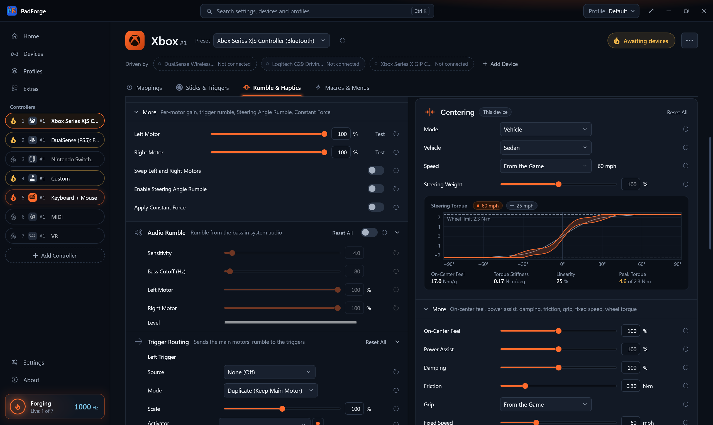
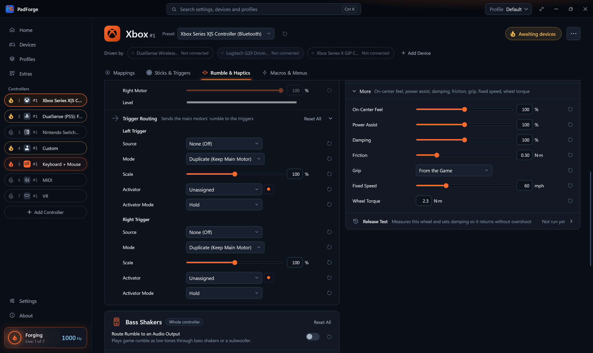
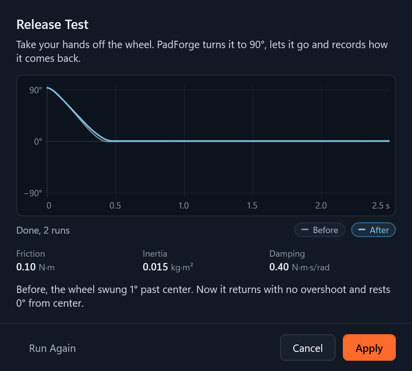

# Wheel Centering

*What brings a force feedback wheel back to center: a plain spring at one strength, or the torque a car's steering gives at its speed, computed from a published tire model.*

The **Centering** card sits in the **Rumble & Haptics** section of a controller's page, after the [Wheel](wheel.md) card. Its settings belong to the wheel picked in the **Driven by** row of the controller's header, so the card's chip reads **This device**. Two wheels on one controller keep their own centering.

No wheel has run wheel centering yet. Every stability result and every Release Test result on this page comes from a simulated wheel. The forces rest on the Linux wheel drivers PadForge's writers follow (new-lg4ff, hid-fanatecff, hid-tmff2) and on the tests. Read [Limits](#limits) before you rely on it.

---

## Which wheels get the card

| Wheel | What the card offers |
|---|---|
| A Logitech, Fanatec or Thrustmaster wheel that PadForge drives with its own writer (the list on [Wheel](wheel.md#supported-wheels)) | Both modes. The card shows from the wheel's saved IDs, so it stays while the wheel is unplugged. |
| A wheel routed through SDL that reports itself as a wheel, and whose driver lists a constant force | Both modes, while the wheel is connected. |
| A wheel routed through SDL whose driver lists a spring and no constant force | Spring mode alone. The **Mode** row is hidden. |

A wheel routed through SDL shows the card without the Wheel card above it, since rotation range and the shift lights need the maker's own commands.

---

## Mode

| Choice | What it does |
|---|---|
| **Spring** | The wheel's own spring at one strength, set by **Auto Centering Strength** (0–100%, default 0%). 0% leaves centering to the game. This is the slider the Wheel tab had before PadForge 6. |
| **Vehicle** | The torque a car's steering puts on the rim, worked out each poll from the car, its speed and the road's grip. |

On a wheel whose driver lists no spring, the first choice reads **Off** in place of **Spring**, since there is no spring for it to hold. The default is Spring, with the slider at 0%.

---

## Vehicle mode

These rows show while Mode is Vehicle. Each has its own reset.

| Setting | Range | Default | What it does |
|---|---|---|---|
| Vehicle | Sedan, Compact, Van, Race Car, Stanford X1 | Sedan | The car whose steering the wheel takes. Each is a published vehicle model. The sources are on [Wheel Centering Internals](../reference/wheel-centering-internals.md#the-cars). |
| Speed | From the Game, Fixed | From the Game | From the Game reads the car’s speed from the game’s telemetry, and uses Fixed Speed while no game sends one. Fixed uses Fixed Speed at all times. |
| Steering Weight | 0–200% | 100% | How heavy the steering is. 100% is the car’s own. |
| Wheel Range | 40–2520° | 900° | How far this wheel turns from lock to lock. Shows only where PadForge does not set the range: on a wheel routed through SDL, and on a Logitech, Fanatec or Thrustmaster wheel with **Set Rotation Range** off. Set it to the wheel's own setting. Elsewhere the model works in the range the Wheel card sends. |

The figure after the Speed picker is the speed the model runs at now, in miles or kilometers an hour. It takes the live color while a game sends it.

### The status line

A line under the rows says what holds the force back, when something does:

| Line | When |
|---|---|
| *Wheel Torque is not set for this wheel, so its forces are held low. Enter it under More.* | The wheel is on no maker's list and no figure was entered. |
| *The wheel started to swing by itself, so the force is held back. Run the Release Test.* | The oscillation guard has cut the force from the PC. |
| *The force is off because the wheel kept swinging or ran from center. Run the Release Test.* | The force from the PC has stopped. Setting Mode again, or running the Release Test, starts it afresh. |

### Steering Torque

The chart draws the torque at the rim against the wheel's angle, out to 90° each side, or to the lock on a wheel that turns less. The car at the speed in use is a band: the torque with friction added above it and taken off below it, so the band's height at center is the friction you feel there. A second line is the same car at 25 mph (40 km/h). Dashes mark the most the wheel gives, labeled *Wheel limit {0} N·m*. While Vehicle mode runs on the wheel, a mark rides the curve where the wheel stands, and **Angle** and **Torque** read out over the chart.

Four measures sit under the chart. Each comes from the weave test of ISO 13674-1, as the model's paper states them, read off the steady curve.

| Measure | Unit | What it says |
|---|---|---|
| On-Center Feel | N·m/g | How fast the torque builds with cornering near center, up to 0.05 g. More feels more planted. |
| Torque Stiffness | N·m/deg | How fast the torque builds as the wheel leaves center. |
| Linearity | % | The torque’s slope between 0.10 and 0.15 g against its slope at center. Lower means the steering goes light sooner. |
| Peak Torque | N·m, "of" the wheel's figure | The most torque the car asks of the wheel, beside the most the wheel gives. It turns gold when the car asks more than the wheel has, and the top of the curve is cut off. |

A measure reads – where the car never reaches what it needs inside the wheel's lock.

### More

| Setting | Range | Default | What it does |
|---|---|---|---|
| On-Center Feel | 0–200% | 100% | How strongly the steering holds its center at low speed. 100% is the car’s own. |
| Power Assist | 0–200% | 100% | How much the power steering takes off as cornering builds. More is lighter steering away from center. |
| Damping | 0–200% | 100% | How strongly the wheel resists quick turns. 100% is what brings it back without swinging past center. |
| Friction | 0–1.50 N·m | 0.30 N·m | A steady drag that resists turning either way. Hidden on a wheel with no friction effect, where PadForge sends it no friction. |
| Grip | From the Game, Dry, Wet, Snow, Ice | From the Game | The road’s grip. The steering goes light where the front tires run out of it. From the Game reads the surface the game reports and falls back to Dry where the game sends none. |
| Fixed Speed | 0–200 mph or 0–320 km/h | 60 mph or 100 km/h | The speed the car is taken to drive at when Speed is Fixed, and while no game sends one. |
| Wheel Torque | 0–50.0 N·m | the maker's figure, or 25.0 N·m | The most torque this wheel gives. Every torque the model asks for is a share of this figure. |

Speeds read in miles an hour where the Windows region's measures are not metric, and in the United Kingdom. Everywhere else they read in kilometers an hour. PadForge reads the region once, when it starts.

PadForge fills in Wheel Torque from the maker's published figure:

| Wheel | Wheel Torque |
|---|---|
| Logitech G29, G920 and G923 | 2.3 N·m |
| Fanatec CSL DD, Gran Turismo DD Pro and ClubSport DD (one product ID for all three) | 15.0 N·m |
| Fanatec ClubSport V2.5 | 8.0 N·m |
| Fanatec Podium DD1 | 20.0 N·m |
| Fanatec Podium DD2 | 25.0 N·m |

Any other wheel starts at 25.0 N·m. A figure above the wheel's own makes every force weaker, never stronger, so a wheel that is not listed starts weak, and the status line asks for its figure. A CSL DD gives 5 N·m, or 8 with the Boost Kit 180, so enter its own figure to get its full force. Typing the listed figure clears the entry, and the wheel follows the list again.

---

## How the force comes in

Vehicle mode waits for the wheel to come to rest: within 5° of one place for 0.3 seconds. Then the force from the PC comes in over one second. A wheel turns itself from lock to lock when it powers on, and a driver may be steering when the mode turns on, so the force never meets a wheel already moving. The wait starts again when the mode turns on, when the wheel connects, when the engine starts, and after a Release Test.

Friction and damping run in the wheel's own firmware, and PadForge sets them from the first poll. The car's torque curve is a constant force PadForge sets each poll. Once the Release Test has measured the wheel's own spring, that spring carries the steep part of the curve near center and the PC adds the rest.

While Vehicle mode runs, the wheel's own centering spring from Spring mode rests, so the two never add. A game's own force adds to the centering force:

- **Logitech**: the game's constant force and the centering force share the wheel's first force slot. While a game plays its own spring, damper or friction effect, which takes that slot, the centering force moves to the fourth slot and Friction rests.
- **Fanatec**: a game's spring, damper or friction takes that kind's slot on the base while it plays, and centering's own effect of that kind rests until it ends. The centering force stays in the constant force slot beside the game's effect.
- **Thrustmaster**: centering has effects of its own beside the game's, and the wheel adds them.
- **A wheel routed through SDL**: centering's effects are made ahead of the game's force and rumble. A wheel whose driver holds one effect gives it to centering, and the game's force and rumble wait.

A wheel on another PC over [Remote Link](../guides/remote-link.md) gets Vehicle mode when it is a Logitech, Fanatec or Thrustmaster wheel. A wheel routed through SDL on another PC gets no centering.

---

## The Release Test

The **Release Test** row at the foot of the card opens the test's window. The row reads **Not run yet** or **Measured**. The test measures what no wheel driver states and Vehicle mode needs, then sets the damping so the wheel returns to center without swinging past it. Its idea is the steering-release test of ISO 17288-1: turn the wheel, let go, record the return.

1. Assign the wheel to a controller and start the engine. The test needs the wheel's force feedback pass. Without it the window says *This wheel is not in use. Assign it to a controller and start the engine, then run the test.*
2. Take your hands off the wheel. Click **Start**. The window reads *Measuring, {0}%* while it runs.
3. The wheel moves on its own. PadForge pushes it gently to find its friction, inertia and loop delay, tries its damper and its spring at set strengths, then turns it to the release angle and lets it go twice: once as it centered before the test, once with the new measurement.
4. The chart draws the two returns, **Before** and **After**, over 2.5 seconds each. Three figures show under it: **Friction** in N·m, **Inertia** in kg·m² and **Damping** in N·m·s/rad. A sentence says how far the wheel swung past center before and how far it swings now.
5. Click **Apply** to keep the measurement, or **Run Again**. **Cancel** or closing the window keeps nothing.

The release angle is 90°, or 60% of the way to the lock on a wheel that turns less than 300°. The window names it before the test starts.

The measurement belongs to the wheel's device record, so it follows the wheel to every controller. **Reset All** on the Centering card leaves it alone. Changing Wheel Torque later rescales it.

**Stop** ends a running test, and so does closing the window. After a test that ended or stopped, Vehicle mode waits for the wheel to come to rest and comes in again over a second.

A test that cannot finish says why:

| Line | What to do |
|---|---|
| *The wheel did not come to rest. Take your hands off it and run the test again.* | The wheel moved for 3 seconds before a step. |
| *The wheel did not move. If Wheel Torque is set above what the wheel gives, set it to the wheel’s own figure and run the test again.* | No push up to the test's limit moved the wheel. |
| *The wheel came close to the end of its range. Center it and run the test again.* | The wheel passed 92% of the way to its lock. |
| *The wheel’s motion could not be read. Run the test again.* | The numbers measured are not a wheel's. |
| *The wheel stopped answering. Check that it is connected and that the engine is running.* | The wheel left, or the engine stopped, during the test. |

---

## Limits

- No wheel has run wheel centering. Every stability result and every Release Test result comes from a simulated wheel. A constant force in a Logitech wheel's fourth slot has run on no wheel either.
- Thrustmaster publishes no torque figure for the wheels PadForge drives. A Thrustmaster wheel starts at 25.0 N·m, so its forces are weak until you enter the wheel's own figure.
- A wheel on another PC over Remote Link gets centering only when it is a Logitech, Fanatec or Thrustmaster wheel.
- The Codemasters games that send the flat format (DiRT and GRID) and the OutGauge games (BeamNG.drive and Live for Speed) send no surface, so Grip set to From the Game uses Dry there. A game with no telemetry uses Fixed Speed.
- The force comes in only once the wheel has been at rest for 0.3 seconds, then over one second.
- The runaway stop has one false trip: a wheel at rest more than 3° off center when the force starts, then turned farther out by hand at over 200° a second within 1.3 seconds. Setting Mode again, or running the Release Test, clears it.
- On a Logitech wheel, a game's own spring, damper or friction effect takes the first slot. While it plays, the centering force is a constant force in the fourth slot and Friction rests.
- On a Fanatec base, Spring mode's slider and Vehicle mode's spring use the base's one spring slot, which belongs to whichever mode is on.
- The Release Test keeps no loop delay under 10 ms on a wheel whose step crossed fewer than 150 counts of its steering axis. A 15° step on a 900° wheel crosses 68 counts of a 12-bit axis.
- The model is steady cornering, read from the wheel's angle, the speed and the grip. Road texture and curbs come from the game's own force, which adds to the centering force.

---

## Related pages

- [Wheel](wheel.md): rotation range, RPM shift LEDs and the game's force feedback on Logitech, Fanatec and Thrustmaster wheels.
- [Wheel Centering Internals](../reference/wheel-centering-internals.md): the model, the cars and every source, the stability rule and the Release Test's steps.
- [Game Telemetry](game-telemetry.md): the games whose speed and road surface reach Vehicle mode.
- [Force Feedback](force-feedback.md): gain, rumble and the generic force feedback path.
- [Remote Link](../guides/remote-link.md): drive a wheel plugged into another PC.

---

*Last updated for PadForge 6.0.0.*
