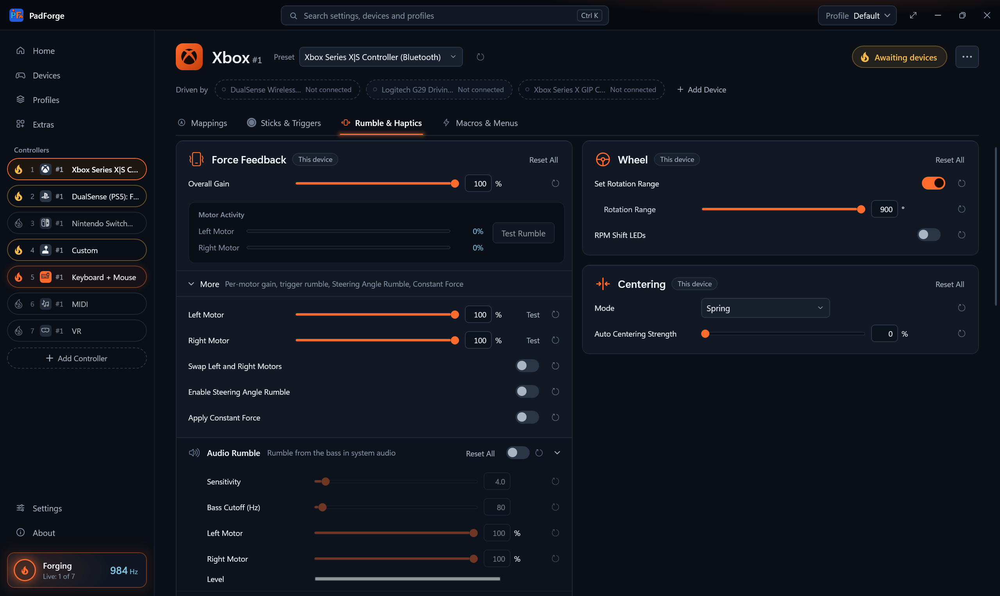

# Wheel

*Native force feedback for Logitech, Fanatec, and Thrustmaster wheels, plus rotation range and RPM shift LEDs on the Wheel card, and centering on the Centering card beside it.*

The **Wheel** card sits in the **Rumble & Haptics** section of a controller's page when the device picked in the **Driven by** row of the controller's header is a supported Logitech, Fanatec, or Thrustmaster wheel. Its settings belong to that device, so its chip reads **This device**. Pick a different wheel in the Driven by row and the card follows it.

The **Centering** card follows the Wheel card. It holds Spring mode, the Auto Centering Strength slider that was on the Wheel tab before PadForge 6, and Vehicle mode, which gives the wheel the torque a car's steering gives at its speed. It has a page of its own: [Wheel Centering](wheel-centering.md).

For a wheel PadForge does not recognize by model, force feedback still runs through the [Force Feedback](force-feedback.md) pipeline. When PadForge reads that wheel as a driving device and its driver lists a centering spring or a constant force, the section shows the Centering card alone, including for wheelbase-and-pedals composites that report more than one force-feedback axis. The Wheel card stays hidden, since rotation range and RPM LEDs need the maker's own commands. A generic wheel with neither effect gets no wheel cards at all.

---

## What "native" means here

Most mappers route a wheel's force feedback through the generic DirectInput or SDL haptic path. PadForge does that too for unrecognized wheels. For the models listed below it does something more direct: it speaks each vendor's own HID protocol, the same one the vendor's driver speaks.

The forces still come from the game. PadForge does not invent them. The game writes standard force-feedback effects to an [Extended virtual controller](controller-slots.md) (the output slot a wheel needs), PadForge decodes those effects, and the Wheel pipeline re-encodes them into the wheel's native commands. The result is constant force and the condition effects (spring, damper, friction) delivered in the form the wheel firmware understands, rather than collapsed into plain rumble. Vehicle mode on the Centering card is the one force PadForge computes itself, and it adds to the game's.

Logitech and Fanatec wheels need no vendor software. PadForge talks to them directly, whether or not Logitech G Hub or the Fanatec driver is installed.

Thrustmaster is the exception. A T-series wheel powers on in a boot mode and switches to the mode PadForge drives only after Thrustmaster's own driver is installed. Keep the Thrustmaster driver in place. Without it, PadForge does not recognize the wheel as a Thrustmaster, and it falls back to the generic path with no native rotation range or RPM LEDs.

---

## The Wheel card

Three settings, each with a reset button.

| Setting | Range | Default | What it does |
|---|---|---|---|
| Set Rotation Range | On / Off | On | Sends the wheel the Rotation Range below. Off leaves the range to the wheel and its own software. |
| Rotation Range | the wheel's own range, from 40° to 2520° | 900° | Degrees of lock-to-lock rotation. The slider spans the range the wheel turns, listed below. |
| RPM Shift LEDs | On / Off | Off | Lights the rev LEDs on the wheel rim or base from live sim telemetry. |

### Rotation Range

The slider stops at the selected wheel's own limits, so the angle it shows is the angle the wheel turns. A saved range outside those limits loads as the nearer one. A wheel with a fixed range shows that one angle.

To set the range in the wheel maker's own software instead, such as Thrustmaster's control panel or a Fanatec base's tuning menu, clear **Set Rotation Range**. PadForge then sends the wheel no range at all, and the slider rests. Clearing it does not undo a range PadForge already sent, so set the range in the wheel's own software afterward. On a Fanatec base the range command is also what switches off the base's own centering spring, so with Set Rotation Range off the base keeps its own centering too. With it off, Vehicle mode on the Centering card shows a **Wheel Range** row, since it needs to know the range the wheel turns. Each wheel keeps its own setting, and a wheel on another PC through the [Remote Link](../guides/remote-link.md) follows the setting of the PC that maps it.

| Wheel | Range |
|---|---|
| Logitech G29, G923, G27, G25, Driving Force GT, Driving Force Pro | 40–900° |
| Logitech MOMO Racing, MOMO Force, Driving Force | 270°, fixed |
| Logitech WingMan Formula Force GP | 180°, fixed |
| Fanatec CSL Elite | 90–1080° |
| Fanatec ClubSport V2 and V2.5, CSR Elite, Porsche 911 GT3 RS | 90–900° |
| Fanatec CSL DD, DD Pro, ClubSport DD, Podium DD1 and DD2 | 90–2520° |
| Thrustmaster T300RS, T-GT II, TS-PC Racer, TS-XW | 40–1080° |
| Thrustmaster T248 | 180–900° |
| Thrustmaster TX | 140–900° |

### Auto centering

Spring mode on the Centering card is a steady centering spring that pulls the wheel back to straight, at the strength **Auto Centering Strength** sets. It is useful for a wheel mapped to an Xbox or PlayStation slot in a game that cannot send DirectInput forces of its own, so the wheel would otherwise have no centering at all. On Logitech and Thrustmaster this is a firmware command. On Fanatec it is a software spring PadForge re-sends with each constant-force update, because Fanatec bases expose no firmware auto centering. See [Wheel Centering](wheel-centering.md) for both modes.

### RPM shift LEDs

When RPM shift LEDs are on and a supported racing game is running, PadForge reads the game's telemetry and lights the wheel's rev LEDs in step with engine RPM. The LED count follows the wheel: 5 on Logitech, 9 on Fanatec, 15 on Thrustmaster.

Telemetry comes from the game, so the LEDs only light for titles PadForge can read: Assetto Corsa and Competizione, the Codemasters F1 22 to F1 25, DiRT, and GRID games, Forza, iRacing, Automobilista 1 and 2, Project CARS 2 and 3, rFactor 1 and 2, Le Mans Ultimate, RaceRoom, the SCS trucks (Euro Truck Simulator 2, American Truck Simulator), BeamNG.drive, and Live for Speed. Other games leave the LEDs dark.

The games that send over the network send to fixed ports here: Forza's Data Out to 5300, F1 and the Codemasters games to 20777, and BeamNG.drive's and Live for Speed's OutGauge to 4444. Assetto Corsa, Assetto Corsa Competizione, iRacing and RaceRoom need nothing set. Automobilista 2 and Project CARS 2 and 3 need their shared memory turned on in the Project CARS 2 format (in Automobilista 2, Options, System, Shared Memory). The rest read a plugin installed in the game: rFactor 2 and Le Mans Ultimate need rF2SharedMemoryMapPlugin, the SCS trucks need RenCloud's scs-sdk-plugin, and rFactor 1 and Automobilista 1 need rFactorSharedMemoryMap.

While [Game Telemetry](game-telemetry.md) listens, the LEDs read the game from its row instead, on whatever port it listens on. That adds EA SPORTS WRC and any custom format, and lets Forza and OutGauge send to a port of your choice. A game that sends no max RPM, such as BeamNG.drive or Euro Truck Simulator 2 through its UDP plugin, lights the LEDs against the highest RPM seen, and the strip reads true once the engine has revved out. When scs-sdk-plugin is installed too, its truck max RPM comes first.

The same telemetry gives Vehicle mode the car's speed and the road's surface. See [Wheel Centering](wheel-centering.md).

---

## Force-feedback effects by vendor

The game decides which effects to send. What reaches the wheel depends on what the firmware can render natively.

| Effect | Logitech | Fanatec | Thrustmaster |
|---|---|---|---|
| Constant force | native | native | native |
| Spring | native | native | native |
| Damper | native | native | native |
| Friction | native on G27 / G25 / DFGT / DFP, else damper | native | as damper |
| Inertia | as damper | native | as damper |
| Periodic (sine, square, triangle, sawtooth) | host-sampled into constant force | host-sampled into constant force | firmware-rendered |
| Auto centering (Spring mode) | firmware spring | software spring | firmware spring |

Thrustmaster wheels have an onboard periodic generator. Logitech and Fanatec do not, so a periodic effect is sampled each frame and sent as a moving constant force, which feels the same at PadForge's polling rate.

Overall force strength is set by the gain controls on the [Force Feedback](force-feedback.md) card. The Wheel card does not duplicate them.

---

## Supported wheels

Other models from these brands, and wheels from other brands, still get force feedback through the generic [Force Feedback](force-feedback.md) path. They do not get the native rotation range, RPM LEDs, or firmware auto centering.

### Logitech

G29 (PS3/PC and PS4 variants), G923 (PlayStation/PC variant), G27, G25, Driving Force GT, Driving Force Pro, Driving Force, MOMO Racing, MOMO Force, WingMan Formula Force GP.

A G29, G27, G25, Driving Force GT or Driving Force Pro that arrives in its Driving Force compatibility mode, and a G923 that arrives in its PlayStation mode, is told to switch to its native mode as it connects, the way the Linux driver new-lg4ff does. The wheel drops off and comes back as its own model, with its full range. Until then, and on a Driving Force itself, PadForge drives it as a Driving Force: 270° and no range command. A wheel in any other mode of its own stays where it was put. No wheel has run this switch yet.

The **G920** and the **Xbox G923** use a different protocol and run through the generic path, as does the **RS50**.

### Fanatec

Wheel bases: CSL Elite (and PS4 variant), CSL DD, DD Pro, ClubSport DD, ClubSport V2 and V2.5, Podium DD1 and DD2, CSR Elite, Porsche 911 GT3 RS. ClubSport V3, CSL Elite, CSL Loadcell, and CSL LC V2 pedals get pedal rumble.

Pedal rumble runs when the game sends rumble to the slot the pedals feed. The low-frequency rumble motor buzzes the brake pedal. The high-frequency motor buzzes the throttle. It needs no setting on the Wheel card.

### Thrustmaster

T300RS (PS3, PS4, and GT variants, plus the advanced and Ferrari F1 modes), T-GT II, T248, TX, TS-XW, TS-PC Racer.

The **T150** uses a separate protocol and runs through the generic path.

---

### Moza and other standard-PID wheels

Moza wheelbases (R3, R5, R9, R12, R16/R21, both generations) speak the standard USB PID force-feedback protocol rather than a proprietary one, so they ride the generic path by design. There is no Moza driver to add, and that is not a gap: the same is true of Cammus, VRS, Asetek, and PXN bases. What the generic path gives them is game force feedback plus the Centering card: Spring mode where the driver lists a spring, and Vehicle mode where it lists a constant force. What it cannot give them is vendor-specific rotation range or RPM LEDs, which have no standard command.

### Rumble plays on top of the centering spring on the generic path

On a wheel driven through the generic path, Spring mode's centering spring has an effect of its own beside the main one, so rumble, audio rumble and haptics play on top of it. The game's own force-feedback effects and Constant Force still take the wheel from the spring: while either plays, the spring lets go, and it comes back the moment they stop. A wheel whose driver holds only one effect keeps the old order. The centering spring keeps that effect and rumble waits. PadForge learns which kind of wheel it has the first time the spring and rumble meet, and writes a `HAPTICDIAG` line to the log. Logitech, Fanatec, and Thrustmaster wheels keep centering as a separate firmware or software spring, so Constant Force and auto centering can run together there. If you want the wheel to pull toward center in games without force feedback, the Centering card is the tool. If you want a fixed lean, Constant Force is.

---

## Over Remote Link

A supported wheel plugged into another PC and shared over [Remote Link](../guides/remote-link.md) keeps the whole native pipeline. The PC running the game decodes the game's force-feedback effects exactly as it does for a local wheel. Instead of writing to the wheel, it ships the steering parameters across the link: constant force, the condition effects, the periodic waveform, rotation range, auto centering, Vehicle mode's centering, and the RPM LED state. The wheel's PC re-encodes them with its own vendor writer, so the wheel firmware receives the same commands a local wheel would.

- The Wheel and Centering cards appear on the PC running the game, as they do for a local wheel, and their settings apply across the link.
- Telemetry for the RPM shift LEDs and for Vehicle mode is read on the game PC, where the sim runs. Only the resolved LED pattern and the centering frame cross the link.
- Fanatec pedal rumble crosses the link too.
- The Thrustmaster driver requirement follows the wheel: install it on the PC the wheel is plugged into.
- A wheel outside the supported list is driven through its DirectInput haptic effects over the link, with rumble as the last fallback. It gets no centering from the other PC.

---

## Setup

1. Plug in the wheel and create an **Extended** output [slot](controller-slots.md) so the game can send DirectInput force feedback.
2. Drag the wheel onto the slot from the [Devices](devices.md) page.
3. Open the controller's **Rumble & Haptics** section. On the **Wheel** card, set the rotation range to match the game (most circuit racers want 540–900°, rally and drift want more).
4. On the **Centering** card, leave Spring mode at 0% unless the game sends no centering force of its own, or pick Vehicle mode and run the Release Test. See [Wheel Centering](wheel-centering.md).
5. Turn on RPM shift LEDs if you run one of the supported sim titles.

---

## Tips

- **Match the rotation range to the car.** A formula car wants a small range. A truck or drift car wants a large one. Setting the wheel wider than the game expects makes the steering feel slow.
- **Use an Extended slot, not Xbox or PlayStation,** so the game can send real force feedback. An Xbox slot only carries rumble.
- **Leave Spring mode at 0% when the game centers the wheel.** When the game sends its own centering spring, a second spring from PadForge fights it.

---

## Related pages

- [Wheel Centering](wheel-centering.md): Spring mode, Vehicle mode and the Release Test.
- [Force Feedback](force-feedback.md): where the force-feedback effects, gain, and the generic-wheel path are documented.
- [Remote Link](../guides/remote-link.md): drive a wheel plugged into another PC.
- [Steering](../guides/steering.md): turn a stick or controller tilt into a steering axis. A different feature from a real wheel.
- [Controller Slots](controller-slots.md): create the Extended slot a wheel needs for force feedback.
- [Devices](devices.md): assign the wheel and check that PadForge recognizes the model.
- [Trigger Deadzones](trigger-deadzones.md): pedal axis floor, ceiling, and curve.
- [Troubleshooting](../troubleshooting.md): help when a wheel has no force feedback.

---

*Last updated for PadForge 6.0.0.*
