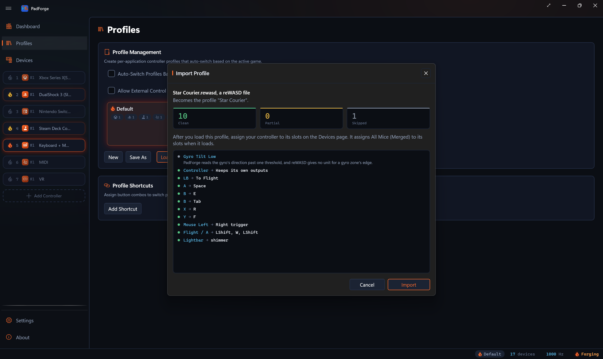

# Import from reWASD and DS4Windows

*Turn a reWASD `.rewasd` config or a DS4Windows profile `.xml` into an ordinary PadForge profile, after a preview of what came across.*

PadForge reads both tools' files directly. You pick or drop the file, a preview lists every binding with its status, and **Import** adds the result to your profile list as a new profile. Nothing runs and nothing changes until you click **Import**, and the profile you have loaded stays loaded.

---

## Open a file

Two ways in, both on the **Profiles** page:

- **Import…** opens a file dialog. Its first filter, **Profiles**, shows `.pfprofile`, `.rewasd` and `.xml` files together. The other filters narrow it to PadForge profiles, reWASD, DS4Windows, or all files.
- Drag the file from Explorer onto the profile list. The dashed **Drop to Import Profile** overlay appears while a `.pfprofile`, `.rewasd` or `.xml` file is over it. Dropping several files imports each one in turn.

The dialog adds the two tools' profile folders to its places pane when they exist on this PC:

| Tool | Folder |
|---|---|
| reWASD | `C:\Users\Public\Documents\reWASD\Profiles` (the shared Documents folder) |
| DS4Windows | `%APPDATA%\DS4Windows\Profiles` (the per-user install) |

A DS4Windows build that keeps its profiles beside its own executable is not added. Browse to its `Profiles` folder yourself.

PadForge decides what a file is from its contents, never from the extension. A file that opens with `{` is read as reWASD JSON. An XML file has to have a `DS4Windows` root element. Anything else is refused, and the status bar says why:

| Status bar | When |
|---|---|
| "PadForge could not read that file." | The file is missing or locked. |
| "That file is too large to be a profile." | It is over 16 MB, or a reWASD file holds more than 64 shifts, more than 5000 entries in one table, or an input set of more than four inputs. |
| "That file is not a PadForge, reWASD or DS4Windows profile." | It is neither tool's format, or its contents are malformed. |
| "That file declares a document type, which a profile never needs, so PadForge did not read it." | The XML carries a DTD. |
| "That file is not in the reWASD format PadForge reads, schema 3." | A reWASD file whose `schemaVersion` is not 3. |

---

## The preview

<!-- SCREENSHOT: import-preview -->

The **Import Profile** window opens over the Profiles page. From the top:

- The file and its tool: "Star Courier.rewasd, a reWASD file".
- The name it lands under: 'Becomes the profile "Star Courier".' A name that is taken gets a number, and the preview shows the numbered name.
- Three counts, **Clean**, **Partial** and **Skipped**.
- A note on what the profile does when it loads and what you still have to do. It names every program the profile's buttons run and every program it starts on load, before you accept anything.
- One row per binding: a status dot, the source, an arrow, and what it became. **Skipped** rows come first, then **Partial**, then **Clean**, each group in the file's own order. A **Skipped** or **Partial** row carries its reason in full under it.

| Status | Meaning |
|---|---|
| **Clean** | The binding came across with the same behavior. |
| **Partial** | It came across with a stated difference, or it needs one step from you. The reason says which. |
| **Skipped** | It did not come across. The reason says why. |

**Clean** describes the translation. It is not a play test, so test the actions you need.

The note can say:

| Note | Meaning |
|---|---|
| "It starts this program when it loads: …" | A DS4Windows `LaunchProgram`. It runs each time the profile loads. |
| "Its buttons run these when pressed: …" | Programs and power commands (log off, shut down, sleep, hibernate, restart) the profile's buttons run, DS4Windows Program special actions included. |
| "After you load this profile, assign your controller to its slots on the Devices page." | Something reads the controller. The import does not pick one for you. |
| "It assigns All Keyboards (Merged) and All Mice (Merged) to its slots when it loads." | Keyboard and mouse inputs read the merged rows, which the profile assigns itself. |
| "This file maps nothing PadForge can use." | No slot came out of it. **Import** is unavailable. |

---

## Import

Click **Import** to add the profile, or **Cancel** to close the preview without adding anything. The status bar confirms the result: "Imported 'Star Courier': 10 clean, 0 partial, 1 skipped".

Import adds a new profile and does not load it. Your active profile stays as it was. Select the new one and click **Load**, or let auto-switch pick it up. From then on it is an ordinary profile: edit it, export it, or delete it like any other.

### What the profile holds

- **Slots.** One controller slot per virtual controller the file uses, then one **Keyboard + Mouse** slot when anything sends keys or mouse. A reWASD Xbox 360 pad becomes an Xbox 360 slot, Xbox One over Bluetooth an Xbox One S slot, DualShock 4 and DualShock 3 the PlayStation presets of the same name, and Switch Pro a Nintendo slot. A DS4Windows profile whose output is DS4 gets a DualShock 4 slot, any other an Xbox 360 slot, and a `DinputOnly` profile gets no controller slot.
- **Devices.** Keyboard and mouse inputs read **All Keyboards (Merged)** and **All Mice (Merged)**, so they work the moment the profile loads, on any PC. Assign your controller to the controller slots on the [Devices](../features/devices.md) page.
- **Games.** reWASD's process names become the profile's executables. For DS4Windows, every program in `Auto Profiles.xml` (one folder above `Profiles`) that names this profile for a controller becomes one.
- **The name.** reWASD's app name, else its comment, else "Game - Config" when the file sits in reWASD's own `Profiles\Game\Controller` folder, else the file name. DS4Windows profiles keep their file name.
- **Tuning.** Stick and trigger curves, motor strength, the gyro dead zone, the touchpad's glide and the battery light's colors apply to the controller you assign, unless that controller already has its own setting.

---

## From reWASD

| reWASD | In PadForge |
|---|---|
| A key, button or stick held to a held output | A [mapping row](../features/mappings.md). Outputs a row cannot carry (media keys, the Windows key, F13 and up, a partial stick value) ride a macro beside it. |
| Single, double, triple and long press, start and release | [Macros](macros.md) on **On Press**, **On Double Press**, **On Triple Press**, **On Long Press** and **On Release**, with the file's own wait times. A single beside a double or triple is **On Single Press**, and beside a long press **On Short Press**, so one button keeps all its gestures. |
| Repeat, turbo and toggle | A repeating macro, **Turbo**, and latches that flip on each press. A toggled sequence loops until the next press. |
| Shifts | [Shift layers](shift-layers.md) under the shift's own name. A shift's own button is a **Hold** or **Toggle** activator. Jumps that hold or toggle carry their delay, double-press window and release edge. Any other jump is a **Switch Layer** macro. |
| Do Not Inherit | The layer stops reading Base for those controls. |
| Unlock shifts | The layer hands the keyboard, the mouse or both back to Windows. |
| Unmaps | Requests for **Consume Mapped Inputs (Hooks)** on the device. A key that no row reads gets an empty macro that holds it back. |
| Radial menus | Radial [menus](menus.md) on the layer that opens them. A sub-menu's sectors join the main ring. |
| Mouse regions | A **Limit Mouse Region** macro held while the button is down. |
| Program and power commands | **Run Program**, named in the preview. |
| Other commands | Toggle virtual controllers, toggle the window, disconnect, gyro on, off and toggle, gyro recenter, Win + Print Screen, Alt + F4. Crosshair commands 1 to 8 become **Toggle Screen Overlay** on overlays 1 to 8, and the crosshair command for every crosshair (type 120) becomes **Toggle Screen Overlay** on **Every Overlay** ([Screen Overlay](../features/screen-overlay.md)). |
| Lightbar | Per layer: a solid color, or the rainbow, breath, heartbeat, stroboscope and shimmer patterns, played by an **Always** macro. |
| Gyro | Gyro mode reads roll and pitch, Tilt mode reads lean. Gyro to a stick on a PlayStation or Nintendo slot drives that slot's motion. |
| Use for UDP server | The profile turns on the DSU motion server while it is loaded. |
| Stick zones and direction zones | Bounded reads at the file's own zone edges. |

## From DS4Windows

| DS4Windows | In PadForge |
|---|---|
| A control with no entry | Sends its own output, the way DS4Windows' default does. Each listed control replaces its own row. |
| Button, key and macro assignments | Mapping rows, or macros for macros, toggled keys and moments such as a touch start. **HoldMacro** and **RepeatMacro** repeat while held. |
| Extras | Rumble and a lightbar color while the control is held. |
| Lightbar macros | A color sequence on the control's press or release. |
| Shift modifiers (`ShiftControl`) | One **Hold** layer per trigger, named "Shift" and the trigger. |
| Special actions | Read from `Actions.xml` one folder above `Profiles`: programs, profile switches (a **Profile Shortcut** action), macros, keys, Bluetooth disconnect, multi-actions (tap, hold past 500 ms, double tap), Xbox Game DVR, gyro calibration and wheel calibration. |
| Gyro output modes | Mouse, Mouse Joystick, Passthru on a DS4 output, Controls and Directional Swipe, each with its engage button and toggle. |
| Touchpad output modes | Mouse with its click regions, Absolute Mouse, Mouse Joystick and Passthru. Trackball mode becomes touchpad **Momentum**. PS + touch toggles the movement, as in DS4Windows. |
| Lightbar | A solid color, the rainbow at its speed and brightness, or the battery light from its low to full color. |
| Trigger effects | Rigid, Full Click and Pulse as adaptive trigger effects. |
| Two-stage triggers | Soft and full pulls in the same mode. |
| Steering wheel emulation | The controller's lean on the named axis. |
| Rumble boost below 100 and the idle disconnect | The motor strength and idle disconnect time. |

---

## What reads Partial or Skipped

The reasons below are condensed from the preview's text, which names the control, setting or device each time. Partial rows came across with that difference. Skipped rows did not come across.

| Status | Reason in the preview | What to do |
|---|---|---|
| Partial | reWASD stopped these inputs reaching Windows. Turn on Consume Mapped Inputs for the device on the Devices page. | Turn on **Consume Mapped Inputs (Hooks)** for the keyboard or mouse. |
| Partial | In reWASD, a mapped key still reaches Windows because the file maps it without an unmap. With Consume Mapped Inputs on, PadForge holds it back. | Leave the switch off if the game needs that key too. |
| Partial | reWASD hid this controller from games. | Turn on **Hide from Games (HidHide)** for it on the Devices page. |
| Partial | reWASD stopped mouse movement reaching Windows. PadForge holds back keys and mouse buttons but not movement. | The pointer still moves. |
| Partial | This file keeps two controllers apart. In PadForge, any controller on the slot fires these mappings. | Use one controller per slot. |
| Partial | reWASD sent this controller to another device through an adapter. | PadForge plays it on this PC. Remote Link sends it to another PC running PadForge. |
| Partial | Nothing in this file opens this layer. | Give the layer a button on the Mappings tab. |
| Partial | Its sub-menus became more slots on one ring. | None. Every action is still on the ring. |
| Partial | The radial menu commits when the stick re-centers or the layer ends. reWASD's Apply button is not used. | None. |
| Partial | A crosshair lives inside reWASD. | The button toggles a Screen Overlay. Give that overlay your own picture. |
| Partial | The movement speed or flick did not come across. | Set the speed on the slot. |
| Partial | PadForge reads Gyro Left and Right from roll and Lean from yaw, reWASD's default. The file does not record whether reWASD's Preferences swapped them. | Swap the rows if your reWASD did. |
| Partial | A touchpad diagonal is two directions at once, which the touchpad reports only with D-Pad Mode on 8-Way. | Set D-Pad Mode to 8-Way on the Touchpad tab. |
| Partial | The layers tune a stick or trigger differently, so each keeps its own tuning, and the curve comes across as the nearest power curve. | None. |
| Partial | DS4Windows came back to this profile from another one on a button. | Add a **Profile Shortcut** for this profile on the Profiles page. |
| Partial | DS4Windows placed the pointer where the stick points. In PadForge the stick moves the pointer. | None. |
| Partial | A stick direction reads the stick before its rotation, or before its zones and curve. DS4Windows read it after. | None. |
| Partial | DS4Windows shapes a radial stick, or the gyro dead zone, by the angle of the push. | A straight push plays the same. A diagonal one differs. |
| Partial | Scroll, tap or an absolute region on the touchpad did not come across. | Set them on the Touchpad tab. |
| Partial or Skipped | This setting did not come across, followed by its name. | Covers settings with no published unit or counterpart: reWASD's report rate, virtual USB hub, extended inputs, macro time unit and some stick and mouse settings, and DS4Windows' extra gyro buttons beyond the first, the touchpad's Release button mode, rotation and threshold, the gyro mouse threshold, the gyro stick's maximum output and other entries. |
| Skipped | PadForge reads the gyro's direction past one threshold, and reWASD gives no unit for a gyro zone's edge. | Map the gyro on the Mappings tab. |
| Skipped | In Tilt mode, reWASD's Lean is a turn around the vertical axis, and a motion sensor gives no angle for that turn. | None. |
| Skipped | An Xbox virtual controller has no motion. | Pick a PlayStation or Nintendo controller type to send motion. |
| Skipped | PadForge reads two sticks, and this names a third. | None. |
| Skipped | PadForge runs eight Screen Overlays, and this is reWASD's ninth or tenth crosshair. | None. |
| Skipped | Crosshair pictures, stick jitter and shaking, analog key actuation points. | None. |
| Skipped | A macro cannot press the touchpad click. A mapping on the Mappings tab can. | Map it as a row. |
| Skipped | Steering wheel emulation on an axis PadForge does not know. | Map the wheel on the Mappings tab. |
| Skipped | PadForge has no such setting, followed by its name. | DS4Windows' rumble auto-stop, mouse acceleration, button-to-mouse speed, stick fuzz, square stick, anti-snapback, delta acceleration, low-battery flash and charging light. |
| Skipped | A special action is missing from `Actions.xml` beside the Profiles folder. | Copy `Actions.xml` along with the profile and import again. |
| Skipped | An unknown input, output, command or controller button. | The row names it. |

---

## Related pages

- [Profiles](profiles.md): the Import button, the drop zone and the profile list.
- [Switching from Another Tool](switching.md): moving one game at a time, with a way back.
- [Shift Layers](shift-layers.md), [Macros](macros.md) and [Menus](menus.md): where the layers, press types and radial menus land.
- [Devices](../features/devices.md): assign your controller, and the **Consume Mapped Inputs (Hooks)** and **Hide from Games (HidHide)** switches.
- [Profile Import Internals](../reference/profile-import-internals.md): how the importers work.

---

*Last updated for PadForge 5.3.0.*
