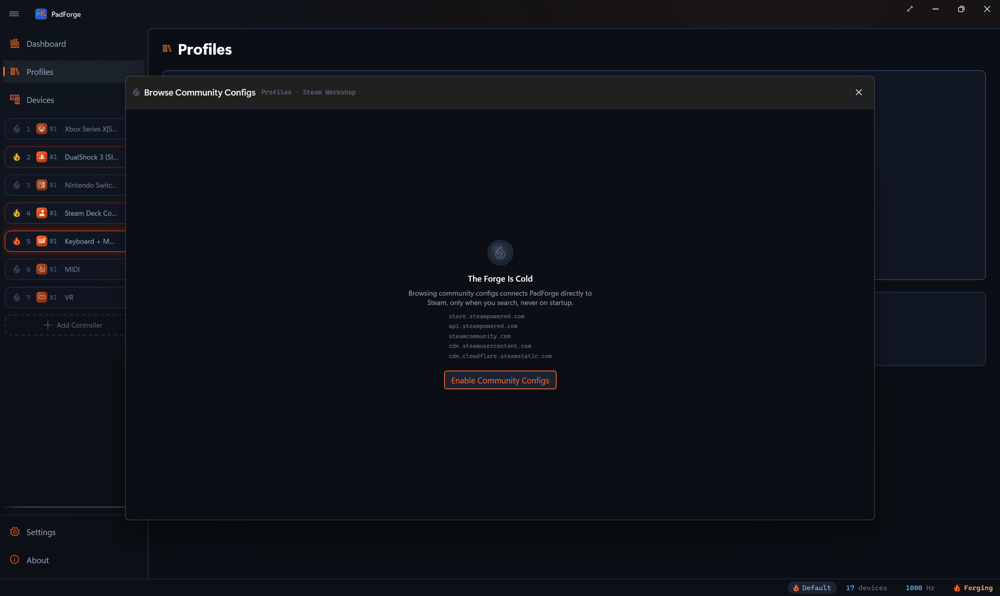
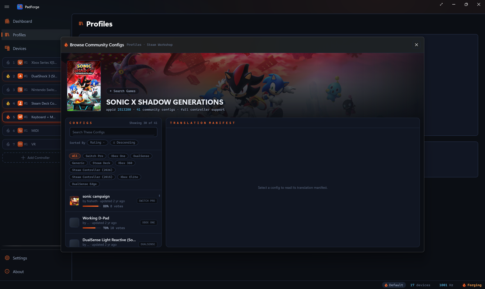
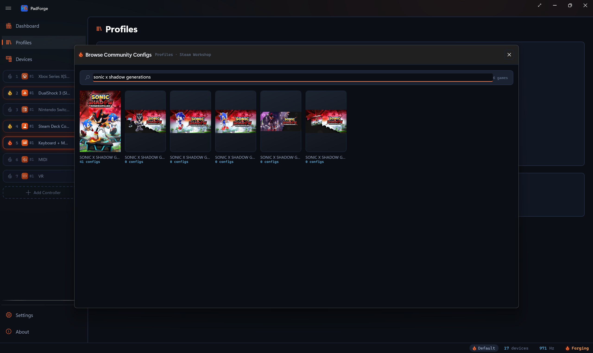
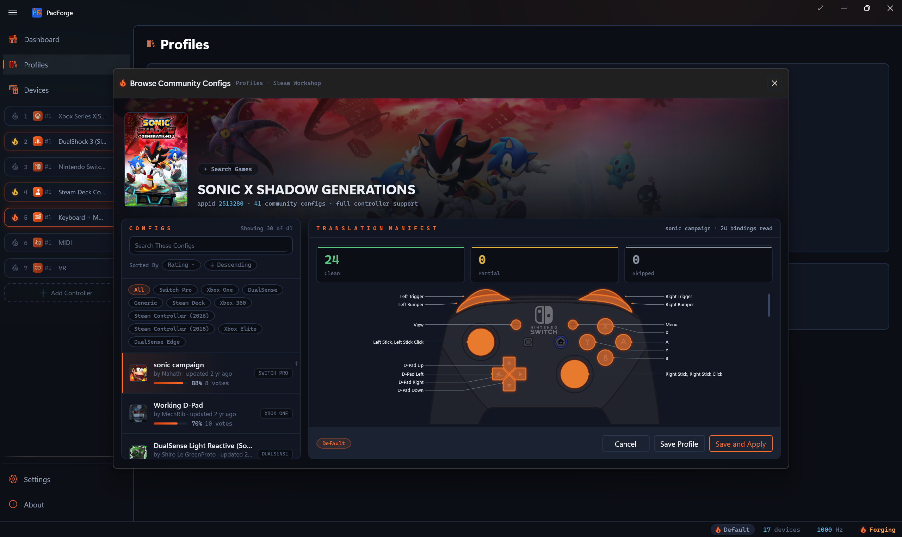
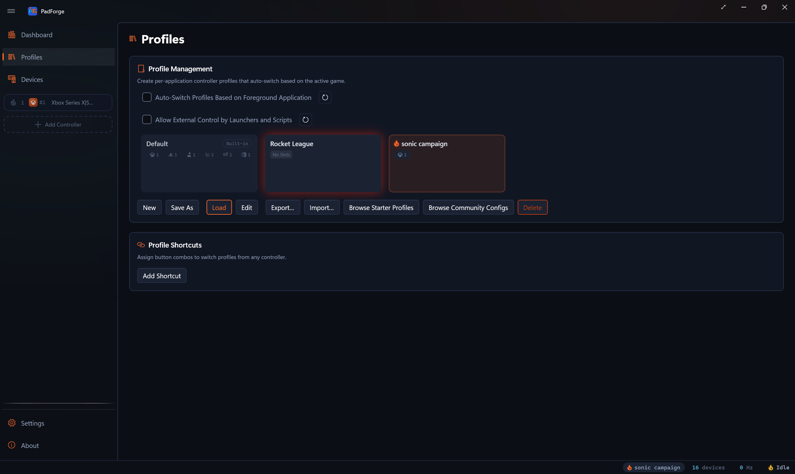

# Steam Workshop Config Import

*Browse community-made Steam Input controller configs for any game, read a per-binding translation manifest, and save the result as a ready-to-use PadForge profile.*

<!-- SCREENSHOT: workshop-browse (capture post-deploy: Browse Community Configs dialog, game open, config cards and translation manifest visible) -->

Steam Workshop holds years of community controller layouts built in Steam Input. PadForge reads those configs straight from Steam and translates them into its own mappings, shift layers, macros, and on-screen menus. Nothing applies blind. A manifest shows what became of the config's bindings before you save anything.

<figure class="pf-video">
<video controls playsinline preload="none" width="1920" height="1080"
       poster="/assets/video/padforge-tutorial-steam-workshop-import-poster.jpg"
       aria-label="Video: a Steam Workshop layout imported, recorded live in PadForge 5.2.0">
<source src="/assets/video/padforge-tutorial-steam-workshop-import.mp4" type="video/mp4">
<track kind="captions" srclang="en" label="English" src="/assets/video/padforge-tutorial-steam-workshop-import.vtt" default>
</video>
<figcaption>Community Configs turned on, an Elden Ring config found and opened, its manifest read and saved as a profile, recorded live in PadForge 5.2.0 in 1 minute 1 second. The narration is a generated voice, with English captions. <a href="/assets/video/padforge-tutorial-steam-workshop-import-transcript.txt">Read the transcript</a>.</figcaption>
</figure>

---

## Turn it on

The feature is off by default. PadForge sends nothing to Steam until you enable it.

1. Open **Settings** and find the **Community Configs** card.
2. Check **Enable Community Configs**.

What the toggle allows, exactly:

- PadForge connects directly to Steam, and only when you act: searching for a game, opening a game's config list, opening one config, or clicking the update check. Never at startup, never in the background.
- The servers contacted are all Steam's own: `store.steampowered.com` (game search), `api.steampowered.com` (Steam's server directory and the update check), the Steam connection servers that directory names (config lists and their details, over an anonymous session), `steamcommunity.com` (creator names), `cdn.steamusercontent.com` (the config files), `cdn.cloudflare.steamstatic.com` (game artwork), and Steam's avatar servers, such as `avatars.fastly.steamstatic.com` (creator avatars). Steam's own data names the config-file and avatar hosts.
- PadForge sends your search text, the ids of the games, configs and creators involved (for the update check, the ids of the configs you imported), and its own version number. The anonymous Steam logon also sends the OS type, a language, and a machine id built from SHA-1 hashes of the Windows machine GUID, the MAC addresses of the physical network adapters, and the boot disk serial. No Steam sign-in, no Steam account needed, no telemetry, no third-party service.

The card carries three more controls:

| Control | What it does |
|---|---|
| **Show Legacy Workshop Configs** | Lists configs from before 2017 too. Those have no downloadable file on Steam's servers, so PadForge marks them with a **LEGACY** badge and reads them through Steam instead. See [Legacy configs](#legacy-configs). |
| **Clear Cached Configs** | Empties the local cache of search results, config files, and artwork. See [The cache](#the-cache). |
| **Check Imported Profiles for Updates** | Asks Steam whether any config you imported has been updated since. See [Check for updates](#check-for-updates). |

See [Settings](../features/settings.md) for the card in context.

---

## Browse configs

Open the **Profiles** page and click **Browse Community Configs**. The button is always there. If Community Configs is still off, the dialog opens on an unlit "The Forge Is Cold" panel that names the Steam servers involved and offers the **Enable Community Configs** step right in place.

### Find the game

Type at least two characters into **Search Games**. The search runs half a second after you stop typing and shows the top matches with their cover art and a config count per game. Click a game (or press Enter for the first match) to open its config list.

### Read the config cards

The game's configs list ranked by rating. A filter row above the list carries an **All** chip plus one chip per controller type found in the first 30 configs Steam returns (Steam Deck, Steam Controller, DualSense, and so on). Click a chip to narrow the list to configs built for that controller.

**Sorted By** re-orders the list by Rating, Trending, Newest, Subscribers, or Most Votes. Steam returns every order in descending rank, so **Ascending** reverses only the configs already loaded, not the game's whole list. **Search These Configs** asks Steam for configs whose title matches that text, so it searches the game's whole Workshop list rather than only the configs already loaded. The search runs 0.42 seconds after you stop typing, or on Enter. Escape clears it.

Each card shows:

| Element | Meaning |
|---|---|
| Title and creator | The config's Workshop title, the creator's Steam name and avatar, and when it was last updated ("by Kaz · updated 3 mo ago"). |
| Vote bar | The share of positive votes, as a filled bar plus a percentage and the total vote count. A full bar means everyone who voted, voted up. It is a quality signal, not a popularity count. |
| Subscriber count | How many Steam users subscribed to the config ("12k subscribers"), shown only when Steam reports at least one. This is the popularity count. |
| Controller chips | Which controller the config was built for. Steam Deck chips render in a colder color. |
| **LEGACY** badge | A pre-2017 config with no downloadable file. Only shown when **Show Legacy Workshop Configs** is on. |

---

## The translation manifest

Click a card and PadForge downloads the config, translates it, and fills the manifest pane. Three stat blocks summarize the run:

| Stat | Meaning |
|---|---|
| **Clean** | The binding is fully expressed in PadForge terms with matching behavior. |
| **Partial** | The binding is expressed, but with a documented behavioral difference, or it needs one step from you before it works. The row's reason says which. |
| **Skipped** | The binding is not expressed. The row's reason says why. |

Below the stats, a drawing of the controller lights the inputs the config binds. Under it comes one row per binding, grouped by the physical control it came from (Left Trackpad, Face Buttons, Gyro, and so on). Each row shows a status dot, the source, the target, and a reason for anything that is not a plain translation.

Real examples of each status:

- **Clean**: "Touchpad 1 Click → Left Click". A clean row shows source and target only, with no reason text. The pad-passthrough part of the config (A stays A, bumpers stay bumpers, sticks stay sticks) appears the same way, one row per output: every binding becomes an explicit mapping row, including the ones that match the automap defaults, and the implicit analog passthroughs (a matched stick, a matched trigger pull) get explicit rows of their own whenever another binding lands on the Xbox pad. A radial menu, touch menu, or hotbar becomes an on-screen menu row, and a macro riding a paddle, touchpad, or gyro trigger becomes a macro row, both counted as Clean.
- **Partial**: "circular scroll wheel approximated as a vertical drag" (a touchpad scratch wheel becomes a linear finger drag), or "camera reset approximated as a gyro recenter" (PadForge re-references its own gyro aim state, the equivalent state it owns).
- **Skipped**: "12 in-game actions, Steam-only, no game-side hook" (bindings that call the game's own action API, which only Steam can deliver), or "player-number change is a Steam-client action, no equivalent".

### Preset chips

Steam Input configs can carry several action sets (Default, Driving, Menu, and so on). Each appears as a chip in the manifest footer, all included by default. Click a chip to leave that set out, and the manifest re-translates live without it. Included sets beyond the first become [Shift Layers](shift-layers.md) in the imported profile.

---

## Import

Two buttons finish the job:

| Button | What it does |
|---|---|
| **Save Profile** | Saves the translated profile to your [Profiles](profiles.md) grid. |
| **Save and Apply** | Saves it and loads it immediately. |

Imports always create a new profile. If the name is taken, PadForge appends a number. The status bar confirms the result: "Imported 'Skyrim DS4': 31 clean, 4 partial, 2 skipped".

### What an imported profile looks like

The profile carries only the virtual controllers the config actually drives. A config that mixes both natures gets two pads, a pure keyboard/mouse layout gets a single Keyboard + Mouse pad, and a plain controller passthrough gets a single Xbox pad:

| Pad | Type | Gets | When it exists |
|---|---|---|---|
| First | **Xbox** | Every controller-shaped output, remapped (a paddle acting as A, a crossed trigger, a swapped stick) or plain passthrough (A stays A, a matched stick or trigger pull). Plain bindings become explicit mapping rows. Turbo, long-press, double-press, and release bindings become macros instead. | The config binds any controller output, switches to a layer that holds controller rows or macros, or carries a macro that reads this pad's output or writes a virtual-controller button or axis (turbo, toggle, hold). |
| Next | **Keyboard + Mouse** | Every plain key, mouse button, mouse move, and scroll binding, including flick stick and absolute-pointer rows. | The config binds a plain key or mouse output, or it has no controller-shaped output at all and still carries a macro or an on-screen menu (something has to host them). |

All created pads read the same physical controller. Radial menus, touch menus, and hotbars land on every created pad, so they follow whichever pad the game reads. The one exception is the keyboard menu that Steam's Show Keyboard becomes: it goes on a single pad, the Xbox pad when the import made one.

Imported mapping tables are **authoritative**: they spell out the whole layout, so assigning a controller to an imported pad adds no automap rows on top. Your pad drives exactly what the config authored, nothing doubled. That holds for every pad whose imported table has rows. A pad whose table came out empty (a layout of macros only) runs the controller's default mapping instead, and its macros read that output.

Where everything lands:

- **Mappings** go into each pad's [Button and Axis Mappings](../features/mappings.md) table. They use device-portable **Gamepad** sources ("Gamepad A", "Gamepad Left Stick X"), so they work on any recognized controller without rework. Imported rows name no device, so their device column reads **(Any Device)** and each row follows whichever controller the slot holds.
- **Action sets and layers** become [Shift Layers](shift-layers.md): hold-style mode shifts become Hold layers, add-layer commands become Toggle layers, and set-switch buttons become layer jumps or cycles.
- **Radial menus, touch menus, and hotbars** become on-screen [Menus](menus.md) with the config's cell labels, fire mode, and screen placement. See [Menus](#menus) below for the defaults they take.
- **Cursor warps, key autofire, turbo, toggles, long presses, double presses, haptic pulses, and lighting commands** become [Macros](macros.md). A double-press activator rides the macro's **On Double Press** fire mode with the config's press window, except on a touchpad, where it reads the pad's double-tap gesture. A macro bound to a standard pad button triggers from the Xbox pad's combined output. A macro bound to a paddle, touchpad, or gyro triggers straight from the physical device, no pad button needed.
- **Flick stick** groups, hosted on a stick or a touchpad, become the [flick stick](../features/stick-deadzones.md#flick-stick) source on the Keyboard + Mouse pad, with the config's Dots per 360° carried over.
- **Mouse regions on a touchpad** become the absolute [Touchpad Pointer](../features/touchpad.md#absolute-pointer) sources, so the cursor warps to your finger inside the config's region.
- **PlayStation touchpad halves** map onto the left and right halves of the single DS4 or DualSense pad.
- **Per-group sensitivity** from the config carries over as per-source Sensitivity on the affected rows, including per-row touchpad mouse sensitivity.

### After the import

1. **Assign your controller.** The imported profile ships with no device assignments, so its Gamepad sources wait for whichever pad you give each slot. Assign your physical controller to every pad the import created.
2. **Attach the game.** Select the profile, click **Edit**, and add the game's executable with **Browse...**. With **Auto-Switch Profiles Based on Foreground Application** checked on the Profiles page (it starts off), PadForge then loads the profile whenever the game gains focus, like any other profile.
3. **Hide the physical pad if needed.** If the game sees both your real pad and the virtual one, cloak the real pad on the [Devices](../features/devices.md) page.

---

## Legacy configs

Configs uploaded before 2017 predate Steam's config download servers, so PadForge cannot fetch them directly. With **Show Legacy Workshop Configs** on, they appear in the list with a **LEGACY** badge. Click one and PadForge tries two things in order:

1. **Your Steam install.** If you are subscribed to the config in Steam, Steam has already downloaded it, and PadForge reads it from your Steam folder on the spot. The manifest fills like any other config.
2. **A subscribe prompt.** If there is no local copy, the manifest pane explains and offers **Open in Steam Workshop**. Subscribe on the page that opens, let Steam download it, then click another config and back to this one.

The same local-folder fallback also rescues a newer config whose download link has gone dead on Steam's side.

---

## Check for updates

Every imported profile remembers which Workshop config it came from and the config's revision date at import time. **Check Imported Profiles for Updates** on the [Settings](../features/settings.md) Community Configs card compares those against Steam in one query:

- Everything current: the status bar reports "Imported profiles are up to date (3 checked)".
- Something stale: a **Workshop Updates** dialog lists each affected profile and its config, and offers **Browse Community Configs** as the re-import route. Re-importing saves a new profile, so your hand edits to the old one survive.

Two notes on the record-keeping:

- A profile forked with **Save As** counts as your own work. It drops the Workshop link and is never flagged.
- The check needs **Enable Community Configs** on. With the opt-in off, the button reports "Enable Community Configs to check for updates" and touches nothing.

---

## The cache

Everything the browser fetches from Steam lands in a local cache at `%LOCALAPPDATA%\PadForge\SteamWorkshopCache`, so repeat visits are instant and polite to Steam:

- Search results, config metadata, and game details stay fresh for a day. Creator names for a week.
- Config files are kept per revision and never expire on their own.
- Artwork refreshes weekly. When Steam is unreachable, the stale copy still shows, so offline browsing keeps its art.
- The cache is capped: 50 MB for data plus 60 MB for artwork, with the least recently used files evicted first.

**Clear Cached Configs** on the Settings card empties the whole thing. Imported profiles are not part of the cache. They live in your normal PadForge settings and survive a clear.

---

## How Steam's controls read

PadForge reads Steam's modes the way the Steam client reads them, with the client's dead zones, hold-backs, and defaults. Each default below applies when the config does not set the value.

### Menus

- A radial menu on a joystick with no activation style set imports with **Fire Mode** set to **On Touch Release**, Steam's default there. On any other host the default is **On Click**, and a touch menu is **On Click** on every host. A style the config sets is kept.
- A hotbar group imports as a menu with the **Hotbar** style. The bar ends at its last bound cell, and a button count set lower cuts it, to at most 16 cells. It sits at 80 percent of the screen height, 10 percent from the left for a left trackpad, left stick, or D-pad host and 90 percent for any other host, unless the config sets a position.
- The hotbar's four controls, **Show or Hide**, **Previous**, **Next**, and **Fire**, read the host's down, left, right, and up. On a stick, trackpad, or gyro host those are Steam's own D-pad reads with the hotbar's defaults, four 90 degree spans and a dead zone of 20000 of 32767 (about 61 percent), and a layout or dead zone the group sets replaces them. A trackpad direction counts only while the pad is clicked, unless the group turns that off. A D-pad or face-button host leaves the controls empty, so they take the **Opens With** direction: the D-pad's down, left, right, and up, or the buttons A, X, B, and Y by position.
- **Wrap Around** imports off, **Hide After Firing** on, and **Re-Center Each Time** on, Steam's defaults, unless the config sets them. How each **Fire Mode** runs on a hotbar is in [Menus](menus.md#hotbar).
- Steam's Show Keyboard imports as a menu with the **Keyboard** style, opened by the input the Steam binding sat on, on the same layer. A long press, double press, or release activator becomes the matching press on the menu's opener, with the activator's time. See [On-Screen Keyboard](../features/on-screen-keyboard.md).

### D-pad and four-button groups

A D-pad or four-button group on a stick, a trackpad, or the gyro reads the position through Steam's own triggers, so edges and diagonals match Steam.

- The D-pad engages past its dead zone (default 10000 of 32767) plus 1.25 percent and lets go 1.25 percent inside it. Layout 0 is four 90 degree spans. Layout 1, the default, and layout 2 widen each span by the overlap region (default 4000), so a diagonal presses both neighbors. Layout 3 presses a direction once its component passes 20 percent.
- A four-button cell presses within the config's button size (default 18000) of its center, and the center sits at the button distance (default 20000) along the cell's axis.
- Requires Click is on by default for four-button groups and for the D-pad on the left and right trackpads, and off for sticks, the gyro, and the center pad. A config that sets it wins.
- On the gyro, the D-pad reads tilt past the dead zone's angle (dead zone divided by 32767, times 90 degrees) while the gyro is on. A four-button group on the gyro presses a cell past a fixed 22.5 degrees.
- Layout 2 is Steam's analog emulation, which pulses each direction on and off, longer the farther it is pushed. PadForge holds the direction while it is pushed, and the row says so.

### Outer Ring Command

The Outer Ring Command (the edge member) fires in the modes where Steam's class has one: the D-pad, joystick move, joystick mouse, mouse region, and flick stick on a stick or trackpad, plus the trigger's Soft Pull. The joystick modes fire past an edge radius (default 25000 of 32767) with 3 percent hold-back. The D-pad's edge uses the same radius with 10 percent hold-back and takes no click. Flick stick reads its own command radius (20 to 100, default 80). A config that sets the edge to invert fires inside the radius instead. An edge on any other mode never fires in Steam, so it imports as a Skipped row naming an unknown input.

### Triggers and Soft Press

- A trigger's click, the Full Pull, fires at 95 percent of the pull (31128 of 32767), Steam's value for controllers it reads as generic gamepads. The `left_trigger_threshold` and `right_trigger_threshold` members of a switches group fire past 1600 of 32767, about 5 percent.
- A trigger group's edge member is its Soft Pull. It fires past the config's edge radius (default 10000 of 32767) with 7.5 percent hold-back, through the Threshold Trigger Style: Simple, Hair Trigger (the default), Hip Fire with a 40, 70, or 100 ms wait, and Hip Fire Exclusive with a 60 ms wait. With Hip Fire Exclusive and a bound edge, the click and the Soft Pull share one read, and the Soft Pull holds the click off.
- A Soft Press activator reads the one analog value Steam's table gives its input: a trigger's pull for its click or edge, a stick's or side trackpad's component toward a D-pad direction, the position's length for an edge. A side trackpad's click keeps the click. The press passes the activation threshold (default 4096 of 32767) with a 5 percent hold-back, or inside it when the activator inverts, through the Soft Press style (default Simple).
- A Soft Press is canceled as Steam's activator coordinator cancels it: by a pressed Full Press or Chord on the same input, by a fired Hip Fire Exclusive Soft Press beside it, and when the pull passes the next higher Soft Press threshold on the input. A Hip Fire press waits out its window before it fires, and a cancel can drop it during the wait. Setting `interruptable` to 0 turns all three off. The cancels import whole.
- A Soft Press on an input with no analog value, such as a bumper or a face button, never fires in Steam. It imports as Skipped.

### Gyro

- The gyro's on and off buttons carry over: Choose Gyro Button(s), or an older config's single gyro button, with the behavior (on while held, the default, off while held, or toggle) and the any-or-all rule. A config with no gyro button gets Steam's default, the right trackpad touch (the right trackpad or right stick touch on handheld configs). One button that turns the gyro on, or toggles it, becomes the device's gyro engage button. Buttons that turn it off while held become the ratchet. Several buttons, an all-buttons rule, or action sets that differ run as a rule per action set, with no setting of its own to edit.
- The gyro mouse and gyro stick modes read Steam's conversion style: Yaw, Roll, Yaw plus Roll, and Advanced with its angle offset translate whole, and Player Space and World Space set the device's gyro space. Laser Pointer reads yaw and is named. Gyro Natural Sensitivity (default 250) and the Vertical/Horizontal Output Mixer carry onto the rows.
- An older gyro mode's turning axis (yaw, roll, or yaw and roll) imports with Steam's own join: for yaw and roll together, the signed length of the two, or the residual when they oppose and roll is at least yaw. Steam Deck, SteamOS handheld, and Zotac Zone configs default to yaw and roll.
- Rotation reads the `rotation_2` setting. The older `rotation` moves in only for the absolute mouse, the mouse joystick, and flick stick, times 1.5 on a handheld's mouse. An original Steam Controller's trackpads default to 15 degrees on the right and -15 on the left in those modes.
- Joystick move, joystick mouse, and Joystick Camera on the gyro read the controller's tilt as the stick position, with the config's dead zone and outer radius as angles. The gyro deflection mode reads its minimum and maximum angles, power curve, and output range onto the same tilt pair. With a gyro button and Use Relative on, the gyro re-centers each time it turns on.
- Where a gyro group sends its pair follows the `output_joystick` setting: 0 is the left stick and 1 the right. For joystick move, joystick mouse, and Joystick Camera, 2 is the mouse. With no setting, joystick move and Joystick Camera take the input's own side, the mouse joystick and gyro stick take the right stick, and the deflection mode takes the left.
- Steam's gyro mouse, gyro stick, and absolute mouse modes press only the east and west directions, by roll past the outer radius (default 2000 of 32767, of 90 degrees). The north and south members never fire in Steam and import as Skipped.

---

## What does not translate

Steam Input has a few features PadForge does not reproduce, and a few it reproduces with a documented difference. The manifest marks each one below with a reason instead of guessing. Mouse smoothing, the mouse movement threshold, and trackball friction drop without a note.

| Steam Input feature | What happens |
|---|---|
| In-game actions | Skipped. These bindings call the game's own action API, which only Steam can deliver. |
| Steam client actions (system key 0, player number, lizard mode, and the Steam-overlay verbs) | Skipped, with the action named. Three translate instead, without a manifest row: screenshot and system key 1 (the Capture button) tap PrintScreen, and the keyboard popup becomes a **Keyboard** menu, opened by the same input. |
| Circular scrolling (the scroll-wheel mode on a touchpad or stick) | Partial: the circular scratch becomes a vertical drag (the finger on a touchpad, the Y deflection on a stick), and a scroll-wheel list steps forward only. Directional swipes translate whole. |
| Mouse regions on a stick or trigger | Partial: a cursor-clamp macro holds the region while the input is engaged. On a touchpad the region translates Clean as the absolute pointer instead. On the gyro it is Skipped. |
| Menu cell icons | Render when your local Steam client has the icon art. An unrecognized icon reference is named per cell and the cell keeps its text label. App-provided icons (Steam-internal) fall back to text silently. |
| Menus hosted on a surface with no direction read | Skipped, with the host named. Sticks, touchpads, the D-pad, the face diamond, and the gyro all host menus, so only a hand-edited config lands here. |
| Flick stick on a surface with no analog pair | Skipped, with the host named. Sticks and touchpads both carry flick stick. |
| Response curve settings | Partial where one drops, named: output_curve always, and deadzone_shape unless the output is a thumb pair or a stick-hosted mouse (trackpad and gyro mouse rows evaluate per axis, with no pair read). On trackpad and gyro hosts the deadzone radii apply per axis rather than radially, which is also Partial and named. A rotated group also withholds its curve exponent, anti-deadzone, and acceleration. Every other curve, range, and sensitivity setting carries onto its rows, apart from the gyro settings in the next rows. |
| Gyro mouse and gyro stick tuning | Partial, named: the speed dead zone, precision speed, trigger clamp, custom curve, and outer dead zone, and the gyro stick's output range, power curve, speed range, dead zones, and precision. Steam's gyro modes read no stick curve or inner dead zone, so those settings do nothing there. |
| Gyro tilt reference | Partial, named: PadForge measures a tilt pair from the pose the controller rests in when the profile starts and at **Gyro Recenter**. Steam measures roll from the horizon and pitch from a fixed angle, which the row states. A deflection maximum past 90 degrees lands at 90. |
| Output sent where Steam sends nothing | Partial, named: an `output_joystick` value the client routes to neither stick nor the mouse maps nothing, and the row names the value. |
| D-pad analog emulation (layout 2) | Partial, named: Steam pulses each direction on and off, and PadForge holds it while pushed. |
| Soft Press on an input with no analog value | Skipped: Steam never fires it. |
| Gyro-mode D-pad north and south members | Skipped: Steam's gyro mouse, gyro stick, and absolute mouse modes never fire them. |
| Unknown key names | Skipped, named per key. |

Features that skipped in older PadForge versions and translate whole now: double-press activators, long presses on keys (down at the threshold, up on release, matching Steam), turbo on any target including trigger pulls, haptic feedback (a rumble pulse per activation), directional swipes, flick stick on touchpads, and the F13–F24 keys. Re-import a config to pick them up.

---

## Troubleshooting

- **Double input, or the game reacts twice per press.** The imported profile replaces what the Steam config did. It does not need Steam Input running. If Steam Input is still active for the game, both layers fire. Disable Steam Input for that game (Steam > game properties > Controller), or close Steam, and cloak the physical pad on the [Devices](../features/devices.md) page.
- **Steam Is Unreachable.** The dialog could not reach Steam. Check your connection and click **Retry**. Profiles you already imported keep working: they live on this PC. In the manifest pane the same title also heads a config that would not read, and the line under it says why.
- **A config's bindings do nothing in game.** Check that every imported pad has your physical controller assigned, and that the profile is the active one.
- **No Configs for This Game Yet.** Steam Workshop has no community controller configs for that game. You can be the first: build one in Steam, and it appears here. The same panel appears when **Search These Configs** or a filter chip matches nothing, and when every config the game has is legacy while **Show Legacy Workshop Configs** is off.

---

## Related pages

- [Profiles](profiles.md): where imported profiles land, and the Browse Community Configs entry point.
- [Settings](../features/settings.md): the Community Configs card, cache clearing, and the update check.
- [Button and Axis Mappings](../features/mappings.md): the Gamepad sources imported mappings use.
- [Shift Layers](shift-layers.md): what action sets become.
- [Menus](menus.md): what radial menus, touch menus, and hotbars become.
- [Macros](macros.md): what cursor warps, autofire, toggles, and long presses become.
- [Profile Import](profile-import.md): the reWASD and DS4Windows import.
- [On-Screen Keyboard](../features/on-screen-keyboard.md): what Steam's Show Keyboard becomes.
- [Devices](../features/devices.md): assign your controller to the imported pads, and cloak it from games.

---

*Last updated for PadForge 5.3.0.*
