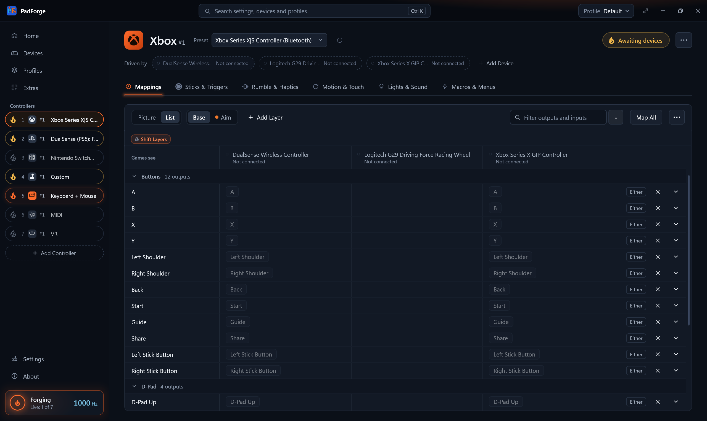

# A Five-Minute Remap

*Change what a button does: the walkthrough swaps A and B, and the same
moves cover any rebind you will ever make.*

You need a virtual controller with a physical pad assigned to it. That is
[Your First Controller](first-controller.md).

<figure class="pf-video">
<video controls playsinline preload="none" width="1920" height="1080"
       poster="/assets/video/padforge-tutorial-five-minute-remap-poster.jpg"
       aria-label="Video: a five-minute remap, recorded live in PadForge 5.2.0">
<source src="/assets/video/padforge-tutorial-five-minute-remap.mp4" type="video/mp4">
<track kind="captions" srclang="en" label="English" src="/assets/video/padforge-tutorial-five-minute-remap.vtt" default>
</video>
<figcaption>The A and B swap picked from each row's Source list, then a stick deadzone and a trigger's range, recorded live in PadForge 5.2.0 in 1 minute 10 seconds, before PadForge 6 rebuilt the interface, so the screens differ from the steps below. The narration is a generated voice, with English captions. <a href="/assets/video/padforge-tutorial-five-minute-remap-transcript.txt">Read the transcript</a>.</figcaption>
</figure>

---

## 1. Open the controller

In the sidebar, under **Controllers**, click the controller's entry. Its page
opens on the first section, **Mappings**, which has two views of one mapping
table. **Picture** shows the controller, and over it the hint "Click a
control, then press the input that should drive it." **List** shows every row:
each row is one output the game sees, in bands that run buttons, D-Pad,
triggers, left stick, right stick. PlayStation controllers add touchpad and
motion rows at the end, and Nintendo controllers add the motion rows.

## 2. Record the first swap

1. In **Picture**, click the **A** button on the controller's picture. A ring
   marks it, its rows show under the picture, and PadForge starts recording
   for it.
2. Press **B** on your physical pad.

PadForge captures the press, fills in the source, and stops recording. The
message line at the bottom of the window reads "Recorded “A” ←" followed by
the input's name. The A output is now driven by the physical B button.

> **Tip:** Press only the input you want. Wiggling a stick while pressing
> a button can catch the stick instead.

## 3. Record the other half

Do the same with **B**: click it on the picture, press **A** on the pad. The
swap is complete.

## 4. Verify on the spot

Press A and B on the pad and watch the picked control's **Value** under the
picture. What you see there is exactly what the game gets. No save step, no
apply step. Your mapping persists in `PadForge.xml` next to the executable.

---

## When recording grabs the wrong input

Use the **Source** list instead. In **List**, click a row to open it. Each of
its sources has a line with a **Source** list, **Record** and **Clear**. The
list holds every input the controller's devices offer, grouped under
device-name headers, with the **(Any Device)** group first. Pick an entry
("B", "Axis 3", "POV 0 Up") and it assigns on the spot, same result as
recording.

Clearing has three scopes:

| Control | Where | What it resets |
| --- | --- | --- |
| **Clear** | at a row's end | the primary source and its options (invert, half-axis, deadzone) |
| **Clear** | on a source's line | that source's input only. The source stays on the row |
| **Clear All** | the **More** menu after **Map All** in the list, and the header's **More** menu | every mapping on the layer shown, with extra sources and combine settings reset to defaults, after a confirmation |

## When you want to remap everything

**Map All**, at the end of the section's top row in both views, walks every
row in order: it marks a row, prompts for the matching input, captures it,
and moves on. It is the fastest way to set up an unrecognized device (a
generic joystick, an arcade encoder) from scratch.

---

## Where to go next

- Multiple sources on one row, invert and half-axis options, and combine
  modes: [Button and Axis Mappings](../features/mappings.md).
- A second binding set on the same pad, held or toggled:
  [Shift Layers](../guides/shift-layers.md).
- Timed sequences on one press: [Macros](../guides/macros.md).

*Last updated for PadForge 6.0.0.*
