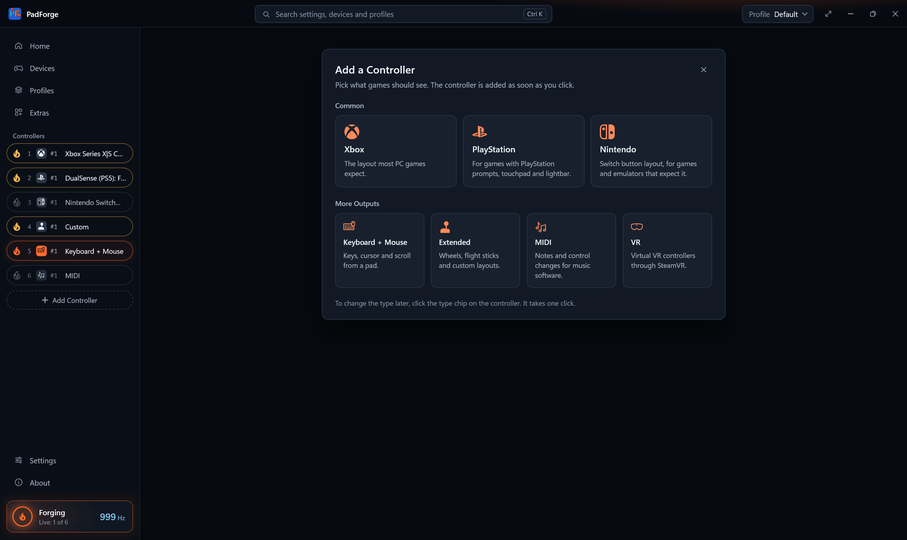
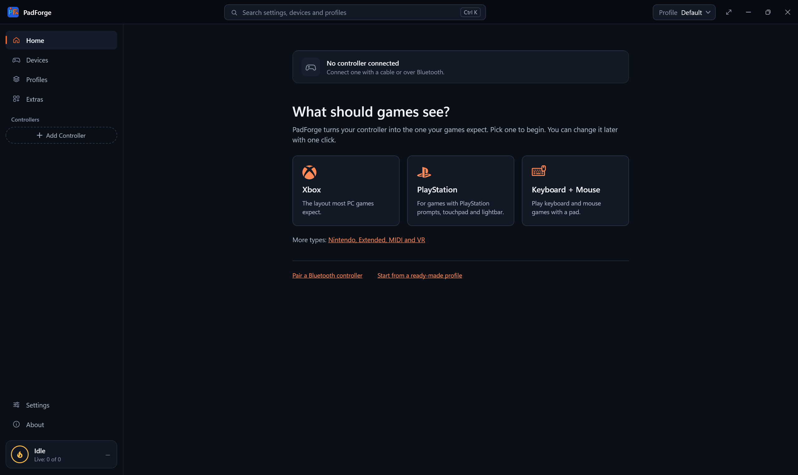
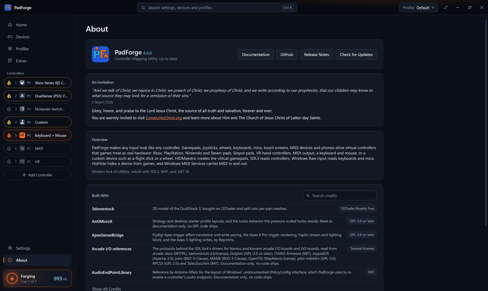
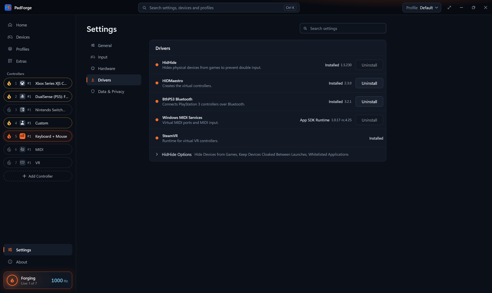

# Installation

*Install PadForge, run it the first time, and set up the optional drivers.*

Prefer to watch? [Your First Controller](first-controller.md) opens with a
video of the install and a first virtual controller, recorded live in
PadForge 5.2.0.

## Quick start (2 minutes)

1. Download the `win-x64` zip from the [latest release](https://github.com/hifihedgehog/PadForge/releases/latest), for example `PadForge-v6.0.0-win-x64.zip`. It holds `PadForge.exe` and nothing else. On Windows on ARM, take the `win-arm64` zip ([Windows on ARM](#windows-on-arm)).
2. Extract the zip to any folder (e.g. `C:\PadForge\`).
3. Run `PadForge.exe`.
4. Approve the one UAC prompt at startup. PadForge needs administrator rights to run.
5. Plug in a physical controller.
6. [Home](../features/dashboard.md) asks *What should games see?* Click **Xbox**, **PlayStation** or **Keyboard + Mouse**, or a type on the *More types* line under them. The controller you plugged in drives the new virtual controller, and its buttons, sticks and triggers are mapped 1:1. The first Xbox, PlayStation, Nintendo or Extended controller installs HIDMaestro automatically. No button to click.
7. Done. Games now see a virtual controller.

> **Upgrading from PadForge v2?** On first launch, PadForge detects ViGEmBus and vJoy and offers to uninstall them. HIDMaestro replaces both.

---

## Requirements

| Requirement | Details |
|-------------|---------|
| **OS** | Windows 10 or 11 (x64), or Windows 11 on ARM64 ([Windows on ARM](#windows-on-arm)) |
| **Runtime** | .NET 10 Desktop Runtime, bundled. No separate install. |
| **Format** | Portable single-file executable. No installer. Extract and run. |

Settings live in `PadForge.xml` next to the executable. To move PadForge, move the whole folder.

### Windows on ARM

Every release carries a second zip, `win-arm64`, a native build for Windows 11 on ARM64. It works as the x64 build does: virtual controllers and HidHide run there, the DualShock 3 Bluetooth driver, Vosk voice recognition and Xbox Elite paddles are built for it, each driver installs its ARM64 version, and Windows MIDI Services comes with Windows on ARM64 as it does on x64, with an ARM64 build of the runtime where Windows does not carry it yet. HidHide, Vosk and Elite paddles joined in 4.5.2.

A few features wait on their vendors, because an ARM64 program can load ARM64 libraries only:

| Feature | In the ARM64 build |
|---|---|
| Razer Sensa HD haptics | Not available. Razer ships no ARM64 engine, and lists Synapse for x86-64 Windows only |
| Logitech G-keys | Not available. Logitech Gaming Software installs x64 and x86 libraries only |
| VR headset and controllers through SteamVR | Not available. PadForge loads SteamVR's win64 library |
| Logitech LIGHTSYNC, OpenXR headset input | Only if the vendor's software installs an ARM64 engine or runtime |

The ARM64 build never adds the Razer Sensa row to the Devices page.

On Windows on ARM every virtual controller runs as a USB device on usbip-win2's virtual USB host controller, which HIDMaestro installs in place of its own driver.

Until 6.0 the ARM64 build's virtual controllers did not work with HIDMaestro. HIDMaestro 2.3.0 runs every one of its profiles on Windows 11 on ARM64, and PadForge 6.0 was tested on a Surface Pro with a Snapdragon X2 Plus: a DualSense over Bluetooth drove an Xbox virtual controller, and HidHide hid the DualSense from games. The DualShock 3 Bluetooth driver, Vosk voice recognition and Xbox Elite paddles have not run on an ARM64 PC. If anything does not work on your ARM64 PC, tell us right away ([how](../troubleshooting.md)).

---

## First launch

PadForge opens [Home](../features/dashboard.md) after first launch. It shows one UAC prompt at startup because it needs administrator rights. Until a virtual controller exists, Home asks *What should games see?* above a card for the first connected controller, or *No controller connected* when there is none. Set things up in this order.

1. **Create a virtual controller.** Click **Xbox**, **PlayStation** or **Keyboard + Mouse** on Home, or a type on its *More types* line: Nintendo, Extended (flight sticks, wheels, third-party gamepads, custom HID), MIDI and VR. **Add Controller** in the sidebar opens the same choice later. The VR type stays dimmed until SteamVR is installed, and one VR controller is the maximum because it drives both hands.
2. **Check devices.** Open **[Devices](../features/devices.md)**. PadForge auto-detects every connected gamepad, joystick, keyboard, and mouse.
3. **Assign a device.** A controller made from Home or from **Add a Controller** takes the device picked under **Driven By**. To change it, select the device on the Devices page and click a controller under **Used By**, or drag the device onto a controller in the sidebar.

Games now see the virtual controller as a standard gamepad.

The **About** page, at the foot of the sidebar, shows PadForge's version, an overview of what it does, the projects it is built on, and its license. The full build, with its commit, is on **[Settings](../features/settings.md)** under **Data & Privacy > Diagnostics > App Version**. Note it when filing an issue.

---

## HIDMaestro

HIDMaestro is the user-mode driver that creates the virtual controllers. PadForge needs it for the Xbox, PlayStation, Nintendo, and Extended controller types. Keyboard + Mouse and MIDI use their own paths and do not need it. The VR type rides HIDMaestro's OpenVR driver, which registers itself with SteamVR instead of creating a HID device.

The driver ships embedded in `PadForge.exe`. It installs automatically the first time an online device is assigned to an Xbox, PlayStation, Nintendo, or Extended controller. On Windows on ARM, HIDMaestro installs usbip-win2's virtual USB host controller in place of its own driver, and every virtual controller runs there as a USB device. Creating the slot alone does not install it, because PadForge only builds the virtual controller once something is feeding it. There's no button to click, and the startup UAC prompt covers it. Under **[Settings](../features/settings.md) > Drivers**, the HIDMaestro row reads **Not Installed** until that first install puts the driver in Windows' driver store, or on Windows on ARM installs the host controller, then **Installed**. It always shows the HIDMaestro version PadForge carries. After that, every Xbox, PlayStation, Nintendo, or Extended slot with an assigned device becomes a fresh HIDMaestro device. Delete the slot and the device disappears. Slots and devices stay 1:1.

If you upgraded from PadForge v2, HIDMaestro replaces ViGEmBus and vJoy. The legacy driver cleanup dialog on first launch handles uninstalling them.

See [HIDMaestro Deep Dive](../reference/hidmaestro-deep-dive.md) for how PadForge talks to the driver under the hood.

---

## Optional add-ons

Two optional installs live under **[Settings](../features/settings.md) > Drivers**. HidHide is bundled inside `PadForge.exe`: the 1.5.230 setup on an x64 PC, the ARM64 driver 1.6.280.0 on an ARM64 PC. SteamVR downloads on demand. Each row fills its status dot once installed and swaps its **Install** button for **Uninstall**. Windows MIDI Services comes with Windows 11 25H2 from the late-November 2026 update, and its row offers the runtime on a PC that does not have it yet.

One more driver installs outside Settings. The first pairing of a [DualShock 3](../devices/dualshock-3.md), [PS Move or Navigation controller](../devices/ps-move.md) for Bluetooth installs the bundled PlayStation Bluetooth driver (BthPS3 and its BthPS3PSM filter). Plugging an original Move or a Navigation controller in over USB runs that pairing on its own. A PC that never pairs one of them never gets the driver. Its **BthPS3 Bluetooth** row under **Settings > Drivers** shows whether it is installed and removes it.

<!-- SCREENSHOT: settings-driver-cards -->

### HidHide

Hides physical controllers from games so only the virtual ones are visible. Install it if a game sees both your physical pad and the PadForge virtual one at the same time and treats each input twice. Skip it if you do not see double input.

### Windows MIDI Services

Creates virtual MIDI ports for the MIDI virtual controller type and reads MIDI keyboards as inputs. It is part of Windows 11 25H2 from the late-November 2026 update. Before that update, and on Windows 11 24H2, click **Install** on its row: PadForge installs its own build of the Windows MIDI Services runtime, since Microsoft no longer offers its download. Without either, MIDI runs on the legacy MIDI API, where each MIDI slot sends to a port you pick. See [Driver Management](../features/driver-management.md#windows-midi-services).

### SteamVR

The VR runtime the virtual VR controllers need. PadForge installs it straight from Valve's servers, with no Steam account and no Steam client. It is several gigabytes, so pick the **Install Location** before starting. Skip it unless you want VR slots. **Uninstall** appears only for the Steam-free install PadForge created. A SteamVR that came with the Steam client belongs to Steam and shows no uninstall.

### Keyboard + Mouse

Always on. Maps controller inputs to keyboard keys and mouse moves. No driver required.

### OpenXInput

PadForge bundles a build of [OpenXInput](https://github.com/hifihedgehog/OpenXinput) so it keeps its own virtual controllers out of its own view. Without it, PadForge would try to map a virtual controller through itself. Games and Steam still see the virtual controllers normally. Nothing to install.

---

## Administrator privileges

PadForge needs administrator rights and shows a UAC prompt at startup. HIDMaestro driver registration (automatic) and its removal from Settings, HidHide install / uninstall / whitelist edits, SteamVR install / uninstall, and the Windows MIDI Services runtime's install / uninstall all need administrator access. Reading physical controllers needs it too. Declining the prompt means PadForge does not start.

The UAC shield is on the EXE icon as a hint. PadForge prompts once per launch.

---

## Start at login

Turn on **Settings > General > Window > Start at Login** to launch PadForge on sign-in.

To run PadForge silently in the background, turn on all three options.

| Option | Effect |
|--------|--------|
| **Start at Login** | Launches PadForge on sign-in. |
| **Start Minimized** | Keeps the window hidden when PadForge starts. It runs and maps as usual. |
| **Minimize to System Tray** | Keeps PadForge in the notification area instead of the taskbar. |

With all three on, PadForge runs in the background with only a tray icon.

---

## Updating

From 4.5.3 on, PadForge updates itself. **Settings > General > Updates** checks GitHub 20 seconds after launch and every 12 hours, and **Install and Restart** replaces `PadForge.exe` in place. `PadForge.xml` is not touched. See [Updates](../features/updates.md).

Version 4.5.2 and older have no updater. Download the new zip, exit PadForge, and replace `PadForge.exe` with the one from the zip. If **Close to System Tray** is on, closing the window leaves PadForge running, so pick **Exit** from its tray icon's menu. `PadForge.xml` stays where it is and carries over.

---

## Uninstalling

There is no installer, so removal is short.

1. Open **[Settings](../features/settings.md) > Drivers** and click **Uninstall** on the HidHide and SteamVR rows if you installed them. The Windows MIDI Services row offers **Uninstall** while a runtime is installed. Other MIDI apps can use the runtime too, so remove it only if nothing else needs it. Click **Uninstall** on the HIDMaestro row last: it stops the engine and removes HIDMaestro's virtual controllers, driver, certificate, registry keys and files ([what it removes](../features/driver-management.md#uninstall)). Turn off **Start at Login** too if it is on, so Windows drops its logon task.
2. Exit PadForge. If **Close to System Tray** is on, pick **Exit** from its tray icon's menu, since closing the window leaves it running.
3. Delete the PadForge folder.

Already deleted PadForge? Download `HIDMaestro-v2.3.0.zip` (`HIDMaestro-v2.3.0-arm64.zip` on Windows on ARM) from the [HIDMaestro releases](https://github.com/hifihedgehog/HIDMaestro/releases/latest) and extract it. In a terminal opened as administrator, change to its `HIDMaestroUninstall` folder and run `.\HIDMaestroUninstall.exe`. It removes HIDMaestro the way the Uninstall button does, and asks first. [Troubleshooting](../troubleshooting.md#removing-padforge-and-hidmaestro) covers the rest of what PadForge installs.

If you previously had ViGEmBus or vJoy installed from PadForge v2, the legacy driver cleanup dialog on first launch removes them for you.

---

## Related pages

- [Settings](../features/settings.md): install and manage optional drivers.
- [Updates](../features/updates.md): keep PadForge current from inside the app.
- [Home](../features/dashboard.md): the first page after launch.
- [Devices](../features/devices.md): view detected physical controllers.
- [Controller Slots](../features/controller-slots.md): create and configure virtual controllers.
- [Driver Management](../features/driver-management.md): detailed driver information.
- [HIDMaestro Deep Dive](../reference/hidmaestro-deep-dive.md): how PadForge talks to HIDMaestro under the hood.

---

*Last updated for PadForge 6.0.0.*
